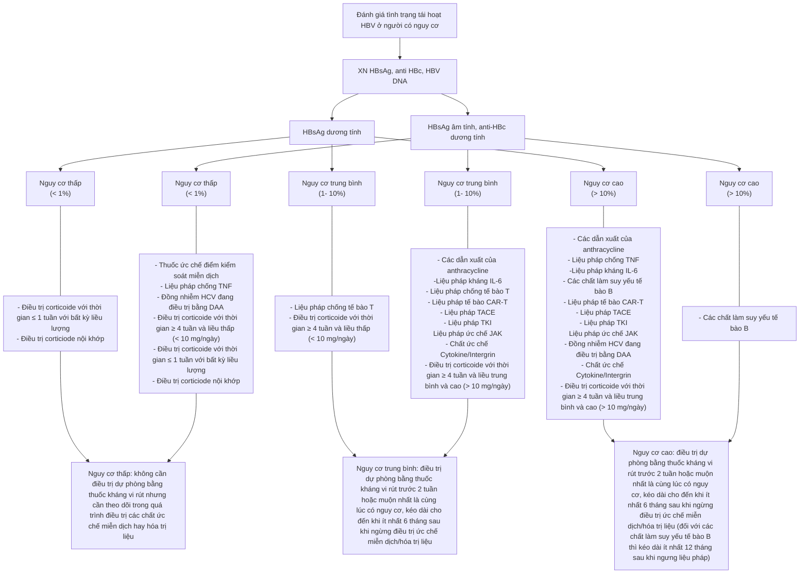
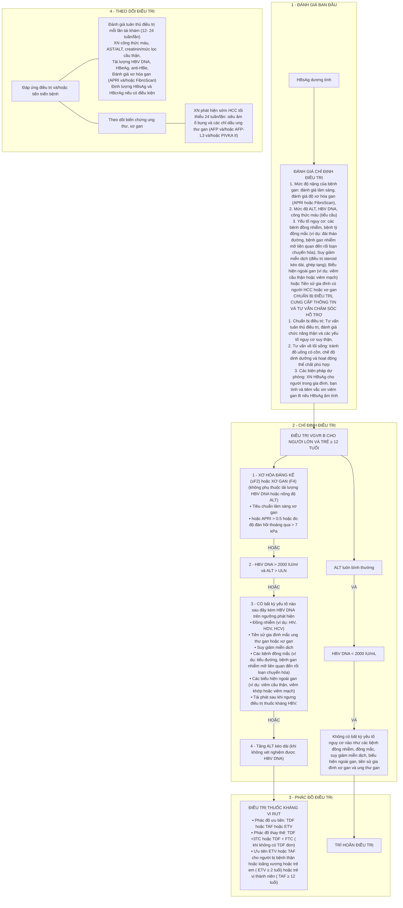
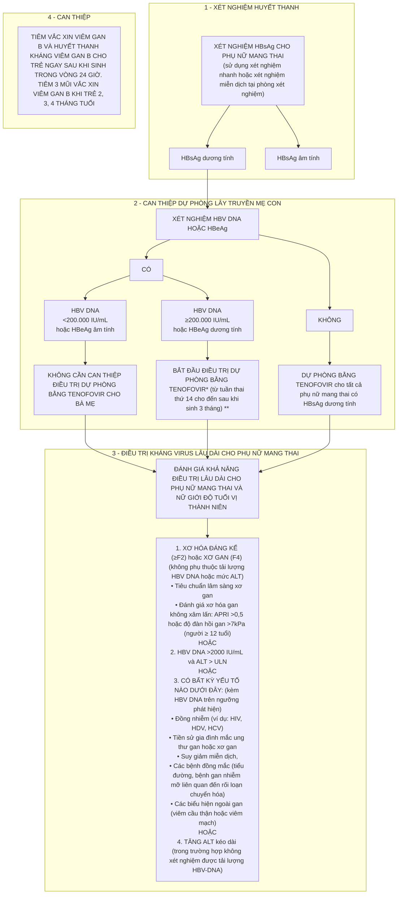

# Hướng dẫn chẩn đoán, điều trị viêm gan vi rút B (Ban hành kèm theo Quyết định số 1740/QĐ-BYT ngày 16 tháng 6 năm 2026)

BỘ Y TẾ

Số: 1740/QĐ-BYT

CỘNG HÒA XÃ HỘI CHỦ NGHĨA VIỆT NAM
Độc lập - Tự do - Hạnh phúc

Hà Nội, ngày 16 tháng 6 năm 2026

**QUYẾT ĐỊNH**

**Về việc ban hành tài liệu chuyên môn “Hướng dẫn chẩn đoán, điều trị viêm gan vi rút B”**

**BỘ TRƯỞNG BỘ Y TẾ**

*Căn cứ Luật Khám bệnh, chữa bệnh năm 2023;*

*Căn cứ Nghị định số 42/2025/NĐ-CP ngày 27 tháng 2 năm 2025 của Chính phủ quy định chức năng, nhiệm vụ, quyền hạn và cơ cấu tổ chức của Bộ Y tế;*

*Theo đề nghị của Cục trưởng Cục Quản lý Khám, chữa bệnh.*

**QUYẾT ĐỊNH:**

**Điều 1.** Ban hành kèm theo Quyết định này “Hướng dẫn chẩn đoán, điều trị viêm gan vi rút B”.

**Điều 2.** Hướng dẫn chẩn đoán, điều trị viêm gan vi rút B được áp dụng tại các cơ sở khám bệnh, chữa bệnh trong cả nước.

**Điều 3.** Quyết định này có hiệu lực kể từ ngày ký, ban hành. Quyết định này thay thế Quyết định số 3310/QĐ-BYT ngày 29/7/2019 của Bộ trưởng Bộ Y tế về việc ban hành Hướng dẫn chẩn đoán, điều trị viêm gan vi rút B.

**Điều 4.** Các ông, bà: Chánh Văn phòng Bộ, Cục trưởng Cục Quản lý Khám, chữa bệnh, Vụ trưởng, Cục trưởng các Vụ/Cục thuộc Bộ Y tế; Giám đốc các cơ sở khám bệnh, chữa bệnh trực thuộc Bộ Y tế; Giám đốc Sở Y tế các tỉnh, thành phố; Thủ trưởng Y tế các Bộ, ngành; Thủ trưởng các đơn vị có liên quan chịu trách nhiệm thi hành Quyết định này./.

*Nơi nhận:*
- Như Điều 4;
- Bộ trưởng (để báo cáo);
- Các Thứ trưởng (để ph/h ch/đ);
- Lưu: VT, KCB.

KT. BỘ TRƯỞNG
THỨ TRƯỞNG

(đã ký)

**Trần Văn Thuấn**

---

**HƯỚNG DẪN CHẨN ĐOÁN, ĐIỀU TRỊ VIÊM GAN VI RÚT B**

*(Ban hành kèm theo Quyết định số 1740/QĐ-BYT, ngày 16 tháng 6 năm 2026 của Bộ trưởng Bộ Y tế)*

Hà Nội, 2026

---

**DANH SÁCH BAN BIÊN SOẠN “HƯỚNG DẪN CHẨN ĐOÁN, ĐIỀU TRỊ VIÊM GAN VI RÚT B”**

**Chỉ đạo biên soạn:**

- GS.TS. Trần Văn Thuấn – Thứ trưởng Bộ Y tế, Chủ tịch Hội đồng Y khoa Quốc gia;
- TS. Hà Anh Đức – Cục trưởng Cục Quản lý Khám, chữa bệnh.

**Chủ biên:**

- TS. Phạm Ngọc Thạch – Giám đốc Bệnh viện Bệnh Nhiệt đới Trung ương, Chủ tịch Hội Truyền nhiễm Việt Nam;
- TS. Nguyễn Trọng Khoa – Phó Cục trưởng Cục Quản lý Khám, chữa bệnh;
- GS.TS. Nguyễn Văn Kính – Phó Chủ tịch thường trực Tổng hội Y học Việt Nam, nguyên Giám đốc Bệnh viện Bệnh Nhiệt đới Trung ương.

**Tham gia biên soạn:**

- PGS. TS. Trịnh Thị Ngọc – Phó Chủ tịch Hội Gan mật Việt Nam;
- PGS.TS. Bùi Hữu Hoàng – Chủ tịch Hội Gan mật Thành phố Hồ Chí Minh, Ban Chuyên gia Bệnh viện Đại học Y Dược Thành phố Hồ Chí Minh;
- PGS.TS. Phạm Thị Thu Thủy – Phó Chủ tịch Hội Gan mật Thành phố Hồ Chí Minh, Trưởng khoa Gan, Trung tâm Chẩn đoán Y khoa Medic Thành phố Hồ Chí Minh;
- PGS.TS. Đỗ Duy Cường – Chủ tịch Hội đồng chuyên ngành Bệnh nhiệt đới Hệ thống Y tế Vinmec, kiêm Giám đốc Trung tâm Bệnh nhiệt đới Vinmec Times City;
- PGS.TS. Trần Văn Giang – Viện trưởng Viện Đào tạo và Nghiên cứu Bệnh Nhiệt đới, Bệnh viện Bệnh Nhiệt đới Trung ương;
- PGS.TS. Tạ Thị Diệu Ngân – Trưởng khoa Bệnh nhiệt đới và Can thiệp giảm hại, Bệnh viện Đại học Y Hà Nội;
- PGS.TS. Phạm Thị Thúy Vân – Giảng viên cao cấp, Trưởng khoa Dược lý – Dược lâm sàng, Trường Đại học Dược Hà Nội;
- PGS.TS. Nguyễn Thị Cẩm Hường – Trưởng phòng Khoa học – Đào tạo – Đối ngoại kiêm nhiệm Phó trưởng Bộ môn Nhiễm, Trường Y, Đại học Y Dược Thành phố Hồ Chí Minh;
- PGS.TS. Trần Thị Khánh Tường – Trưởng khoa Y, Trưởng Bộ môn Nội Tổng quát, Trường Đại học Y khoa Phạm Ngọc Thạch;
- BSCKII. Nguyễn Nguyên Huyền – Giám đốc Trung tâm Phòng chống dịch, Bệnh viện Bệnh nhiệt đới Trung ương;
- ThS. Trương Lê Vân Ngọc – Trưởng phòng Nghiệp vụ, Cục Quản lý Khám, chữa bệnh;
- BSCKII. Hoàng Thị Thư – Trưởng phòng Tổ chức cán bộ, Trưởng khoa Bệnh nhiệt đới, Bệnh viện Đa khoa Trung ương Thái Nguyên;
- BSCKII. Đào Bách Khoa – Trưởng khoa Nhiễm A, Bệnh viện Bệnh Nhiệt đới Thành phố Hồ Chí Minh;
- ThS. Trần Thị Hạnh Chân – Trưởng khoa Nhi Tiêu hóa – Tiết niệu – Bệnh nhiệt đới, Bệnh viện Trung ương Huế;
- TS. Đoàn Thị Thùy Linh – Phó Trưởng phòng Kiểm soát HIV và bệnh truyền nhiễm mạn tính, Cục Phòng bệnh;
- BSCKII. Bùi Hoàng Chương – Phó Trưởng phòng Kế hoạch tổng hợp, Bệnh viện Bệnh Nhiệt đới Thành phố Hồ Chí Minh;
- TS. Cao Thị Thanh Thủy – Khoa Truyền nhiễm, Bệnh viện Đại học Y Hà Nội;
- TS. Nguyễn Thị Thúy Vân – Chuyên gia của Tổ chức Y tế Thế giới tại Việt Nam;
- BSCKII. Huỳnh Thị Kim Yến – Giảng viên Bộ môn Lao – Truyền nhiễm, Khoa Y, Trường Đại học Y Dược Cần Thơ;
- BS. Đỗ Minh Hùng – Chuyên viên chính, Phòng Đăng ký thuốc, Cục Quản lý Dược;
- ThS. Phạm Hùng Tiến – Chuyên viên Phòng Nghiệp vụ, Cục Quản lý Khám, chữa bệnh;

---

**MỤC LỤC**

- CÁC TỪ VIẾT TẮT ........ v
- CÁC THUẬT NGỮ ........ vii
- I. ĐẠI CƯƠNG ........ 1
- II. XÉT NGHIỆM CHẨN ĐOÁN NGƯỜI NHIỄM HBV ........ 1
- III. CHẨN ĐOÁN VÀ ĐIỀU TRỊ VIÊM GAN B CẤP ........ 3
  - 3.1. Chẩn đoán viêm gan B cấp ........ 3
  - 3.2. Chẩn đoán phân biệt ........ 4
  - 3.3. Điều trị ........ 4
    - 3.3.1. Điều trị triệu chứng ........ 4
    - 3.3.2. Điều trị đặc hiệu: ........ 4
  - 3.4. Theo dõi ........ 5
    - 3.4.1. Lâm sàng ........ 5
    - 3.4.2. Cận lâm sàng ........ 5
    - 3.4.3. Xác định hồi phục hoặc chuyển mạn ........ 6
- IV. CHẨN ĐOÁN VÀ ĐIỀU TRỊ VIÊM GAN B MẠN ........ 6
  - 4.1. Chẩn đoán ........ 6
    - 4.1.1. Chẩn đoán nhiễm HBV mạn ........ 6
    - 4.1.2. Đánh giá tình trạng viêm gan B mạn ........ 6
  - 4.2. Điều trị ........ 8
    - 4.2.1. Mục tiêu điều trị ........ 8
    - 4.2.2. Nguyên tắc điều trị ........ 8
    - 4.2.3. Điều trị ........ 8
    - 4.2.4. Thuốc điều trị ........ 11
    - 4.2.5. Thời gian điều trị và tiêu chuẩn ngừng điều trị ........ 12
    - 4.2.6. Điều trị các quần thể đặc biệt ........ 14
  - 4.3. Theo dõi điều trị ........ 17
    - 4.3.1. Trường hợp chưa có chỉ định điều trị thuốc kháng vi rút ........ 17
    - 4.3.2. Trường hợp đang điều trị hoặc đã ngừng điều trị thuốc kháng vi rút ........ 18
  - 4.4. Các trường hợp thất bại điều trị với thuốc kháng vi rút ........ 21
    - 4.4.1. Tiêu chuẩn thất bại điều trị ........ 21
    - 4.4.2. Xử trí ........ 21
  - 4.5. Tăng cường triển khai chăm sóc và điều trị viêm gan B tại các cơ sở y tế ........ 22
- V. PHÒNG BỆNH ........ 23
  - 5.1. Phòng bệnh chủ động ........ 23
  - 5.2. Phòng lây truyền HBV từ mẹ sang con ........ 24
  - 5.3. Dự phòng sau phơi nhiễm HBV6,7 ........ 24
  - 5.4. Phòng bệnh không đặc hiệu ........ 24
- PHỤ LỤC 1. CHẨN ĐOÁN CÁC GIAI ĐOẠN CỦA NHIỄM HBV MẠN1 ........ 25
- PHỤ LỤC 2. ĐÁNH GIÁ CÁC GIAI ĐOẠN ĐỘ XƠ HÓA GAN VÀ XƠ GAN3 ........ 26
- PHỤ LỤC 3. ĐIỀU TRỊ DỰ PHÒNG VIÊM GAN B BÙNG PHÁT KHI ĐIỀU TRỊ CÁC THUỐC ỨC CHẾ MIỄN DỊCH HAY HÓA TRỊ LIỆU12 ........ 27
- PHỤ LỤC 4. CHUYỂN THUỐC HOẶC ĐIỀU CHỈNH LIỀU THUỐC KHÁNG VI RÚT TRÊN NGƯỜI SUY THẬN THEO MỨC LỌC CẦU THẬN3 ........ 28
- PHỤ LỤC 5. ĐIỀU TRỊ VIÊM GAN B MẠN Ở NGƯỜI ≥ 12 TUỔI1 ........ 29
- PHỤ LỤC 6. XÉT NGHIỆM VÀ ĐIỀU TRỊ NGĂN NGỪA LÂY TRUYỀN HBV11 ........ 30

---

## CÁC TỪ VIẾT TẮT

| Viết tắt | Diễn giải |
|---|---|
| AFP | Alpha-fetoprotein |
| ALT | Alanine Aminotransferase |
| Anti-HBc | Antibody against Hepatitis B core antigen - Kháng thể kháng kháng nguyên lõi vi rút viêm gan B |
| Anti-HBe | Antibody against Hepatitis B e antigen - Kháng thể kháng kháng nguyên e vi rút viêm gan B |
| Anti-HBs | Antibody against Hepatitis B surface antigen - Kháng thể kháng kháng nguyên bề mặt vi rút viêm gan B |
| APRI | AST to Platelet Ratio Index - Chỉ số tỷ số AST trên tiểu cầu |
| ARFI | Acoustic Radiation Force Impulse |
| AST | Aspartate aminotransferase |
| ARV | Antiretrovirals - Thuốc kháng retrovirus |
| CMV | Cytomegalovirus |
| CrCl | Creatinin clearance – Độ thanh thải Creatinin |
| DAAs | Direct-acting antiviral agents - Các thuốc kháng vi rút tác động trực tiếp |
| EBV | Epstein- Barr virus |
| ETV | Entecavir |
| HBcAg | Hepatitis B core antigen - Kháng nguyên lõi vi rút viêm gan B |
| HBeAg | Hepatitis B e antigen - Kháng nguyên e vi rút viêm gan B |
| HBsAg | Hepatitis B surface antigen - Kháng nguyên bề mặt vi rút viêm gan B |
| HBV | Hepatitis B virus - Vi rút viêm gan B |
| HCC | Hepatocellular carcinoma - Ung thư biểu mô tế bào gan |
| HCV | Hepatitis C virus - Vi rút viêm gan C |
| HDV | Hepatitis D virus - Vi rút viêm gan D |
| HEV | Hepatitis E virus - Vi rút viêm gan E |
| HIV | Human immunodeficiency virus - Vi rút gây suy giảm miễn dịch ở người |
| IFN | Interferon |
| IL-6 | Interleukin 6 |
| CAR-T | Chimeric antigen receptor T-cell therapy |
| TKI | Tyrosine Kinase Inhibitor |
| TACE | Transcatheter arterial chemoembolization – Thuyên tắc hóa chất xuyên động mạch hay còn gọi là nút mạch |
| JK | Janus Kinase |
| INR | International normalized ratio - Tỷ số chuẩn hóa quốc tế |
| LAM | Lamivudine |
| MRE | Magnetic Resonance Elastography - Cộng hưởng từ đàn hồi |
| NAs | Nucleot(s)ide analogue - Thuốc tương tự nucleot(s)ide |
| Peg-IFN | Pegylated- interferon |
| qHBsAg | Hepatitis B surface antigen quantitative - định lượng HBsAg |
| RNA | Ribonucleic acid - Chuỗi thông tin di truyền axít nhân ribo |
| DNA | Axit deoxyribonucleic |
| TAF | Tenofovir alafenamide |
| TDF | Tenofovir disoproxil fumarate |
| ULN | Upper Limit of Normal - Giới hạn trên của mức bình thường |
| M2BPGI | Mac-2 Binding Protein Glycosylation |
| HBcrAg | Hepatitis B core-related antigen - Kháng nguyên liên quan đến lõi của HBV |
| PIVKA II | Prothrombin induced by vitamin K absence-II: Prothrombin được hình thành do thiếu hụt vitamin K - tuýp II |
| TNF | Tumor Necrosis Factors: Yếu tố hoại tử u |

## CÁC THUẬT NGỮ

| Thuật ngữ | Định nghĩa |
|---|---|
| **DIỄN BIẾN TỰ NHIÊN CỦA NHIỄM VI RÚT VIÊM GAN B (HBV)** | |
| Viêm gan B | Trong hướng dẫn này, thống nhất sử dụng từ ‘viêm gan B’ thay cho từ ‘viêm gan vi rút B’. |
| Nhiễm HBV cấp | Tình trạng nhiễm mới HBV, có thể có hoặc không có triệu chứng, thường kéo dài dưới 6 tháng và có thể hồi phục hoàn toàn ở phần lớn người trưởng thành (mất HBsAg). |
| Nhiễm HBV mạn | Tình trạng HBsAg tồn tại duy trì từ 6 tháng trở lên sau nhiễm cấp HBV. Trên lâm sàng, nhiễm HBV mạn được xác định khi có HBsAg dương tính ở người lớn và HBsAg tồn tại kéo dài 6 tháng trở lên ở vị thành niên và trẻ em1. |
| Nhiễm HBV mạn HBeAg dương tính (Giai đoạn dung nạp miễn dịch) | Giai đoạn sớm của nhiễm HBV mạn, xảy ra ở người nhiễm HBV lúc mới sinh hoặc trong thời thơ ấu, đặc trưng bởi sự nhân lên HBV cao mà không có tổn thương gan đáng kể. |
| Viêm gan B mạn HBeAg dương tính | Giai đoạn có HBeAg dương, AST và ALT dao động nồng độ HBV DNA cao; có thể dẫn đến chuyển đổi huyết thanh sang anti-HBe. |
| Nhiễm HBV HBeAg âm tính (Giai đoạn không hoạt động) | Giai đoạn HBV nhân lên thấp, đặc trưng bởi HBeAg âm tính, anti HBe dương tính, ALT bình thường và tải lượng HBV DNA < 2000 IU/mL. |
| Viêm gan B mạn HBeAg âm tính (Giai đoạn tái hoạt động) | Giai đoạn đặc trưng bởi mất HBeAg (thường đi kèm sự xuất hiện của anti-HBe) nhưng HBV vẫn hoạt động nhân lên (sao chép) với các mức độ khác nhau gây ra tình trạng viêm và hoại tử gan các mức độ khác nhau. |
| Vùng xám | Tình trạng người bệnh có biểu hiện xét nghiệm không điển hình, không thuộc các giai đoạn tiêu chuẩn. Điều này gây khó khăn cho việc phân loại bệnh và tạo ra sự không chắc chắn về quyết định điều trị kháng vi rút. |
| Viêm gan B thể ẩn | Tình trạng nhiễm HBV không còn HBsAg (HBsAg âm tính nhưng HBV DNA trên ngưỡng phát hiện, thường ở nồng độ thấp (<200 IU/mL), anti-HBc toàn phần hầu hết dương tính. |
| Xơ gan | Giai đoạn tiến triển của bệnh lý gan, được xác định khi có xơ hóa lan rộng, nhu mô gan có nốt tái sinh và rối loạn nghiêm trọng về cấu trúc và tuần hoàn của gan. Chẩn đoán xơ gan khi xơ hóa gan ở mức F4 bằng các phương pháp đánh giá không xâm lấn hoặc xâm lấn. |
| Xơ gan mất bù | Giai đoạn cuối của bệnh gan mạn tính với chức năng gan suy giảm nặng, không còn khả năng bù trừ. Xác định xơ gan mất bù khi người bệnh có ≥ 1 biến cố mất bù: vỡ, giãn tĩnh mạch thực quản, cổ chướng, bệnh não gan, vàng da; và/hoặc khi điểm Child Pugh ≥ 7. |
| Ung thư biểu mô tế bào gan (HCC) | Khối u ác tính phát sinh từ các tế bào gan. |
| Viêm gan B thể tối cấp | Tình trạng suy gan cấp xảy ra trong vòng vài tuần kể từ khi xuất hiện triệu chứng vàng da với 3 đặc điểm chính: suy chức năng gan nghiêm trọng, bệnh não gan và rối loạn đông máu nặng. Viêm gan B thể tối cấp có tỷ lệ tử vong rất cao (thường > 70%) nếu không được điều trị kịp thời1. |
| Viêm gan B tái hoạt | Tình trạng bệnh lý gan nghiêm trọng, xảy ra khi HBV đang không hoạt động hoặc thể ẩn, đột ngột nhân lên nhanh chóng, dẫn đến viêm và hoại tử tế bào gan cấp tính, gây ra các biểu hiện lâm sàng từ nhẹ đến nặng, có thể dẫn đến viêm gan B thể tối cấp và tử vong. |
| Chuyển đảo huyết thanh HBeAg | Tình trạng mất HBeAg (HBeAg âm tính) và xuất hiện anti-HBe (anti-HBe dương tính). |
| Chuyển đảo huyết thanh HBsAg | Tình trạng mất HBsAg (HBsAg âm tính) và xuất hiện anti HBs (anti-HBs dương tính). |
| **CÁC THUẬT NGỮ KHÁC** | |
| Xét nghiệm tại điểm chăm sóc (*Point of Care)* | Xét nghiệm sử dụng các thiết bị đơn giản có khả năng thực hiện tại các cơ sở khám bệnh, chữa bệnh cấp ban đầu và cho kết quả nhanh. |
| Xét nghiệm tại phòng xét nghiệm *(Laboratory - based assays)* | Xét nghiệm thực hiện tại phòng xét nghiệm trên các hệ thống tự động (automatic), bán tự động (semi-automatic). |
| Lấy mẫu xét nghiệm HBV DNA tại thời điểm chẩn đoán nhiễm HBV (*Reflex HBV DNA testing)* | Việc thu thập mẫu xét nghiệm HBV DNA ngay sau khi một người được xét nghiệm HBsAg dương tính thông qua việc sử dụng mẫu máu đã có hoặc lấy mẫu máu ngay sau khi có kết quả HBsAg. |
| Tuân thủ điều trị | Mức độ hành vi của người bệnh (bao gồm việc uống thuốc duy trì đều đặn đúng giờ hàng ngày, tái khám đúng hẹn, xét nghiệm định kỳ, thực hiện chế độ ăn kiêng và/hoặc thay đổi lối sống) phù hợp với kế hoạch chăm sóc và điều trị đã được thống nhất giữa nhân viên y tế và người đang sống chung với HBV. |
| Đáp ứng điều trị viêm gan B ban đầu | Tình trạng người bệnh đạt được hiệu quả điều trị ban đầu với tải lượng HBV DNA giảm > 1log10 IU/mL trong vòng ba tháng kể từ khi bắt đầu điều trị kháng vi rút. |
| Đáp ứng điều trị viêm gan B | HBV DNA không phát hiện trong máu/huyết thanh tại một thời điểm xác định sau khi hoàn thành điều trị. |
| Thất bại điều trị ban đầu | Tình trạng người bệnh không đạt được hiệu quả điều trị ban đầu với tải lượng HBV DNA giảm < 1log10 IU/mL trong vòng ba tháng kể từ khi bắt đầu điều trị kháng vi rút. |
| Thất bại điều trị thứ cấp (*thường là dấu hiệu của kháng thuốc nếu người bệnh tuân thủ điều trị)* | Tình trạng mất hiệu quả điều trị sau khi người bệnh đã có đáp ứng điều trị viêm gan B ban đầu, xác định khi nồng độ HBV DNA tăng > 1log10 IU/mL so với mức thấp nhất đã đạt được trong quá trình điều trị. |
| Đáp ứng vi rút hoàn toàn | HBV DNA không phát hiện được bằng xét nghiệm có độ nhạy cao (ngưỡng phát hiện thường <20 IU/mL). |
| Không đáp ứng vi rút | HBV DNA giảm <1 log10 IU/mL sau 6 tháng điều trị bằng thuốc kháng vi rút nucleot(s)ide. |
| Đồng nhiễm | Tình trạng một người mắc đồng thời hai hoặc nhiều bệnh truyền nhiễm khác nhau. |
| Đồng mắc | Tình trạng một người mắc hai hay nhiều bệnh lý khác nhau. Các bệnh lý này xuất hiện đồng thời hoặc kế tiếp nhau, không cùng chung nguyên nhân. |

---

**HƯỚNG DẪN CHẨN ĐOÁN, ĐIỀU TRỊ VIÊM GAN VI RÚT B**

*(Ban hành kèm theo Quyết định số 1740/QĐ-BYT ngày 16/6/2026 của Bộ trưởng Bộ Y tế)*

## I. ĐẠI CƯƠNG

Viêm gan vi rút B (Viêm gan B) là bệnh truyền nhiễm phổ biến trên toàn cầu, do vi rút viêm gan B (HBV) gây ra. Theo báo cáo của Tổ chức Y tế Thế giới, ước tính năm 2022 có khoảng **254 triệu** người nhiễm HBV mạn trên toàn cầu; **1,2 triệu** người nhiễm HBV mới hàng năm; **1,1 triệu** trường hợp tử vong, chủ yếu là do xơ gan và ung thư biểu mô tế bào gan (HCC)1,2. HBV lây nhiễm qua đường máu, quan hệ tình dục và từ mẹ sang con. Tại Việt Nam, đường lây chủ yếu là từ mẹ truyền sang con. Tỷ lệ lưu hành HBsAg trong cộng đồng dân cư ≥18 tuổi là **9,4%**2. Hiện nay, tỉ lệ người nhiễm HBV được phát hiện và điều trị còn thấp, số tử vong liên quan đến viêm gan B còn cao.

HBV thuộc họ *Hepadnaviridae*, có cấu trúc di truyền DNA, được chia thành 10 kiểu gen ký hiệu từ A đến J. HBV có 3 loại kháng nguyên chính: HBsAg, HBeAg và HBcAg, tương ứng với 3 loại kháng thể là: Anti-HBs, Anti-HBe và Anti-HBc. Xét nghiệm phát hiện các kháng nguyên, kháng thể này có ý nghĩa quan trọng trong việc xác định bệnh, thể bệnh cũng như diễn biến bệnh.

HBV có thể gây viêm gan cấp, viêm gan tối cấp nhưng chủ yếu là viêm gan mạn và có thể tiến triển thành xơ gan, HCC. Viêm gan B là nguyên nhân hàng đầu gây bệnh xơ gan và HCC tại Việt Nam. Tiêm vắc xin viêm gan B và phòng ngừa lây truyền HBV từ mẹ sang con là phương pháp dự phòng chính, hiệu quả.

## II. XÉT NGHIỆM CHẨN ĐOÁN NGƯỜI NHIỄM HBV

Mọi người dân đang sinh sống tại Việt Nam nên xét nghiệm phát hiện sớm nhiễm HBV, *đặc biệt là các đối tượng sau3-5*:

+ Người sinh trước năm 2003 - năm triển khai chương trình vắc xin viêm gan B cho trẻ dưới một tuổi trên toàn quốc.
+ Người đến tư vấn, xét nghiệm tại các phòng khám tư vấn xét nghiệm HIV, lao.
+ Phụ nữ mang thai.
+ Người có hành vi nguy cơ lây nhiễm HBV: người nhiễm HIV, người tiêm chích ma tuý, nam quan hệ tình dục đồng giới, phụ nữ mại dâm, phạm nhân, người có quan hệ tình dục không an toàn.
+ Người có biểu hiện nghi ngờ mắc viêm gan: có triệu chứng lâm sàng của viêm gan và/hoặc xét nghiệm men gan tăng. Người có biểu hiện xơ hóa gan và xơ gan.
+ Người bệnh phải chạy thận chu kỳ, lọc máu, truyền máu và chế phẩm máu.
+ Người bệnh trước khi điều trị ức chế miễn dịch, hoá trị liệu. Người mắc các bệnh lý khối u và ung thư.
+ Nhân viên y tế chưa được tiêm vắc xin viêm gan B.
+ Người hiến máu, người hiến tạng, người cho trứng, tinh trùng.
+ Bạn tình, thành viên gia đình có người nhiễm HBV.
+ Người có tiền sử tiêm, làm thủ thuật không an toàn. Người cần dự phòng sau phơi nhiễm HBV.
+ Các đối tượng khác theo yêu cầu.

Các xét nghiệm cần làm: HBsAg, anti-HBs, anti-HBc (*nếu có điều kiện*)6; tối **thiểu phải thực hiện HBsAg**5.

**Bảng 1. Phiên giải các kết quả xét nghiệm chẩn đoán nhiễm HBV5,6**

| HBsAg *(Các xét nghiệm)* | anti- HBc *(Các xét nghiệm)* | anti-HBs *(Các xét nghiệm)* | Phiên giải | Quản lý | Tiêm vắc xin viêm gan B |
|---|---|---|---|---|---|
| Dương Tính | Dương Tính | Bất kỳ | Viêm gan B mạn | Kết nối cơ sở điều trị để quản lý theo hướng dẫn | Không |
| Âm tính | Dương tính | **≥ 10 IU/L** | Hồi phục sau nhiễm HBV trong quá khứ | Không cần quản lý về viêm gan B trừ khi suy giảm miễn dịch hoặc đang hóa trị hoặc điều trị ức chế miễn dịch | Không |
| Âm tính | Dương tính | **< 10 IU/L** | Hồi phục sau nhiễm HBV trong quá khứ hoặc dương tính giả | Xét nghiệm HBV DNA nếu suy giảm miễn dịch hoặc nghi ngờ viêm gan B thể ẩn | Không |
| Âm tính | Âm tính | **≥ 10 IU/L** | Không nhiễm HBV, có miễn dịch bảo vệ do tiêm phòng | Không cần xét nghiệm thêm | Không *(tiếp tục bổ sung các mũi tiêm theo lịch nếu chưa hoàn thành)* |
| Âm tính | Âm tính | **< 10 IU/L** | Không nhiễm HBV, chưa có miễn dịch bảo vệ | Xét nghiệm anti-HBs sau 1- 2 tháng kể từ khi hoàn thành liệu trình tiêm vắc xin viêm gan B nếu có điều kiện | Có *(tiêm đầy đủ các mũi theo liệu trình hoặc theo phác đồ tăng cường với các nhóm đối tượng đặc biệt)* |

*Lưu ý*:

- Với người có HBsAg dương tính: cần tư vấn và kết nối người bệnh đến cơ sở quản lý và điều trị bệnh;
- Với người có HBsAg âm tính: nên làm xét nghiệm anti-HBc và anti-HBs (nếu trước đó chưa làm) để tư vấn các biện pháp phòng bệnh.

## III. CHẨN ĐOÁN VÀ ĐIỀU TRỊ VIÊM GAN B CẤP

### 3.1. Chẩn đoán viêm gan B cấp

- Tiền sử: người bệnh có tiền sử nguy cơ tiếp xúc/phơi nhiễm với HBV (truyền máu hay các chế phẩm của máu, tiêm chích ma túy, quan hệ tình dục không an toàn, xăm trổ, trải qua thủ thuật y tế với các dụng cụ chưa được khử khuẩn tốt) trong khoảng **4 - 24 tuần** (thời gian ủ bệnh) trước khi khởi phát các triệu chứng.

- Lâm sàng:

+ Thể điển hình:

▪ Giai đoạn tiền vàng da: Các triệu chứng không đặc hiệu như mệt mỏi, chán ăn, buồn nôn, nôn, sốt nhẹ (thường xảy ra trước khi vàng da), đau tức nhẹ vùng hạ sườn phải.

▪ Giai đoạn vàng da: sau khi hết sốt, người bệnh có thể xuất hiện ngứa, vàng da, vàng mắt, tiểu sậm màu (như nước chè đặc), phân bạc màu (ít gặp hơn).

▪ Giai đoạn hồi phục: triệu chứng lâm sàng cải thiện và lui dần. Người bệnh từ từ hồi phục.

+ Các thể lâm sàng khác:

▪ Thể không triệu chứng: Đa số người bệnh (đặc biệt là người lớn) không có biểu hiện lâm sàng rõ ràng hoặc chỉ có triệu chứng mơ hồ.

▪ Thể tối cấp (ít gặp với tỷ lệ < 1% ở người lớn): Viêm gan B cấp có thể diễn tiến nặng sang thể tối cấp với bệnh cảnh suy gan cấp dẫn đến bệnh não gan, rối loạn đông máu nghiêm trọng. Viêm gan B thể tối cấp có tỷ lệ tử vong rất cao (thường > 70%) nếu không được điều trị kịp thời1,7.

- Cận lâm sàng:

+ AST, ALT tăng, thường trên **5 lần** giới hạn trên của mức bình thường (ULN, ULN đối với ALT: **30 U/L đối với nam, 19 U/L đối với nữ**).

+ Anti-HBc IgM dương tính, HBsAg dương tính (hoặc âm tính trong giai đoạn cửa sổ).

+ Các xét nghiệm khác có thể thay đổi tùy thể lâm sàng.

### 3.2. Chẩn đoán phân biệt

- Viêm gan cấp do vi rút khác (HAV, HCV, HDV, HEV,...).
- Đợt cấp của viêm gan B mạn.
- Viêm gan do các nguyên nhân khác tùy theo bệnh cảnh lâm sàng.

### 3.3. Điều trị

Điều trị viêm gan B cấp chủ yếu là điều trị triệu chứng.

#### 3.3.1. Điều trị triệu chứng

- Nghỉ ngơi, tránh làm việc nặng hoặc gắng sức trong thời kỳ có triệu chứng lâm sàng.
- Chế độ dinh dưỡng: giảm bớt chất béo, kiêng rượu bia. Chỉ nuôi dưỡng tạm thời bằng đường tĩnh mạch khi bị nôn nhiều hoặc không ăn uống được.
- Tránh sử dụng các thuốc chuyển hóa qua gan.
- Điều trị hồi sức nội khoa tích cực các trường hợp diễn tiến nặng.

#### 3.3.2. Điều trị đặc hiệu:

- Chỉ định dùng thuốc kháng vi rút: Dùng **tenofovir disoproxil fumarate (TDF)** hoặc **entecavir (ETV)** hoặc **tenofovir alafenamid (TAF)** cho đến khi mất HBsAg sau 3 tháng trong các trường hợp sau8:

+ Viêm gan B cấp diễn biến nặng, xác định khi có ít nhất 2 tiêu chí sau:

▪ Bệnh não gan.

▪ Bilirubin toàn phần huyết thanh **> 3 mg/dL hay > 51 µmol/L** (hoặc bilirubin trực tiếp **> 1,5 mg/dL hay > 25 µmol/L**).

▪ **INR > 1,5**

+ Bệnh kéo dài > 4 tuần với bilirubin có xu hướng tăng.

+ Người bệnh suy giảm miễn dịch hoặc có bệnh đồng mắc nghiêm trọng.

- Với viêm gan B thể tối cấp cần hội chẩn chuyên khoa để xét chỉ định ghép gan nếu người bệnh có điều kiện.

### 3.4. Theo dõi

#### 3.4.1. Lâm sàng

Theo dõi các triệu chứng: vàng da, vàng mắt, rối loạn tiêu hóa, xuất huyết, phù, cổ trướng, rối loạn tri giác,…

#### 3.4.2. Cận lâm sàng

**Bảng 2. Xét nghiệm theo dõi người bệnh viêm gan B cấp3**

| Xét nghiệm | Tần suất | Mục đích |
|---|---|---|
| AST/ALT | 1−2 tuần/lần cho đến khi mức ALT giảm về mức bình thường. Sau đó, định kỳ 4−12 tuần/lần trong vòng ít nhất 6 tháng (hoặc đến khi HBsAg âm tính). | Đánh giá mức độ tổn thương và hồi phục của tế bào gan. |
| INR (Tỉ lệ chuẩn hóa quốc tế)/ hoặc tỉ lệ PT và bilirubin (toàn phần và trực tiếp) | 1−2 tuần/lần cho đến khi các chỉ số trở về trị số bình thường. | Đánh giá chức năng đông máu và chức năng thải bilirubin của gan, đặc biệt quan trọng để loại trừ suy gan cấp. |
| HBsAg và Anti-HBs | Xét nghiệm tại thời điểm tuần thứ 12 và tuần thứ 24 (hoặc 3 và 6 tháng sau khởi phát bệnh). | Xác định quá trình thanh thải vi rút và đáp ứng miễn dịch. |
| Tải lượng HBV DNA | Có thể thực hiện định kỳ 24 tuần/lần nếu nghi ngờ tiến triển thành mạn. | Đánh giá mức độ nhân lên của vi rút. |

#### 3.4.3. Xác định hồi phục hoặc chuyển mạn

- ***Hồi phục:*** xác định khi mất HBsAg (HBsAg âm tính), có hoặc không xuất hiện anti-HBs sau 6 tháng kể từ lúc khởi phát bệnh. Sau hồi phục, người bệnh cần kiểm tra sinh hóa gan hàng năm. Trường hợp bị suy giảm miễn dịch hoặc sử dụng hóa trị liệu ung thư hoặc các thuốc ức chế miễn dịch cần xét nghiệm HBsAg, HBV DNA để theo dõi sự tái hoạt *(xem thêm bảng 1)*.
- ***Chuyển mạn***: khi HBsAg dương tính sau 6 tháng kể từ lúc khởi phát bệnh (hoặc từ khi chẩn đoán viêm gan B cấp). Người bệnh trong trường hợp này cần được theo dõi và quản lý như người bệnh viêm gan B mạn ***(xem phần IV)*.**

## IV. CHẨN ĐOÁN VÀ ĐIỀU TRỊ VIÊM GAN B MẠN

### 4.1. Chẩn đoán

#### 4.1.1. Chẩn đoán nhiễm HBV mạn

Trên lâm sàng, nhiễm HBV mạn được xác định khi có HBsAg dương tính ở người lớn, và HBsAg tồn tại kéo dài 6 tháng trở lên ở vị thành niên và trẻ em1.

#### 4.1.2. Đánh giá tình trạng viêm gan B mạn

Tất cả người nhiễm HBV mạn cần được kết nối với cơ sở điều trị để được quản lý lâu dài và điều trị thuốc kháng vi rút theo chỉ định càng sớm càng tốt để ngăn ngừa tiến triển đến các bệnh lý gan giai đoạn cuối.

Người nhiễm HBV mạn cần được đánh giá về lâm sàng, thực hiện các xét nghiệm và thăm dò đánh giá giai đoạn bệnh gan và các biến chứng (xơ gan, HCC), đánh giá tình trạng nhân lên của vi rút để xét chỉ định điều trị kháng vi rút và theo dõi tiến triển của bệnh cũng như đáp ứng với điều trị.

***a. Lâm sàng***

- Phần lớn người nhiễm HBV không có triệu chứng lâm sàng cho đến khi có biểu hiện bệnh gan tiến triển bao gồm xơ gan hoặc HCC.

+ Các đặc điểm lâm sàng khác của bệnh gan tiến triển và xơ gan có thể bao gồm: gan to, lách to, ngứa, mệt mỏi, đau khớp, ban đỏ lòng bàn tay, sao mạch và phù nề...

+ Các đặc điểm lâm sàng của xơ gan mất bù: tăng áp lực tĩnh mạch cửa (cổ trướng, xuất huyết do vỡ giãn tĩnh mạch thực quản), bệnh não gan, vàng da.

- Có thể có các biểu hiện ngoài gan như: viêm cầu thận, viêm đa khớp, cryoglobulin máu hoặc viêm mạch.

***b. Các xét nghiệm đánh giá giai đoạn bệnh***

Bao gồm các xét nghiệm sinh hóa gan, các xét nghiệm đánh giá tình trạng vi rút, các xét nghiệm đánh giá tình trạng xơ hóa gan và các xét nghiệm phát hiện sớm biến chứng

- *Các xét nghiệm đánh giá chức năng gan và tình trạng viêm gan*:

+ Xét nghiệm huyết học: công thức máu (số lượng tiểu cầu), thời gian prothrombin, INR (thay đổi khi người bệnh xơ gan)

+ Xét nghiệm sinh hóa gan:

▪ ALT, AST có thể bình thường hoặc tăng (Giới hạn trên của mức bình thường đối với ALT được xác định là **30 U/L đối với nam và 19 U/L đối với nữ**);

▪ Bilirubin toàn phần và trực tiếp;

▪ Albumin máu.

- *Các xét nghiệm đánh giá tình trạng vi rút (xem thêm phụ lục 1):*

+ Xét nghiệm đo tải lượng HBV DNA tại phòng xét nghiệm (laboratory-based) hoặc trên hệ thống xét nghiệm tại điểm chăm sóc (point-of-care).

+ XN huyết thanh học:

▪ HBeAg/anti HBe: giúp đánh giá giai đoạn bệnh;

▪ Trong trường hợp có điều kiện có thể xét nghiệm qHBsAg, HBcrAg: giúp phân tầng nguy cơ để theo dõi và tiên lượng điều trị.

- *Các xét nghiệm đánh giá tình trạng xơ hóa gan, xơ gan*: *(xem Phụ lục 2).*

+ Đánh giá bằng các phương pháp không xâm lấn như áp dụng các chỉ số APRI, M2BPGi, FIB-4, FibroTest … hay siêu âm độ đàn hồi gan (đo độ đàn hồi gan thoáng qua, siêu âm đàn hồi điểm, siêu âm đàn hồi 2D hay MRE…).

▪ Bằng chứng xơ hóa gan đáng kể (≥ F2): ví dụ **APRI > 0,5** hoặc **FibroScan >7 kPa**.

▪ Chẩn đoán xơ gan dựa vào triệu chứng lâm sàng và/hoặc kết quả đánh giá xơ hóa gan là F4: ví dụ **APRI > 1** hoặc **FibroScan >12,5 kPa**.

+ Đánh giá xơ gan còn bù hoặc mất bù dựa vào phân loại Child-Pugh: Child-Pugh A là xơ gan còn bù; Child-Pugh B, C là xơ gan mất bù.

- *Các xét nghiệm phát hiện sớm biến chứng:*

+ Ung thư biểu mô tế bào gan: Xét nghiệm các chỉ dấu ung thư gan như AFP, PIVKA II, AFP-L3 và các xét nghiệm chẩn đoán hình ảnh như siêu âm ổ bụng, chụp cắt lớp gan mật và cộng hưởng từ gan mật. Trường hợp có ung thư biểu mô tế bào gan: các chỉ dấu ung thư gan có thể tăng; siêu âm, chụp cắt lớp vi tính, cộng hưởng từ vùng bụng có hình ảnh khối u gan.

+ Xơ gan: nội soi thực quản-dạ dày để phát hiện giãn tĩnh mạch thực quản.

***c. Các xét nghiệm đánh giá các bệnh đồng mắc:***

- Các xét nghiệm đánh giá bệnh thận, bệnh đồng nhiễm (HIV, HCV, HDV, HEV), bệnh đồng mắc (bệnh đái tháo đường, bệnh gan nhiễm mỡ liên quan đến rối loạn chuyển hóa…).
- Các xét nghiệm khác theo chỉ định lâm sàng.

### 4.2. Điều trị

#### 4.2.1. Mục tiêu điều trị

- Ức chế lâu dài sự sao chép của HBV.
- Cải thiện chất lượng sống, ngăn ngừa diễn tiến xơ gan, HCC.
- Dự phòng lây truyền HBV cho cộng đồng bao gồm dự phòng lây truyền mẹ con.
- Dự phòng đợt bùng phát viêm gan B và viêm gan B tái hoạt.

#### 4.2.2. Nguyên tắc điều trị

- Lựa chọn ban đầu là các thuốc uống nucleot(s)ide analogues (NAs) đơn trị liệu (*xem bảng 3*). Chỉ nên dùng các phác đồ có Peg-IFN đối với một số trường hợp đặc biệt.
- Điều trị viêm gan B mạn với NAs là điều trị lâu dài, có thể kéo dài suốt đời.
- Tuân thủ điều trị và quy trình tái khám.

#### 4.2.3. Điều trị

***a. Tiêu chuẩn điều trị***

Đánh giá tiêu chuẩn điều trị dựa vào mức độ nặng của bệnh gan qua đánh giá độ xơ hóa gan (APRI hoặc độ đàn hồi gan), tình trạng xơ gan mất bù (thang điểm Child-Pugh), đánh giá lâm sàng, xét nghiệm AST/ALT, tải lượng HBV DNA, công thức máu (tiểu cầu) và tiền sử có bệnh đồng nhiễm, bệnh đồng mắc, suy giảm miễn dịch, biểu hiện ngoài gan hoặc tiền sử gia đình có người ung thư gan hoặc xơ gan.

> **Tiêu chuẩn điều trị cho người lớn, vị thành niên và trẻ ≥ 12 tuổi**
>
> Điều trị được khuyến cáo cho tất cả người lớn và thanh thiếu niên (≥12 tuổi) nhiễm HBV mạn và có:
>
> - Xơ hóa gan đáng kể (**≥F2: ví dụ APRI > 0,5, FibroScan > 7 kPa**) hoặc xơ gan (triệu chứng lâm sàng xơ gan và/hoặc xơ hóa **F4: ví dụ APRI > 1, FibroScan >12,5 kPa**) (không phụ thuộc tải lượng HBV DNA hoặc nồng độ ALT).
>
> ***Hoặc***
>
> - Tải lượng **HBV DNA > 2000 IU/mL** và **ALT > giới hạn trên của mức bình thường**. Đối với vị thành niên ALT > giới hạn trên của mức bình thường ít nhất 2 lần trong 6-12 tháng.
>
> ***Hoặc***
>
> - Có bất kỳ yếu tố nào dưới đây kèm tải lượng HBV DNA trên ngưỡng phát hiện *(không phụ thuộc mức ALT và độ xơ hóa gan):*
>   + Bệnh đồng nhiễm (HIV, HDV, HCV);
>   + Bệnh đồng mắc (đái tháo đường, bệnh gan nhiễm mỡ liên quan đến rối loạn chuyển hóa);
>   + Suy giảm miễn dịch (điều trị steroid kéo dài, ghép tạng);
>   + Biểu hiện ngoài gan (viêm cầu thận, viêm đa khớp hoặc viêm mạch);
>   + Tiền sử gia đình có người ung thư gan hoặc xơ gan;
>   + Tái phát sau khi ngưng điều trị thuốc kháng HBV.
>
> ***Hoặc***
>
> **- Trường hợp không đo được tải lượng HBV DNA:**
>
> Chỉ định điều trị khi ALT > giới hạn trên của mức bình thường kéo dài trong 6- 12 tháng, không phụ thuộc độ xơ hóa gan.

***b. Chuẩn bị điều trị, cung cấp thông tin và tư vấn hỗ trợ***

***- Chuẩn bị điều trị***

+ Khai thác thông tin về thời gian phát hiện nhiễm HBV của người bệnh, tiền sử đã từng/chưa từng điều trị thuốc kháng vi rút, tiền sử gia đình có người mắc xơ gan và/hoặc ung thư gan;

+ Đánh giá các biểu hiện ngoài gan như viêm mạch, viêm tuyến giáp, viêm khớp, viêm cầu thận;

+ Đánh giá chức năng thận: Xét nghiệm creatinine, đánh giá mức lọc cầu thận và các yếu tố nguy cơ cao gây rối loạn chức năng thận như tăng huyết áp, đái tháo đường, sử dụng các loại thuốc gây độc với thận, tuổi cao, nhẹ cân (<50 kg), …để lựa chọn thuốc điều trị và theo dõi điều trị;

+ Đánh giá các bệnh đi kèm (HCV, HIV, HDV, đái tháo đường, bệnh gan nhiễm mỡ liên quan đến rối loạn chuyển hóa…) và các thuốc đang sử dụng (các thuốc ức chế miễn dịch hoặc hóa trị liệu ung thư..).

***- Cung cấp thông tin và tư vấn hỗ trợ***

Việc cung cấp thông tin và tư vấn hỗ trợ cho người nhiễm HBV cần được thực hiện ngay sau khi có chẩn đoán, trước khi bắt đầu điều trị, và trong suốt quá trình quản lý, điều trị bệnh. Nội dung cung cấp thông tin, tư vấn cần được điều chỉnh phù hợp với tình trạng bệnh, mức đáp ứng điều trị và mức độ tuân thủ của người bệnh.

*+ Cung cấp thông tin về bệnh và tiên lượng:*

- Thông tin về bệnh và tiên lượng.
- Giải thích rõ tình trạng nhiễm HBV hiện tại và diễn tiến tự nhiên của bệnh.
- Thông tin về nguy cơ tiến triển của viêm gan B mạn, bao gồm xơ gan và ung thư biểu mô tế bào gan, kể cả trong quá trình điều trị (đặc biệt ở người bệnh có xơ hóa gan mức độ F ≥ 3).
- Trình bày kế hoạch quản lý và điều trị dài hạn.

*+ Cung cấp thông tin về điều trị kháng vi rút và tư vấn về tuân thủ điều trị:*

- Giải thích mục tiêu điều trị, hiệu quả mong đợi và thời gian điều trị.
- Cung cấp thông tin về thuốc: loại thuốc, liều dùng, cách sử dụng, các tác dụng không mong muốn và cách xử trí.
- Nhấn mạnh tầm quan trọng của tuân thủ điều trị; tư vấn các biện pháp hỗ trợ tuân thủ.
- Hướng dẫn lịch tái khám, xét nghiệm định kỳ và theo dõi lâu dài.

*+Tư vấn sống khỏe mạnh:*

- Duy trì chế độ dinh dưỡng hợp lý và cân nặng phù hợp.
- Tránh hoặc hạn chế tối đa sử dụng rượu, bia.
- Thận trọng khi sử dụng các thuốc có nguy cơ gây độc cho gan (ví dụ: một số thuốc giảm đau/hạ sốt như Acetaminophen, thuốc chống lao, thuốc chống co giật, thuốc thảo dược hoặc thực phẩm chức năng không rõ nguồn gốc).
- Thông báo cho nhân viên y tế về tình trạng nhiễm HBV khi điều trị các bệnh lý khác, đặc biệt trong các trường hợp cần ức chế miễn dịch hoặc hóa trị liệu.

*+ Tư vấn về phòng ngừa lây nhiễm:*

- Thông tin về nguy cơ lây truyền HBV cho người thân và người tiếp xúc gần (bao gồm bạn tình và người sử dụng chung dụng cụ tiêm chích).
- Khuyến nghị xét nghiệm sàng lọc HBV cho các đối tượng có nguy cơ.
- Hướng dẫn các biện pháp dự phòng lây nhiễm, bao gồm sử dụng bao cao su, không dùng chung vật dụng cá nhân có nguy cơ tiếp xúc máu (dao cạo, bàn chải đánh răng), và tiêm vắc xin phòng HBV cho người chưa nhiễm.

#### 4.2.4. Thuốc điều trị

**Bảng 3. Các thuốc kháng vi rút viêm gan B cho người ≥ 12 tuổi1**

| Tên thuốc | Liều người lớn và lưu ý | Tác dụng phụ |
|---|---|---|
| Tenofovir disoproxil fumarate 300 mg (TDF) | - **300 mg/ngày** - Đối với người có suy thận: điều chỉnh liều theo mức lọc cầu thận *(Phụ lục 4)* | -Bệnh thận, hội chứng Fanconi, hội chứng loãng xương, nhiễm toan lactic - Tránh dùng cho người bệnh có mức lọc cầu thận **<50 ml/phút**; hoặc được chẩn đoán xác định loãng xương; hoặc người có các yếu tố nguy cơ cao gây rối loạn chức năng thận như tăng huyết áp, đái tháo đường, sử dụng các loại thuốc gây độc với thận, tuổi cao, nhẹ cân (<50 kg). |
| Entecavir 0,5 mg, 1 mg (ETV) | - **0,5 mg/ngày** (**1 mg/ngày** nếu người bệnh từng sử dụng lamivudine hoặc có xơ gan mất bù) - Đối với người có suy thận: điều chỉnh liều theo mức lọc cầu thận *(Phụ lục 4)* | - Nhiễm toan lactic. - Không dùng cho phụ nữ mang thai. |
| Tenofovir alafenamide 25 mg (TAF) | - **25 mg/ngày** - Không cần giảm liều đối với các trường hợp suy thận nhẹ, vừa và nặng, hoặc chạy thận nhân tạo. | - Có thể chỉ định cho người bệnh xơ gan mất bù. - Có thể gây tăng cân, tăng cholesterol, nhiễm toan lactic. - Không chỉ định cho người bệnh suy thận có mức lọc cầu thận **<15 ml/phút** mà không được lọc máu/chạy thận nhân tạo. |
| Thuốc phối hợp: Tenofovir disoproxil fumarate 300 mg/lamivudine 100 mg (TDF/3TC) ***hoặc*** Tenofovir disoproxil fumarate 300 mg/ emtricitabine 200 mg (TDF/FTC) | - **1 viên phối hợp/ngày** - Chỉ sử dụng khi không sẵn có TDF đơn | - Bệnh thận, hội chứng Fanconi, hội chứng loãng xương, nhiễm toan lactic |
| Peg-IFN-α-2a | - **180 µg/tuần** - Có thể xem xét chỉ định cho người bệnh muốn điều trị trong thời gian ngắn hạn; người bệnh đồng nhiễm HDV; hoặc người bệnh có tải lượng vi rút thấp và ALT tăng cao, không muốn điều trị dài hạn bằng NAs. - Lưu ý: cần tư vấn kỹ về hiệu quả và tác dụng phụ khi chỉ định phác đồ này | Các triệu chứng giả cúm, mệt mỏi, rối loạn tâm thần, giảm bạch cầu, rối loạn miễn dịch, rối loạn chức năng tuyến giáp, chán ăn và sụt cân |

#### 4.2.5. Thời gian điều trị và tiêu chuẩn ngừng điều trị

***a. Thời gian điều trị***

*- Với thuốc NAs*

+ Người bệnh xơ gan, HCC: phải điều trị suốt đời.

+ Người bệnh chưa xơ gan: điều trị lâu dài, có thể suốt đời. Việc ngưng thuốc kháng vi rút được cân nhắc khi người bệnh đạt các tiêu chuẩn ngừng điều trị.

*- Với thuốc Peg-IFN*

+ Thời gian điều trị là **48 tuần**.

***b.Tiêu chuẩn ngừng điều trị***

Có thể cân nhắc ngừng điều trị thuốc kháng vi rút NAs nếu người bệnh đạt các tiêu chuẩn sau (*cần giải thích và tư vấn cho người bệnh nguy cơ bùng phát viêm gan B, bệnh gan mất bù và ung thư gan sau khi ngưng điều trị*):

- Không có biểu hiện của bệnh gan tiến triển (bằng chứng trên lâm sàng, đánh giá không có xơ hóa gan tiến triển (F3) hoặc xơ gan (F4) và:
- Có điều kiện theo dõi định kỳ trong thời gian dài để đánh giá khả năng tái hoạt HBV sau khi ngưng thuốc.

**VÀ có một trong các tiêu chuẩn dưới đây:**

- Tải lượng HBV DNA dưới ngưỡng phát hiện và mất HBsAg (có hoặc không xuất hiện anti-HBs) tại 2 thời điểm cách nhau 6 tháng;
- Người viêm gan B mạn HBeAg dương tính: có thể ngưng điều trị sau khi đã điều trị thêm **12 tháng** kể từ khi có chuyển đổi huyết thanh HBeAg (HBeAg âm tính, anti-HBe dương tính và tải lượng HBV DNA dưới ngưỡng phát hiện);
- Người viêm gan B mạn HBeAg âm tính: có thể ngưng điều trị khi tải lượng HBV DNA dưới ngưỡng phát hiện ít nhất **3- 4 năm** và mức HBsAg định lượng thấp (**<100 IU/ml**);
- Trường hợp không thể đo tải lượng HBV DNA, có thể cân nhắc ngưng thuốc kháng vi rút khi mất HBsAg kéo dài ít nhất tại 2 thời điểm cách nhau 6 tháng trước khi ngưng điều trị (không phụ thuộc tình trạng HBeAg);
- Trường hợp có điều kiện xét nghiệm được HBcrAg: ngừng điều trị nếu **HBcrAg < 2 logU/mL** và tải lượng HBV DNA dưới ngưỡng phát hiện.

Trường hợp người bệnh suy giảm miễn dịch hoặc điều trị suy giảm miễn dịch không khuyến cáo ngừng thuốc kháng vi rút do có nguy cơ cao bị viêm gan B tái hoạt, việc ngừng thuốc phải được đánh giá bởi bác sĩ chuyên khoa.

Theo dõi người bệnh hàng tháng sau khi ngừng điều trị trong 6 tháng đầu, và sau đó 12 tuần/lần trong 1- 2 năm tiếp theo bằng xét nghiệm ALT và tải lượng HBV DNA. Tái hoạt vi rút khi tải lượng **HBV DNA ≥ 2000 IU/ml**. Điều trị lại khi tải lượng **HBV DNA > 10.000 IU/ml** không phụ thuộc mức ALT. (*Xem phần 4.4)*

#### 4.2.6. Điều trị các quần thể đặc biệt

***a. Đồng nhiễm HBV/HCV9***

Xét nghiệm anti-HCV cho tất cả người nhiễm HBV. Nếu anti-HCV dương tính, tiến hành xét nghiệm tải lượng HCV RNA hoặc kháng nguyên HCVcAg để chẩn đoán viêm gan C.

Chỉ định điều trị viêm gan C khi người bệnh được chẩn đoán viêm gan C mạn.

Các trường hợp đồng nhiễm HBV/HCV cần chỉ định điều trị viêm gan B bằng thuốc kháng vi rút NAs, không phụ thuộc vào mức tải lượng HBV DNA, ALT và độ xơ hóa gan *(xem phần 4.2.3)*.

Nguy cơ tái hoạt HBV ở người bị viêm gan C có HBsAg âm tính, anti-HBs âm tính nhưng anti-HBc dương tính rất thấp trong quá trình điều trị thuốc DAA. Những người này không điều trị dự phòng bằng NAs, nhưng cần theo dõi ALT, AST định kỳ **4 - 8 tuần/lần** trong thời gian điều trị thuốc DAA và trong **12 tuần** sau khi hoàn thành điều trị DAA. Nếu ALT/AST tăng, người bệnh cần được xét nghiệm HBsAg và tải lượng HBV DNA để phát hiện viêm gan B tái hoạt. Điều trị NAs nếu có bằng chứng viêm gan B tái hoạt (HBsAg dương tính và/hoặc HBV DNA phát hiện được).

***b. Đồng nhiễm HBV/HIV1***

Các trường hợp đồng nhiễm HBV/HIV nên được điều trị thuốc kháng HIV (ARV) với phác đồ có TDF hoặc TAF1.

Nếu phải chuyển phác đồ có TDF hoặc TAF sang phác đồ khác do kháng thuốc thì khi chuyển phác đồ vẫn tiếp tục sử dụng TDF hoặc TAF.

Nếu không sử dụng được TDF do chống chỉ định (suy chức năng thận hoặc có loãng xương): thay thế TDF bằng TAF để điều trị đồng thời cả viêm gan B và HIV hoặc chỉ định dùng ETV để điều trị viêm gan B.

***c. Đồng nhiễm HBV/HDV***

Chẩn đoán viêm gan D: Xét nghiệm anti-HDV total cho tất cả các trường hợp có HBsAg dương tính (nếu có điều kiện). Nếu có anti-HDV dương tính, xét nghiệm tải lượng HDV RNA. Nếu HDV RNA dương tính chẩn đoán nhiễm HDV hoạt động.

Điều trị viêm gan D (khi tải lượng HDV RNA cao và nồng độ ALT tăng): điều trị **Peg-IFNα180 µg/tuần x 48 tuần** (hoặc các thuốc điều trị thay thế được Bộ Y tế cấp phép). Xét nghiệm HDV RNA sau điều trị nếu ALT tăng để theo dõi sự tái phát HDV.

Điều trị viêm gan B: Người bệnh đồng nhiễm HBV/HDV có chỉ định điều trị kháng vi rút viêm gan B mà không phụ thuộc vào mức tải lượng HBV DNA, ALT và độ xơ hóa gan *(xem phần 4.2.3)*.

***d. Phụ nữ mang thai11***

- Đối với phụ nữ mang thai có HBsAg dương tính và chưa điều trị thuốc kháng vi rút, cần đánh giá các tiêu chuẩn điều trị *(xem phần phụ lục 6):*

+ Nếu đủ tiêu chuẩn: điều trị bằng TDF hoặc TAF;

+ Nếu chưa đủ tiêu chuẩn: Điều trị TDF hoặc TAF để dự phòng lây nhiễm HBV từ mẹ sang con. *(Xem Quyết định số 678/QĐ-BYT ngày 26/02/2025 của Bộ Y tế về việc ban hành Hướng dẫn kỹ thuật các can thiệp dự phòng lây truyền HIV, viêm gan B và giang mai từ mẹ sang con.*

- Đối với phụ nữ đang điều trị viêm gan B mạn và muốn có thai, tiếp tục điều trị bằng TDF hoặc TAF. Nếu đang điều trị ETV, chuyển sang TDF hoặc TAF trước khi dự kiến có thai ít nhất **2 tháng**.

- Đối với phụ nữ mới phát hiện có thai trong khi đang điều trị thuốc kháng vi rút, tiếp tục điều trị TDF hoặc TAF, hoặc chuyển sang TDF hoặc TAF nếu đang điều trị ETV.

***e. Trẻ em 2-11 tuổi***

**Tiêu chuẩn điều trị cho trẻ 2-11 tuổi1**:

Hiện chưa có đầy đủ bằng chứng để áp dụng tiêu chuẩn điều trị của người lớn và vị thành niên cho trẻ em dưới 12 tuổi. Vì thế chỉ điều trị cho trẻ 2-11 tuổi khi có một trong các biểu hiện sau đây:

- Có bùng phát viêm gan dai dẳng (ít nhất 2 lần đánh giá trong vòng 6 tháng) và có **HBV DNA >2000 IU/mL**;
- Xơ gan hoặc xơ hóa gan tiến triển (**≥F2**);
- Các bệnh đồng nhiễm, đồng mắc có nguy cơ làm tăng tiến triển của bệnh gan;
- Có chỉ định điều trị thuốc ức chế miễn dịch hoặc hóa trị liệu.

Chỉ định điều trị viêm gan B mạn ở trẻ em cần được xem xét cẩn thận và loại trừ các nguyên nhân khác gây tổn thương gan, bao gồm các bệnh gan di truyền (ví dụ bệnh Wilson...).

Không chỉ định điều trị ở trẻ **< 2 tuổi**.

**Bảng 4. Các thuốc kháng vi rút viêm gan B cho trẻ 2-11 tuổi1**

| Tên thuốc | Liều trẻ em | Tác dụng phụ |
|---|---|---|
| Entecavir 0,5 mg, 1 mg (ETV) | Trẻ ≥ 2 tuổi: tính liều theo cân nặng: **0,015 mg/kg mỗi ngày** (cao nhất **0,5 mg/ngày**) | Nhiễm toan lactic. |
| Tenofovir disoproxil fumarate 300 mg (TDF) | TDF gói: **8mg/kg/ngày** (tối đa **300 mg/ngày**) cho trẻ ≥ 2 tuổi1 | Bệnh thận, hội chứng Fanconi, hội chứng loãng xương, nhiễm toan lactic. Không chỉ định cho trẻ có mức lọc cầu thận **<50 ml/phút**; hoặc được chẩn đoán xác định loãng xương. |
| Tenofovir alafenamide 25 mg (TAF) | dùng **25 mg/ngày** với trẻ **≥ 6 tuổi** và có cân nặng **≥ 25kg**;1 | Tăng cân, tăng cholesterol, nhiễm toan lactic. Không chỉ định cho trẻ suy thận có mức lọc cầu thận **<15 ml/phút** mà không lọc máu/chạy thận nhân tạo. |
| IFN-α-2b | Trẻ ≥ 2 tuổi: **6 triệu đơn vị/m2 x 3 lần/tuần** | Các triệu chứng giả cúm, mệt mỏi, rối loạn tâm thần, giảm bạch cầu, chán ăn và sụt cân. |

***g. Người bệnh bị ung thư biểu mô tế bào gan***

*(Ghi chú biên tập: bản gốc đánh số mục từ "e." chuyển thẳng sang "g.", không có mục "f."; tương tự từ "i." sang "k.", không có mục "j.". Giữ nguyên đánh số của bản gốc.)*

Điều trị lâu dài bằng ETV hoặc TDF hoặc TAF ngay trước, trong và sau khi điều trị HCC.

***h. Người bệnh dùng thuốc ức chế miễn dịch, hóa trị liệu ung thư, ghép tạng12***

- Các trường hợp chuẩn bị ghép tạng, dùng thuốc ức chế miễn dịch, hóa trị liệu ung thư phải làm các xét nghiệm phát hiện nhiễm HBV gồm HBsAg, anti-HBc, tải lượng HBV DNA. *(phụ lục 3)*.
- Các trường hợp dùng thuốc ức chế miễn dịch, hóa trị liệu ung thư: Điều trị dự phòng bằng thuốc kháng vi rút khởi đầu càng sớm càng tốt, trước **2 tuần** hoặc muộn nhất là cùng lúc với các thuốc ức chế miễn dịch hay hóa trị liệu ung thư, tiếp tục duy trì **6 - 12 tháng** (tùy trường hợp) sau khi ngưng thuốc ức chế miễn dịch và hóa trị liệu *(phụ lục 3)*. Thuốc điều trị dự phòng tái hoạt HBV gồm TDF hoặc TAF hoặc ETV.
- Trường hợp ghép tạng: dự phòng theo chỉ định ghép tạng.

***i. Đợt bùng phát của viêm gan B mạn12***

- Chẩn đoán đợt bùng phát viêm gan B mạn khi đột ngột tăng **ALT > 3 lần** mức tăng ban đầu hoặc **> 5 lần ULN** không do các nguyên nhân khác như rượu, thuốc…ở người bệnh có HBsAg dương tính. Lưu ý tải lượng HBV DNA có thể không tăng thậm chí có thể giảm so với trước.
- Biểu hiện lâm sàng của đợt bùng phát viêm gan B mạn rất đa dạng, có thể từ không triệu chứng cho đến có triệu chứng tương tự viêm gan cấp.
- Đợt bùng phát viêm gan B mạn có thể xảy ra tự phát hoặc khi có yếu tố thuận lợi:

  + Điều trị với các thuốc ức chế miễn dịch hay hóa trị liệu;
  + Ngưng thuốc kháng HBV;
  + Có bệnh đi kèm gây tổn thương gan và suy yếu hệ miễn dịch.

- Điều trị thuốc kháng vi rút ngay đối với đợt bùng phát viêm gan B mạn để tránh nguy cơ dẫn đến bệnh gan mất bù và tử vong. Tư vấn cho người bệnh ghép gan nếu có chỉ định.

***k. Các trường hợp chưa đề cập trong Hướng dẫn***

Cần hội chẩn chuyên khoa để quyết định điều trị.

### 4.3. Theo dõi điều trị

#### 4.3.1. Trường hợp chưa có chỉ định điều trị thuốc kháng vi rút

*- Tư vấn về theo dõi tình trạng nhiễm HBV*

+ Giải thích lý do chưa có chỉ đinh điều trị bằng thuốc kháng vi rút;

+ Hướng dẫn lịch tái khám và xét nghiệm định kỳ để theo dõi tình trạng bệnh;

+ Nhấn mạnh sự cần thiết của việc duy trì theo dõi lâu dài, nguy cơ xơ gan và HCC nếu không được theo dõi định kỳ và điều trị kịp thời khi có chỉ định;

+ Người bệnh cần thông báo cho bác sĩ về tình trạng nhiễm HBV và bệnh gan khi điều trị các bệnh lý khác (như là điều trị ức chế miễn dịch, hóa trị liệu ung thư).

*- Chỉ số theo dõi*

Khám lâm sàng, làm các xét nghiệm sinh hóa gan, công thức máu/tiểu cầu, xét nghiệm tổng phân tích nước tiểu (đánh giá tình trạng viêm cầu thận) **3- 6 tháng** một lần.

Khai thác tiền sử gia đình xơ gan/HCC và tìm các biểu hiện ngoài gan mỗi lần thăm khám để điều trị kịp thời.

Thực hiện các xét nghiệm đánh giá tình trạng vi rút (HBeAg/anti HBe, tải lượng HBV DNA định kỳ **24- 48 tuần/lần** và qHBsAg hoặc HBcrAg nếu có điều kiện.

Thực hiện các xét nghiệm đánh giá tình trạng xơ hóa gan **24- 48 tuần/lần**.

Thực hiện các xét nghiệm phát hiện sớm ung thư biểu mô tế bào gan như siêu âm và các chỉ dấu phát hiện sớm HCC **24- 48 tuần/lần** tùy theo mức độ nguy cơ của người bệnh.

#### 4.3.2. Trường hợp đang điều trị hoặc đã ngừng điều trị thuốc kháng vi rút

***a. Đang điều trị thuốc kháng vi rút***

**Bảng 5: Các chỉ số theo dõi điều trị người bệnh viêm gan B**

| Chỉ số theo dõi | Tần suất |
|---|---|
| Lịch tái khám | - Tái khám và cấp thuốc **12 tuần (hoặc 3 tháng)/lần** với nhóm có nguy cơ tiến triển như: người bị xơ gan, người điều trị năm đầu tiên, người tuân thủ điều trị không tốt. - Tái khám và cấp thuốc **12- 24 tuần (hoặc 3- 6 tháng)/lần** với nhóm điều trị ổn định được xác định khi: đã điều trị > 1 năm, không có xơ gan, tuân thủ điều trị tốt, và có đáp ứng vi rút (tải lượng HBV DNA dưới ngưỡng phát hiện). - Lịch tái khám có thể điều chỉnh tùy theo tình trạng của người bệnh |
| Đánh giá tuân thủ điều trị | - Thực hiện trong tất cả các lần tái khám. - Cần khai thác kỹ việc uống thuốc đều đặn hàng ngày, đúng giờ, đúng liều lượng và hỗ trợ người bệnh tuân thủ điều trị nếu cần. |
| **Các xét nghiệm đánh giá chức năng gan và tình trạng viêm gan** | |
| - Công thức máu - AST/ALT | Thực hiện **12- 24 tuần/lần** với phác đồ dùng NAs, **12 tuần/lần** nếu phác đồ dùng Peg-IFN/IFN. |
| - Bilirubin, INR/PT, Albumin | Thực hiện **12- 24 tuần/lần** đối với người bệnh xơ gan hoặc khi nghi ngờ người bệnh xơ gan. |
| **Xét nghiệm đánh giá đáp ứng điều trị và ngưng thuốc** | |
| - Tải lượng HBV DNA | Thực hiện ở tuần điều trị thứ **12, 24 và 48**; sau đó thực hiện **24- 48 tuần/lần**; hoặc khi ALT tăng không rõ nguyên nhân. |
| - HBeAg/anti-HBe | Thực hiện HBeAg **48 tuần/lần**; anti-HBe **48 tuần/lần** nếu HBeAg âm tính. |
| - qHBsAg/ HBsAg - HBcrAg | - Thực hiện HBsAg, qHBsAg **48 tuần/lần**, sau khi tải lượng HBV DNA dưới ngưỡng, nếu có điều kiện. - Thực hiện HBcrAg **48 tuần/lần** để theo dõi đáp ứng điều trị và quyết định ngưng thuốc nếu có điều kiện. |
| **Đánh giá xơ hóa gan bằng các phương pháp không xâm lấn** | |
| - APRI - FIB-4 - FibroScan - M2BPGi13,14 (nếu có điều kiện) | **24- 48 tuần/lần** *(có thể làm 1- 2 phương pháp đánh giá tùy theo điều kiện của cơ sở y tế)*. Đánh giá mức độ xơ hóa gan chỉ nên thực hiện khi bệnh nhân không trong giai đoạn viêm gan cấp hoặc đợt bùng phát. (**ALT < 5 ULN**). |
| **Phát hiện sớm HCC1,3,15** | |
| Siêu âm ổ bụng | **12- 24 tuần/lần**; nếu nghi ngờ, chỉ định chụp cộng hưởng từ hoặc chụp cắt lớp ổ bụng có tiêm cản quang. |
| Các chỉ dấu ung thư gan - AFP - AFP-L3 - PIVKA II | Xét nghiệm các chỉ dấu HCC **24 tuần/lần**. Nếu nghi ngờ HCC (tăng chỉ dấu ung thư gan hoặc siêu âm có khối), chỉ định chụp cộng hưởng từ hoặc chụp cắt lớp ổ bụng có tiêm cản quang. *(có thể làm 1- 3 chỉ dấu ung thư gan tùy theo điều kiện của cơ sở y tế)*. |
| **Phát hiện sớm biến chứng xơ gan mất bù** | |
| Nội soi thực quản dạ dày | Nội soi thực quản dạ dày nếu nghi ngờ người bệnh xơ gan. |
| **Xét nghiệm phát hiện tác dụng phụ của thuốc:** | |
| - Creatin/mức lọc cầu thận - Tổng phân tích nước tiểu | - Xét nghiệm creatinin, đánh giá mức lọc cầu thận và tổng phân tích nước tiểu ở tháng đầu tiên sau điều trị NAs, sau đó **24- 48 tuần/lần** hoặc tùy theo tình trạng người bệnh. - Xét nghiệm creatinin **4- 12 tuần/lần** nếu phác đồ dùng Peg-IFN/IFN. |
| Đo mật độ xương | Đo mật độ xương **48 tuần/lần** nếu người bệnh dùng TDF hoặc khi nghi ngờ có triệu chứng của loãng xương trên lâm sàng. |
| FT4, TSH | Xét nghiệm chức năng tuyến giáp (FT4/TSH) **4- 12 tuần/lần** nếu phác đồ dùng Peg-IFN/IFN. |
| Mỡ máu | **24- 48 tuần/lần** nếu điều trị TAF. |
| **Kiểm tra các bệnh đồng mắc** | |
| Glucose máu | - Mỗi **12- 24 tuần** tùy vào tình trạng lâm sàng. - Với phác đồ Peg-IFN thì cần xét nghiệm glucose máu **12 tuần/lần**. |
| Các xét nghiệm khác | Thực hiện tùy vào tình trạng của người bệnh. |

***b. Đã ngừng điều trị thuốc kháng vi rút***

- Khám định kỳ để theo dõi các triệu chứng lâm sàng và các chỉ số xét nghiệm.
- Năm đầu tiên sau ngưng thuốc: xét nghiệm công thức máu, AST/ALT, bilirubin **4-12 tuần/lần**; siêu âm bụng, tải lượng HBV DNA **12-24 tuần/lần**.
- Các năm tiếp theo: xét nghiệm AST, ALT **12-24 tuần/lần** và tải lượng HBV DNA **24- 48 tuần/lần**. Xét nghiệm phát hiện sớm biến chứng HCC **12-24 tuần/lần** bằng siêu âm bụng và các chỉ dấu ung thư gan.
- Trường hợp sau khi ngừng điều trị Peg-IFN: theo dõi đáp ứng vi rút muộn bằng HBeAg nếu trước đó HBeAg dương tính, định lượng (hoặc định tính) HBsAg và tải lượng HBV DNA **12 tuần/lần** trong thời gian ít nhất 1 năm sau khi ngưng thuốc, sau đó **12- 24 tuần/lần** trong 5 năm tiếp theo.
- **Lưu ý mọi trường hợp nhiễm HBV dù chưa điều trị, đang điều trị hay đã ngưng điều trị đều cần phải xét nghiệm phát hiện sớm HCC 12-24 tuần/lần** bằng siêu âm ổ bụng và các chỉ dấu ung thư gan (AFP và/hoặc AFP-L3 và/hoặc PIVKA II)15. Nếu nghi ngờ u gan trên siêu âm hoặc bất thường về các chỉ dấu ung thư gan thì chụp cắt lớp vi tính bụng có chất cản quang hoặc cộng hưởng từ bụng có chất tương phản từ.

*(Ghi chú biên tập: tần suất phát hiện sớm HCC không thống nhất trong bản gốc — mục 4.3.1 (người chưa có chỉ định điều trị) ghi "24- 48 tuần/lần tùy theo mức độ nguy cơ", Bảng 5 ghi chỉ dấu HCC "24 tuần/lần", trong khi lưu ý này ghi "mọi trường hợp … dù chưa điều trị … 12-24 tuần/lần". Giữ nguyên văn bản gốc.)*

### 4.4. Các trường hợp thất bại điều trị với thuốc kháng vi rút

#### 4.4.1. Tiêu chuẩn thất bại điều trị

Dự phòng thất bại điều trị, tránh kháng thuốc, người bệnh cần được tư vấn tuân thủ điều trị khi chuẩn bị điều trị, đánh giá tuân thủ điều trị trong tất cả các lần tái khám và tăng cường hỗ trợ tuân thủ điều trị cho tất cả người bệnh tuân thủ không tốt và nghi ngờ thất bại điều trị.

**Chẩn đoán thất bại điều trị:**

***Trường hợp làm được tải lượng HBV DNA1,10,16***

Thất bại điều trị ban đầu: khi tải lượng HBV DNA giảm **<1 log10 IU/mL** trong vòng ba tháng kể từ khi bắt đầu điều trị kháng vi rút.

Thất bại điều trị thứ cấp: tải lượng HBV DNA tăng **> 1log10 IU/mL** so với mức thấp nhất đã đạt được trong quá trình điều trị sau khi người bệnh đã có đáp ứng điều trị viêm gan B ban đầu.

*\* Lưu ý:*

- Cần đánh giá tuân thủ điều trị, tăng cường hỗ trợ tuân thủ điều trị và xem xét các phương pháp đo tải lượng HBV DNA để kiểm tra lại trước khi kết luận thất bại điều trị.
- Việc đánh giá thất bại điều trị để thay đổi hoặc phối hợp thuốc không nên kéo dài quá 4 tuần.
- Nếu có điều kiện nên xác định đột biến kháng thuốc bằng giải trình tự gen để có hướng xử trí phù hợp.

***Trường hợp không làm được tải lượng HBV DNA:***

Nghi ngờ thất bại điều trị và kháng thuốc có thể dựa trên các đặc điểm sau: đang dùng thuốc kháng vi rút có hàng rào kháng thuốc thấp, được ghi nhận hoặc nghi ngờ tuân thủ điều trị kém kèm theo tăng ALT và/hoặc có bằng chứng bệnh gan tiến triển.

#### 4.4.2. Xử trí

- Chỉ thay đổi thuốc kháng vi rút sau khi đã tăng cường hỗ trợ tuân thủ điều trị và xác định có thất bại điều trị. Áp dụng cho tất cả các trường hợp điều trị NAs không đáp ứng ban đầu hoặc bùng phát vi rút.
- Đối với người bệnh đang điều trị với TDF (hoặc TAF) hoặc ETV mà tải lượng HBV DNA thấp (**< 2.000 IU/mL**) thì tùy trường hợp cụ thể, có thể đổi thuốc ngay hoặc tiếp tục điều trị và theo dõi đến khi tải lượng HBV DNA tăng cao hơn mới thay đổi thuốc.
- Nguyên tắc thay đổi thuốc: chuyển sang thuốc có hiệu lực kháng vi rút mạnh, hàng rào kháng cao, và không có kháng chéo với phác đồ trước đó. Các thuốc ưu tiên bao gồm tenofovir disoproxil fumarate hoặc tenofovir alafenamide hoặc entecavir. Phối hợp các thuốc nucleos(t)ide không được khuyến cáo thường quy và chỉ được xem xét trong những trường hợp kháng thuốc phức tạp10.

**Bảng 6. Lựa chọn thuốc khi thất bại điều trị1,8,10**

| Thất bại điều trị với các thuốc đang sử dụng | Cách thức: Đổi thuốc | Cách thức: Phối hợp thuốc |
|---|---|---|
| Entecavir | Tenofovir (TDF hoặc TAF) | Entecavir + Tenofovir (TDF hoặc TAF) hoặc TDF +FTC |
| TDF | Entecavir hoặc TAF | Tenofovir (TDF hoặc TAF) + Entecavir |
| Đa kháng | Tenofovir (TDF hoặc TAF) | Tenofovir (TDF hoặc TAF) + Entecavir |

### 4.5. Tăng cường triển khai chăm sóc và điều trị viêm gan B tại các cơ sở y tế

**- Phân cấp và mở rộng dịch vụ:**

+ Phân cấp chẩn đoán và điều trị viêm gan B đến cơ sở khám bệnh, chữa bệnh cấp ban đầu và cấp cơ bản theo phạm vi chuyên môn được bảo hiểm y tế chi trả.

+ Thiết lập và duy trì dịch vụ chẩn đoán, điều trị phù hợp với chức năng của từng cấp chuyên môn, kỹ thuật.

+ Bảo đảm khả năng tiếp cận xét nghiệm, bao gồm thực hiện tại chỗ hoặc chuyển mẫu theo quy định.

**- Tăng cường năng lực hệ thống y tế**

+ Đào tạo và cập nhật kiến thức cho nhân viên y tế về chẩn đoán, điều trị và quản lý viêm gan B.

+ Chuẩn hóa quy trình chuyên môn nhằm bảo đảm chất lượng dịch vụ tại các cấp chuyên môn, kỹ thuật.

**- Mở rộng sàng lọc và chẩn đoán sớm**

+ Lồng ghép xét nghiệm phát hiện HBV vào hoạt động khám chữa bệnh thường quy.

+ Mở rộng sàng lọc tại cộng đồng, đặc biệt ở nhóm nguy cơ cao.

+ Sử dụng xét nghiệm nhanh HBsAg khi phù hợp.

+ Thực hiện xét nghiệm HBV DNA sớm sau khi phát hiện HBsAg dương tính nhằm rút ngắn thời gian điều trị.

**- Tăng cường quản lý người bệnh**

+ Thiết lập hệ thống quản lý dữ liệu đồng bộ để theo dõi người bệnh.

+ Theo dõi tuân thủ tái khám, xét nghiệm và điều trị.

+ Triển khai cơ chế nhắc lịch và can thiệp sớm đối với người bệnh tuân thủ kém.

**- Tăng cường phối hợp liên cấp chuyên môn, kỹ thuật**

+ Thiết lập cơ chế phối hợp rõ ràng giữa cơ sở khám bệnh, chữa bệnh cấp ban đầu, cơ bản và chuyên sâu: Cấp ban đầu và cấp cơ bản quản lý và điều trị cho người bệnh viêm gan B giai đoạn ổn định (chưa xơ gan hoặc xơ gan còn bù); cần chuyển cấp chuyên sâu với các trường hợp xơ gan mất bù (Child-Pugh B, C), nghi ngờ thất bại điều trị (kháng thuốc).

+ Quản lý người bệnh ổn định tại cấp ban đầu, cấp cơ bản; chuyển cấp chuyên sâu các trường hợp nặng hoặc phức tạp.

+ Xây dựng tiêu chí chuyển cấp chuyên môn, kỹ thuật hai chiều minh bạch và hiệu quả.

**- Tích hợp dịch vụ**

+ Tích hợp chẩn đoán và điều trị viêm gan B vào các chương trình hiện có như: chăm sóc HIV, sức khỏe sinh sản, các chương trình giảm tác hại.

+ Tăng cường tiếp cận các nhóm dân số có nguy cơ cao.

## V. PHÒNG BỆNH

### 5.1. Phòng bệnh chủ động

Phòng bệnh chủ động bằng vắc xin viêm gan B, thực hiện theo quy định hiện hành.

### 5.2. Phòng lây truyền HBV từ mẹ sang con

Xem Phụ lục 6 và chi tiết tại Quyết định 678/QĐ-BYT ngày 26 tháng 2 năm 2025 của Bộ Y tế về việc ban hành Hướng dẫn kỹ thuật các can thiệp dự phòng lây truyền HIV, viêm gan B và giang mai từ mẹ sang con11.

### 5.3. Dự phòng sau phơi nhiễm HBV6,7

Điều trị dự phòng sau phơi nhiễm với vi rút viêm gan B cần được thực hiện ngay sau phơi nhiễm (**trong vòng 24 giờ**). Thực hiện các bước sau đây:

Bước 1: Rửa vết thương/nơi tiếp xúc dưới vòi nước chảy bằng xà phòng. Trường hợp là niêm mạc mắt thì rửa bằng nước nhỏ mắt NaCl 0,9%;

Bước 2: Xét nghiệm HBsAg, anti-HBs, anti-HBc cho người phơi nhiễm;

Bước 3: Thực hiện biện pháp dự phòng khi người phơi nhiễm có HBsAg âm tính, **anti-HBs < 10 IU/ml**, anti-HBc âm tính. *(các trường hợp khác không cần can thiệp)*.

Dự phòng bằng:

- Hepatitis B immune globulin, liều **0,06mL/kg** tiêm bắp;
- Tiêm đủ **3 mũi** vắc xin viêm gan B;
- Xét nghiệm lại HBsAg, anti-HBs sau 1-2 tháng sau khi hoàn thành mũi tiêm vắc-xin viêm gan B cuối cùng.

### 5.4. Phòng bệnh không đặc hiệu

- Đảm bảo an toàn truyền máu và các chế phẩm của máu. Tất cả các mẫu máu toàn phần và máu tách huyết tương cần được sàng lọc để phát hiện viêm gan B trước khi được đưa vào sử dụng trong lâm sàng hoặc sản xuất. Tư vấn và chuyển gửi người cho máu có HBsAg dương tính sang các cơ sở y tế cung cấp dịch vụ điều trị viêm gan vi rút để được theo dõi và điều trị lâu dài.
- Không dùng chung kim tiêm và các dụng cụ xuyên da.
- Thực hiện an toàn tình dục.
- Tránh tiếp xúc trực tiếp với máu và các dịch tiết của người bệnh nhiễm HBV.
- Các cơ sở y tế cần thực hiện các biện pháp phòng ngừa chuẩn, dự phòng các bệnh lây truyền qua đường máu.

---

## PHỤ LỤC 1. CHẨN ĐOÁN CÁC GIAI ĐOẠN CỦA NHIỄM HBV MẠN1

*(Ban hành kèm theo Quyết định số 1740/QĐ-BYT ngày 16 tháng 6 năm 2026 của Bộ trưởng Bộ Y tế)*

| Thuật ngữ | | Nhiễm HBV HBeAg dương | Viêm gan B HBeAg dương | Nhiễm HBV HBeAg âm | Viêm gan B HBeAg âm | Vùng xám | Viêm gan B thể ẩn |
|---|---|---|---|---|---|---|---|
| Cách gọi khác | | Dung nạp miễn dịch | Thể hoạt động | Thể không hoạt động | Thể tái hoạt động | Không xác định | Không xác định |
| Huyết thanh | HBsAg | Dương | Dương | Dương | Dương | Dương | Âm |
| (IU/mL) | qHBsAg | 3.5–4.5 log10 | 3.5–4.5 log10 | 2.5–3.5 log10 | 2–3 log10 | 2–3 log10 | Âm |
| Huyết thanh | HBeAg | Dương | Dương | Âm | Âm | Âm | Âm |
| Huyết thanh | Anti-HBe | Âm | Âm | Dương | Dương | Dương | Có thể Dương |
| IU/mL | HBV DNA | Thường >107 | Thường >105-107 | <103 | Thường 103-105 | 2000 - 20000 | Thấp ở giới hạn phát hiện |
| Sinh hóa | ALT | Bình thường | Tăng | Bình thường | Tăng | Dao động | Bình thường |
| Mô học | Sinh thiết | Viêm hoại tử tối thiểu hoặc xơ hóa | Viêm hoại tử trung bình hoặc nặng và các mức độ xơ hóa | Viêm hoại tử tối thiểu và xơ hóa | Viêm hoại tử trung bình đến nặng hoặc xơ hóa | Viêm hoại tử tối thiểu hoặc thấp | Viêm hoại tử tối thiểu hoặc thấp Có thể xơ hóa |
| HBcrAg | Đo lường | Mức cao | Mức cao | Thấp hoặc không phát hiện | Thấp | Có thể phát hiện | Không đủ dữ liệu |
| HBV RNA | Đo lường | Mức cao | Mức cao | Thấp hoặc không phát hiện | Thấp | Có thể phát hiện | Không đủ dữ liệu |

*(Ghi chú biên tập: trong bản gốc, ô "Thuật ngữ" ở dòng tiêu đề và ô "Cách gọi khác" là ô gộp 2 cột đầu; ở đây để trống cột thứ hai của hai dòng này.)*

*(Ghi chú biên tập: ngưỡng HBV DNA của giai đoạn "Nhiễm HBV HBeAg âm" trong bảng này là "<103" IU/mL, trong khi mục CÁC THUẬT NGỮ định nghĩa "Nhiễm HBV HBeAg âm tính (Giai đoạn không hoạt động)" với "tải lượng HBV DNA < 2000 IU/mL". Giữ nguyên cả hai như bản gốc.)*

## PHỤ LỤC 2. ĐÁNH GIÁ CÁC GIAI ĐOẠN ĐỘ XƠ HÓA GAN VÀ XƠ GAN3

*(Ban hành kèm theo Quyết định số 1740/QĐ-BYT ngày 16 tháng 6 năm 2026 của Bộ trưởng Bộ Y tế)*

Xơ hóa gan gồm 4 giai đoạn (F0→4) theo phân loại Metavir trên mô học

Các mức độ xơ hóa gan gồm

- Không xơ hóa gan hoặc xơ hóa rất nhẹ: F0-F1
- Xơ hóa đáng kể (significant fibrosis): F ≥ 2
- Xơ hóa tiến triển (advanced fibrosis): F ≥ 3
- Xơ gan (cirrhosis): F4

### 1. Đo độ đàn hồi gan (ví dụ FibroScan)

| Giai đoạn | Độ đàn hồi gan |
|---|---|
| F0-1 | **≤ 7,0 Kpa** |
| F2 | **>7,0 và ≤ 9,5 Kpa** |
| F3 | **> 9,5 và ≤ 12,5KPa** |
| F4 | **> 12,5 Kpa** |

### 2. Chỉ số APRI

APRI = ( AST x 100/AST (ULN)\* ) / ( Tiểu cầu (109/l) )

*(Trong bản gốc là phân số: tử số "AST x 100/AST (ULN)\*", mẫu số "Tiểu cầu (109/l)".)*

*\* ULN (upper limit of normal-giới hạn trên của mức bình thường): quy ước ULN của AST là 40 U/L hoặc theo trị số của phòng xét nghiệm*

| Giai đoạn | APRI |
|---|---|
| F0 - F1 | **≤ 0,5** |
| F2 - F3 | **> 0,5 và ≤ 1** |
| F4 | **>1** |

### 3. Chỉ số M2BPGi13,14

| Giai đoạn | M2BPGi |
|---|---|
| F0-1 | **< 0,79 C.O.I** |
| F2 | **0,79 - < 1,14 C.O.I** |
| F3 | **1.14 - < 1,3 C.O.I** |
| F4 | **≥ 1,3 C.O.I** |

*(Ghi chú biên tập: trong bản gốc (trang 26) dàn trang bị lệch — dòng "F4 : >1" của chỉ số APRI nằm tách xuống dưới các giá trị C.O.I và cùng dòng với tiêu đề "3. Chỉ số M2BPGi13,14", còn các giá trị C.O.I (F0-1 … F4) lại nằm trước tiêu đề này. Ở đây đã xếp "F4 : >1" vào bảng APRI và các giá trị C.O.I vào mục M2BPGi theo vị trí thụt lề và đơn vị; số liệu giữ nguyên.)*

### 4. Bảng điểm Child-Turcotte-Pug

| Tiêu chuẩn để đánh giá | 1 điểm | 2 điểm | 3 điểm |
|---|---|---|---|
| Bệnh não gan | Không | Giai đoạn 1-2 | Giai đoạn 3-4 |
| Cổ trướng | Không | Ít | Nhiều |
| Bilirubin huyết thanh (mg/dl) | < 2 | 2-3 | > 3 |
| Bilirubin huyết thanh (µmol/L) | < 35 | 35-50 | > 50 |
| Albumin huyết thanh (g/dL) | > 3,5 | 2,8-3,5 | < 2,8 |
| Albumin huyết thanh (g/L) | > 35 | 28 - 35 | < 28 |
| Tỷ lệ Prothrombin (%) | > 64 | 44-64 | < 44 |
| hay INR | < 1,7 | 1,7-2,3 | > 2,3 |

- Child A: **5-6 điểm** — xơ gan còn bù
- Child B: **7-9 điểm** — xơ gan mất bù
- Child C: **≥ 10 điểm** — xơ gan mất bù

## PHỤ LỤC 3. ĐIỀU TRỊ DỰ PHÒNG VIÊM GAN B BÙNG PHÁT KHI ĐIỀU TRỊ CÁC THUỐC ỨC CHẾ MIỄN DỊCH HAY HÓA TRỊ LIỆU12

*(Ban hành kèm theo Quyết định số 1740/QĐ-BYT ngày 16 tháng 6 năm 2026 của Bộ trưởng Bộ Y tế)*

*(Ghi chú biên tập: trong sơ đồ gốc, mỗi mức nguy cơ là một ô tiêu đề nằm ngay trên ô liệt kê các liệu pháp tương ứng (không có mũi tên giữa hai ô); ở đây thể hiện bằng đường nối không mũi tên.)*

## PHỤ LỤC 4. CHUYỂN THUỐC HOẶC ĐIỀU CHỈNH LIỀU THUỐC KHÁNG VI RÚT TRÊN NGƯỜI SUY THẬN THEO MỨC LỌC CẦU THẬN3

*(Ban hành kèm theo Quyết định số 1740/QĐ-BYT ngày 16 tháng 6 năm 2026 của Bộ trưởng Bộ Y tế)*

| Thuốc kháng vi rút | Mức lọc cầu thận | Điều chỉnh liều |
|---|---|---|
| 1. Tenofovir disoproxil fumarate (TDF) | + **CrCl ≥ 50 mL/phút** | + Không cần giảm liều |
| 1. Tenofovir disoproxil fumarate (TDF) | **CrCl < 50 mL/phút** | Chuyển thuốc ETV hoặc TAF hoặc |
| 1. Tenofovir disoproxil fumarate (TDF) | + **CrCl 30-49 mL/phút** | + **TDF 300mg mỗi 48 giờ** |
| 1. Tenofovir disoproxil fumarate (TDF) | + **CrCl 10-29 mL/phút** | + **TDF 300mg mỗi 72 - 96 giờ** |
| 1. Tenofovir disoproxil fumarate (TDF) | + **CrCl <10 mL/phút** | + **TDF Không dùng** |
| 1. Tenofovir disoproxil fumarate (TDF) | + Chạy thận | + **TDF 300mg mỗi 7 ngày** hoặc uống sau 12 giờ mỗi lần chạy thận |
| 2. Entecavir (ETV) | + **CrCl: ≥ 50 mL/phút** | + Không cần giảm liều. |
| 2. Entecavir (ETV) | **CrCl < 50 mL/phút** | Chuyển thuốc TAF hoặc |
| 2. Entecavir (ETV) | + **CrCl: 30-49 mL/phút** | + **ETV 0,25 mg/ngày hoặc 0,5 mg mỗi 48 giờ.** |
| 2. Entecavir (ETV) | + **CrCl: 10-29 mL/phút** | + **ETV 0,15 mg/ngày hoặc 0,5 mg mỗi 72 giờ.** |
| 2. Entecavir (ETV) | + **CrCl <10 mL/phút, chạy thận** | + **ETV 0,5 mg mỗi 7 ngày** |
| 3. Tenofovir alafenamide (TAF) | | Không cần giảm liều đối với các trường hợp suy thận nhẹ, vừa và nặng, hoặc chạy thận. Chưa có dữ liệu trên người suy thận có **CrCl < 15 ml/phút** nhưng chưa chạy thận |

*(Ghi chú biên tập: trong bản gốc, tên thuốc ở cột 1 là ô gộp cho tất cả các dòng mức lọc cầu thận của thuốc đó; ở đây lặp lại tên thuốc ở mỗi dòng. Các dòng "Chuyển thuốc … hoặc" kết thúc bằng "hoặc" như nguyên văn, ý là chuyển thuốc hoặc điều chỉnh liều theo các dòng bên dưới.)*

## PHỤ LỤC 5. ĐIỀU TRỊ VIÊM GAN B MẠN Ở NGƯỜI ≥ 12 TUỔI1

*(Ghi chú biên tập: trong sơ đồ gốc, khối 4 "THEO DÕI ĐIỀU TRỊ" không có mũi tên nối từ khối 3; hai ô bên trái được nối với nhau bằng một ngoặc nhọn và mỗi ô nằm cạnh ô nội dung tương ứng — thể hiện bằng đường nối không mũi tên. Ô 1 ghi "APRI > 0.5 hoặc đo độ đàn hồi thoáng qua > 7 kPa" dưới dòng "Tiêu chuẩn lâm sàng xơ gan", là ngưỡng của xơ hóa đáng kể ≥F2 (Phụ lục 2, mục 4.1.2), không phải ngưỡng xơ gan F4 (APRI > 1, FibroScan > 12,5 kPa). Tần suất "XN phát hiện sớm HCC tối thiểu 24 tuần/lần" khác với "12-24 tuần/lần" ở mục 4.3.2. Giữ nguyên văn bản gốc.)*

## PHỤ LỤC 6. XÉT NGHIỆM VÀ ĐIỀU TRỊ NGĂN NGỪA LÂY TRUYỀN VIÊM GAN B TỪ MẸ SANG CON11

*\*: Thai phụ có bệnh lý thận hoặc loãng xương ưu tiên dùng TAF*

*\*\*: cần XN đánh giá lại trước khi ngừng thuốc*

*(Ghi chú biên tập: trong sơ đồ gốc, ô "HBsAg âm tính" không có mũi tên đi tiếp, và khối 4 "CAN THIỆP" không có mũi tên nối từ khối 3 — giữ nguyên như bản gốc. Sơ đồ này ghi "KHÔNG CẦN CAN THIỆP ĐIỀU TRỊ DỰ PHÒNG BẰNG TENOFOVIR CHO BÀ MẸ" khi HBV DNA <200.000 IU/mL hoặc HBeAg âm tính, trong khi mục 4.2.6.d ghi với phụ nữ mang thai HBsAg dương tính "Nếu chưa đủ tiêu chuẩn: Điều trị TDF hoặc TAF để dự phòng lây nhiễm HBV từ mẹ sang con" mà không nêu điều kiện HBV DNA/HBeAg. Giữ nguyên văn bản gốc.)*

---

## Tài liệu tham khảo

1. WHO. Organization WH, ed. *Guidelines for the prevention, care and treatment of persons with chronic hepatitis B infection*. 2024.
2. WHO. Viral hepatitis situation and response in Vietnam 2018;
3. Quyết định 3310/QĐ-BYT Hướng dẫn chẩn đoán và điều trị bệnh viêm gan vi rút B (2019).
4. Quyết định 1868 /QĐ- BYT Hướng dẫn xét nghiệm vi rút viêm gan B, C (2020).
5. WHO. Organization WH, ed. *Consolidated guidance on hepatitis B and C prevention, testing, treatment, service delivery and monitoring: an implementation handbook for a public health approach*. 2026.
6. Conners EE PL, Hofmeister MG, Spradling PR, Hagan LM, Harris AM, Rogers-Brown JS, Wester C, Nelson NP; Contributors. Screening and Testing for Hepatitis B Virus Infection: CDC Recommendations - United States, 2023. *MMWR Recomm Rep*. 2023;1(72)doi:10.15585/mmwr.rr7201a1.
7. Wedemeyer M, Berg, Keitel, Rockstroh, Sarrazin. *Hepatology – A clinical textbook*. 2024.
8. Terrault NA, Lok ASF, McMahon BJ, et al. Update on prevention, diagnosis, and treatment of chronic hepatitis B: AASLD 2018 hepatitis B guidance. *Hepatology*. Apr 2018;67(4):1560–1599. doi:10.1002/hep.29800
9. Quyết định 2855/QĐ-BYT Hướng dẫn chẩn đoán và điều trị bệnh viêm gan vi rút C (2024).
10. European Association for the Study of the L. EASL Clinical Practice Guidelines on the management of hepatitis B virus infection. *J Hepatol*. Aug 2025;83(2):502–583. doi:10.1016/j.jhep.2025.03.018.
11. Quyết định 678/QĐ-BYT Hướng dẫn kỹ thuật các can thiệp dự phòng lây truyền HIV, HBV và giang mai từ mẹ sang con (2025).
12. Ali FS, Nguyen MH, Hernaez R, et al. AGA Clinical Practice Guideline on the Prevention and Treatment of Hepatitis B Virus Reactivation in At-Risk Individuals. *Gastroenterology*. Feb 2025;168(2):267–284. doi:10.1053/j.gastro.2024.11.008.
13. Pham TTT, Ho DT, Phan HT, Nguyen TB, Nguyen KM. Assessing the role of Mac-2 binding protein glycosylation isomer in the management of patients with chronic hepatitis B. *World J Hepatol*. May 27 2025;17(5):106916. doi:10.4254/wjh.v17.i5.106916.
14. Feng S, Wang Z, Zhao Y, Tao C. Wisteria floribunda agglutinin-positive Mac-2-binding protein as a diagnostic biomarker in liver cirrhosis: an updated meta-analysis. *Sci Rep*. Jun 29 2020;10(1):10582. doi:10.1038/s41598-020-67471-y.
15. Quyết định 3129/QĐ-BYT Hướng dẫn chẩn đoán và điều trị ung thư biểu mô tế bào gan (2020).
16. Sarin SK, Kumar M, Lau GK, et al. Asian-Pacific clinical practice guidelines on the management of hepatitis B: a 2015 update. *Hepatology International*. 2015;10(1):1–98. doi:10.1007/s12072-015-9675-4.
