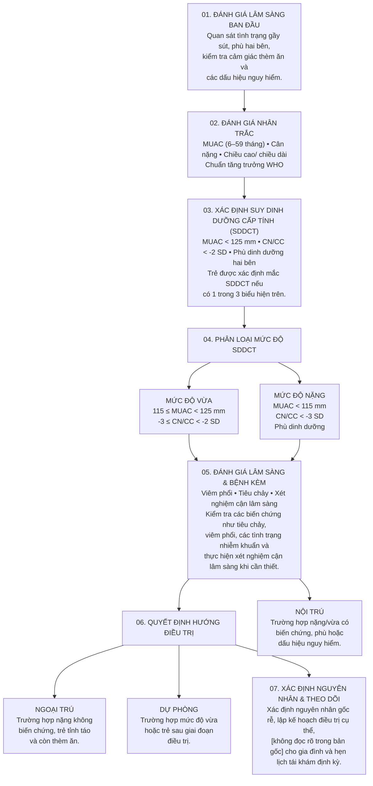
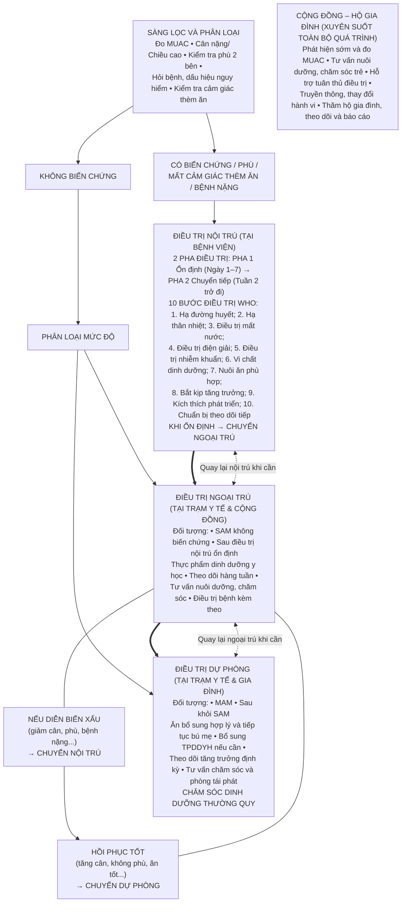

# Hướng dẫn chẩn đoán và điều trị bệnh suy dinh dưỡng cấp tính ở trẻ em từ 0 đến 59 tháng tuổi (Ban hành kèm theo Quyết định số 2989/QĐ-BYT ngày 22 tháng 9 năm 2026)

**BỘ Y TẾ**

**CỘNG HÒA XÃ HỘI CHỦ NGHĨA VIỆT NAM**
**Độc lập - Tự do - Hạnh phúc**

Số: 2989/QĐ-BYT

*Hà Nội, ngày 22 tháng 9 năm 2026*

**QUYẾT ĐỊNH**

**Về việc ban hành tài liệu chuyên môn "Hướng dẫn chẩn đoán và điều trị bệnh suy dinh dưỡng cấp tính ở trẻ em từ 0 đến 59 tháng tuổi"**

**BỘ TRƯỞNG BỘ Y TẾ**

*Căn cứ Luật khám bệnh, chữa bệnh năm 2023;*

*Căn cứ Nghị định số 313/2026/NĐ-CP ngày 08/8/2026 của Chính phủ quy định chức năng, nhiệm vụ, quyền hạn và cơ cấu tổ chức của Bộ Y tế;*

*Căn cứ Biên bản họp Hội đồng chuyên môn nghiệm thu tài liệu "Hướng dẫn chẩn đoán và điều trị bệnh suy dinh dưỡng cấp tính ở trẻ em từ 0 đến 59 tháng tuổi" ngày 06/7/2026.*

*Theo đề nghị của Cục trưởng Cục Quản lý Khám, chữa bệnh, Bộ Y tế.*

**QUYẾT ĐỊNH:**

**Điều 1.** Ban hành kèm theo Quyết định này tài liệu chuyên môn "Hướng dẫn chẩn đoán và điều trị bệnh suy dinh dưỡng cấp tính ở trẻ em từ 0 đến 59 tháng tuổi". Quyết định này thay thế Quyết định số 4487/QĐ-BYT ngày 18 tháng 8 năm 2016 của Bộ Y tế.

**Điều 2.** Tài liệu chuyên môn "Hướng dẫn chẩn đoán và điều trị bệnh suy dinh dưỡng cấp tính ở trẻ em từ 0 đến 59 tháng tuổi" được áp dụng tại các cơ sở khám bệnh, chữa bệnh kể từ ngày ký ban hành.

**Điều 3.** Các ông, bà: Chánh Văn phòng Bộ, Cục trưởng Cục Quản lý Khám, chữa bệnh, Vụ trưởng và Cục trưởng các Vụ, Cục thuộc Bộ Y tế, Giám đốc các bệnh viện trực thuộc Bộ Y tế, Giám đốc Sở Y tế các tỉnh, thành phố trực thuộc Trung ương, Thủ trưởng Y tế các Bộ, Ngành và Thủ trưởng các đơn vị có liên quan chịu trách nhiệm thi hành Quyết định này./.

*Nơi nhận:*
- Như Điều 3;
- Bộ trưởng (để báo cáo);
- Các Thứ trưởng;
- Lưu VT, KCB.

**KT. BỘ TRƯỞNG**
**THỨ TRƯỞNG THƯỜNG TRỰC**

*(Đã ký)*

**Vũ Mạnh Hà**

---

**HƯỚNG DẪN**
**CHẨN ĐOÁN VÀ ĐIỀU TRỊ BỆNH SUY DINH DƯỠNG CẤP TÍNH Ở TRẺ EM TỪ 0 ĐẾN 59 THÁNG TUỔI**

***(Tài liệu chuyên môn dùng cho nhân viên y tế)***

*(Ban hành kèm theo Quyết định số 2989/QĐ-BYT ngày 22 tháng 9 năm 2026 của Bộ Y tế)*

**Hà Nội, 2026**

---

| **Chủ biên** | |
|---|---|
| TS. Hà Anh Đức | Cục trưởng Cục Quản lý Khám, chữa bệnh |
| TS. Dương Huy Lương | Phó Cục trưởng Cục Quản lý Khám, chữa bệnh |
| **Tham gia biên soạn** | |
| TS. Dương Huy Lương | Phó Cục trưởng Cục Quản lý Khám, chữa bệnh |
| PGS.TS. Trần Thanh Dương | Viện trưởng Viện Dinh dưỡng |
| TS. Viên Chinh Chiến | Viện trưởng Viện Vệ sinh dịch tễ Tây Nguyên |
| ThS. Hà Thanh Sơn | Phòng Điều dưỡng – Dinh dưỡng &KSNK, Cục Quản lý Khám, chữa bệnh |
| ThS. Nguyễn Mai Hương | Chuyên viên chính, Cục Bà mẹ và Trẻ em, Bộ Y tế |
| TS. Nguyễn Thị Hồng Diễm | Phó trưởng phòng Kiểm soát bệnh không lây nhiễm và Dinh dưỡng, Cục Phòng bệnh Bộ Y tế |
| BSCK2. Cao Đức Phương | Phó Trưởng phòng Điều dưỡng – Dinh dưỡng &KSNK, Cục Quản lý Khám, chữa bệnh |
| TS. Huỳnh Nam Phương | Trưởng phòng Quản lý Khoa học, Viện Dinh dưỡng |
| TS. Lưu Thị Mỹ Thục | Trưởng khoa Dinh dưỡng, Bệnh viện Nhi Trung ương |
| TS. Trần Khánh Thu | Bộ môn Dinh dưỡng, Trường Đại học Y Dược Thái Bình |
| BSCK2. Nguyễn Hải Yến | Trưởng khoa Dinh dưỡng, Bệnh viện Trung ương Thái Nguyên |
| PGS.TS. Nguyễn Quang Dũng | Trưởng Bộ môn Dinh dưỡng, Trường Đại học Y Hà Nội |
| TS. Hoàng Thị Đức Ngàn | Trưởng khoa Dinh dưỡng cộng đồng, Viện Dinh dưỡng |
| TS. Phạm Thị Lan Anh | Trưởng khoa Dinh dưỡng, Trường Đại học Y Dược TP. Hồ Chí Minh |
| TS. Hoàng Thị Bạch Yến | Trưởng Bộ môn Dinh dưỡng, Trường Đại học Y Dược Huế |
| ThS. Đỗ Hồng Phương | Chuyên gia Dinh dưỡng, Tổ chức UNICEF tại Việt Nam |
| ĐDCK1. Trương Thị Thu Hương | Phòng Điều dưỡng - Dinh dưỡng &KSNK, Cục Quản lý Khám, chữa bệnh, Bộ Y tế |
| ThS. Nguyễn Hồng Nhung | Phòng Điều dưỡng - Dinh dưỡng &KSNK, Cục Quản lý Khám, chữa bệnh, Bộ Y tế |
| ThS. Phạm Thị Tú Anh | Phòng Quản lý chất lượng và Chuyển giao kỹ thuật, Cục Quản lý Khám, chữa bệnh, Bộ Y tế |
| **Hội đồng chuyên môn nghiệm thu tài liệu** | |
| PGS.TS. Trương Tuyết Mai | Phó Viện trưởng Viện Dinh dưỡng |
| TS. Nguyễn Trọng Khoa | Phó Cục trưởng Cục Quản lý Khám, chữa bệnh |
| TS. Phan Bích Nga | Trưởng khoa Khám tư vấn dinh dưỡng trẻ em, Viện Dinh Dưỡng |
| PGS.TS. Bùi Thị Nhung | Nguyên Trưởng khoa Dinh dưỡng học đường, Viện Dinh dưỡng |
| BSCKII. Nguyễn Thị Hằng Nga | Khoa Dinh dưỡng, Bệnh viện Nhi Trung ương |
| PGS.TS. Phạm Thị Dung | Trưởng Bộ môn Dinh dưỡng và An toàn thực phẩm, Trường Đại học Y Dược Thái Bình |
| TS. Nguyễn Thị Thu Hậu | Trưởng khoa Dinh dưỡng, Bệnh viện Nhi Đồng 2, Tp. Hồ Chí Minh |
| ThS. Phan Ngọc Sơn | Phó Trưởng phòng Quản lý chất lượng và Chuyển giao kỹ thuật, Cục Quản lý Khám, chữa bệnh, Bộ Y tế |
| TS. Nguyễn Duy Sơn | Nguyên cán bộ Khoa Giám sát và Chính sách dinh dưỡng, Viện Dinh dưỡng |
| ThS. Hoàng Thị Ái Nhi | Phó Trưởng khoa Dinh dưỡng, Bệnh viện Phụ sản - Nhi, Đà Nẵng |
| BS. Đỗ Thị Hạnh Nga | Trưởng khoa Dinh dưỡng, Trung tâm Kiểm soát bệnh tật tỉnh Gia Lai |

---

## LỜI NÓI ĐẦU

Bệnh suy dinh dưỡng cấp tính ở trẻ em là vấn đề sức khỏe nghiêm trọng đối với cả y tế công cộng và y học lâm sàng, ảnh hưởng trực tiếp đến tỷ lệ sống còn, sự phát triển thể chất và trí tuệ của thế hệ trẻ. Trên thế giới có hơn 45 triệu trẻ em dưới 5 tuổi bị suy dinh dưỡng cấp tính, trong đó khoảng 13,6 triệu trẻ rơi vào tình trạng suy dinh dưỡng cấp tính nặng là nguyên nhân gián tiếp hoặc trực tiếp gây ra gần 1/5 tổng số tử vong ở trẻ dưới 5 tuổi toàn cầu. Tại Việt Nam, tỷ lệ suy dinh dưỡng cấp tính toàn quốc duy trì ở mức khoảng 4,5% - 5,6% tập trung cao ở các vùng Tây Nguyên, Trung du và Miền núi phía Bắc (có nơi vượt ngưỡng 10%) đặc biệt là trẻ em dân tộc thiểu số, vùng thiên tai và nhóm trẻ có bệnh lý mạn tính. Do đó, việc phát hiện sớm, chẩn đoán chính xác và can thiệp điều trị kịp thời đóng vai trò quyết định nhằm giảm tỷ lệ tử vong và hạn chế di chứng lâu dài.

Kế thừa và phát triển từ Hướng dẫn chẩn đoán và điều trị suy dinh dưỡng cấp tính ở trẻ em năm 2016, tài liệu Hướng dẫn năm 2026 được xây dựng và cập nhật dựa trên các bằng chứng khoa học mới nhất từ Tổ chức Y tế Thế giới (WHO 2023). Hướng dẫn này tập trung chuẩn hóa các định nghĩa, tiêu chuẩn chẩn đoán, phân loại và phác đồ điều trị cho nhóm trẻ suy dinh dưỡng do thiếu protein - năng lượng, đảm bảo tính khoa học, thống nhất và khả thi trên toàn hệ thống y tế quốc gia. Bên cạnh việc kế thừa các nguyên tắc kinh điển, Hướng dẫn năm 2026 đã cập nhật và tích hợp các luận điểm khoa học hiện đại về vai trò của hệ vi sinh đường ruột và miễn dịch, phương pháp quản lý và cá thể hóa phác đồ, kiểm soát nguy cơ Hội chứng nuôi ăn lại và đề cao sự phối hợp giữa nhi khoa, dinh dưỡng lâm sàng, điều dưỡng và y tế dự phòng trong suốt quá trình điều trị cũng như theo dõi sau xuất viện, nhằm đảm bảo trẻ phục hồi toàn diện cả về thể trạng lẫn chức năng thần kinh - vận động.

Được hoàn thiện dựa trên nguồn lực và điều kiện thực tế của hệ thống y tế Việt Nam, Hướng dẫn năm 2026 là tài liệu chuyên môn chuẩn mực dành cho cán bộ y tế các cấp, góp phần nâng cao chất lượng chăm sóc, bảo vệ và cải thiện tầm vóc cho trẻ em Việt Nam. Cục Quản lý Khám, chữa bệnh trân trọng giới thiệu tài liệu này tới các cơ sở khám bệnh, chữa bệnh và đội ngũ nhân viên y tế trên toàn quốc để tham khảo và áp dụng trong thực hành chuyên môn. Chúng tôi tin tưởng rằng tài liệu sẽ góp phần nâng cao chất lượng chẩn đoán và điều trị suy dinh dưỡng cấp tính ở trẻ em.

Trong quá trình biên soạn, biên tập, mặc dù Ban Biên soạn đã hết sức cố gắng nhưng tài liệu khó tránh khỏi thiếu sót, Bộ Y tế mong nhận được sự góp ý, phản hồi của các chuyên gia hành nghề. Các góp ý xin gửi về: Bộ Y tế (Cục Quản lý Khám, chữa bệnh), số 138A phố Giảng Võ, phường Giảng Võ, thành phố Hà Nội.

Trân trọng cảm ơn.

**TS. Vũ Mạnh Hà**
**THỨ TRƯỞNG THƯỜNG TRỰC BỘ Y TẾ**

## CHỮ VIẾT TẮT

| Chữ viết tắt | Nghĩa |
|---|---|
| CN/CC | Cân nặng/Chiều cao |
| CN/CD | Cân nặng/Chiều dài |
| CN/T | Cân nặng/Tuổi |
| TPDDYH | Thực phẩm dinh dưỡng y học |
| MAM | Suy dinh dưỡng cấp tính vừa |
| MUAC | Chu vi vòng cánh tay |
| MUAC/T | Chu vi vòng cánh tay/Tuổi |
| SAM | Suy dinh dưỡng cấp tính nặng |
| SD | Độ lệch chuẩn |
| SDDCT | Suy dinh dưỡng cấp tính |

## MỤC LỤC

- I. ĐẠI CƯƠNG — 1
- 1. Khái niệm — 1
- 2. Nguyên tắc phát hiện và quản lý — 2
- II. CHẨN ĐOÁN SUY DINH DƯỠNG CẤP TÍNH — 2
- 1. Lâm sàng — 2
- 2. Cận lâm sàng — 3
- 3. Chẩn đoán xác định — 4
- 4. Chẩn đoán phân biệt — 5
- 5. Chẩn đoán nguyên nhân và yếu tố nguy cơ — 5
- 6. Quy trình chẩn đoán suy dinh dưỡng cấp tính — 6
- III. ĐIỀU TRỊ SUY DINH DƯỠNG CẤP TÍNH — 8
- 1. Nguyên tắc điều trị chung và phân tầng điều trị — 8
- 2. Điều trị nội trú — 10
- 3. Điều trị ngoại trú — 18
- 4. Điều trị dự phòng — 21
- IV. QUẢN LÝ SDD CẤP TÍNH TẠI CỘNG ĐỒNG — 23
- 1. Huy động cộng đồng và truyền thông giáo dục dinh dưỡng — 23
- 2. Tổ chức sàng lọc, phát hiện sớm và chuyển tuyến — 23
- 3. Tiếp nhận và quản lý điều trị tại Trạm y tế — 24
- 4. Theo dõi trẻ tại hộ gia đình — 24
- 5. Giám sát, theo dõi và báo cáo — 24
- 6. Vai trò và trách nhiệm của các cấp chuyên môn kỹ thuật trong quản lý và điều trị suy dinh dưỡng cấp tính — 24
- 7. Đào tạo, hỗ trợ chuyên môn và bảo đảm hoạt động — 26
- V. PHÒNG BỆNH — 26
- PHỤ LỤC — 28
- Phụ lục 1. Thuật ngữ sử dụng trong Hướng dẫn — 28
- Phụ lục 2. Quy trình chẩn đoán suy dinh dưỡng cấp tính — 30
- Phụ lục 3. Lưu đồ tổng thể quản lý suy dinh dưỡng cấp tính — 31
- Phụ lục 4. Thành phần dinh dưỡng của các loại thực phẩm dinh dưỡng y học sử dụng để điều trị trẻ suy dinh dưỡng cấp tính — 32
- Phụ lục 5. Đánh giá cảm giác thèm ăn — 35
- Phụ lục 6. Truyền thông phục vụ phòng, phát hiện sớm và điều trị suy dinh dưỡng cấp tính ở trẻ em — 36

## I. ĐẠI CƯƠNG

### 1. Khái niệm

**Suy dinh dưỡng** (Malnutrition) là tình trạng thiếu hoặc thừa hoặc mất cân đối các chất dinh dưỡng thiết yếu trong khẩu phần hoặc suy giảm khả năng sử dụng chất dinh dưỡng của cơ thể. Gánh nặng kép của suy dinh dưỡng bao gồm cả suy dinh dưỡng, thừa cân và béo phì, cũng như các bệnh không lây nhiễm liên quan đến chế độ ăn. Suy dinh dưỡng do thiếu hụt biểu hiện dưới bốn dạng chính: gầy còm (wasting), thấp còi (stunting), nhẹ cân (underweight) và thiếu vi chất dinh dưỡng (micronutrient deficiencies).

**Suy dinh dưỡng cấp tính** (SDDCT) là tình trạng bệnh lý xảy ra khi cơ thể không được cung cấp đủ năng lượng và protein theo nhu cầu trong một khoảng thời gian ngắn. Nguyên nhân có thể do khẩu phần ăn thiếu hụt, do bệnh lý hoặc sự kết hợp của cả hai, dẫn đến rối loạn chuyển hóa và suy giảm khối lượng cơ thể. Đặc trưng lâm sàng của SDDCT là tình trạng giảm cân nhanh (gầy còm) hoặc xuất hiện phù dinh dưỡng.

**Gầy còm (wasting)** là tình trạng trẻ có cân nặng theo chiều cao/chiều dài thấp, phản ánh sự mất nhanh khối mỡ và khối cơ do thiếu ăn, bệnh tật hoặc cả hai. Gầy còm phản ánh tình trạng thiếu hụt dinh dưỡng cấp hoặc bán cấp, thường gặp sau các đợt tiêu chảy, viêm phổi, sởi, nhiễm khuẩn tái diễn, hoặc do khẩu phần ăn không đáp ứng nhu cầu.

**Phù dinh dưỡng (Nutritional oedema)** là phù đều hai bên, thường bắt đầu ở chân và lan dần lên phía trên của cơ thể, là dấu hiệu của suy dinh dưỡng cấp tính nặng và có thể che lấp mức độ giảm cân thực sự do tình trạng giữ nước. Phù dinh dưỡng cần được chẩn đoán phân biệt với phù do tim, thận, gan hoặc các nguyên nhân bệnh lý khác.

Theo Tổ chức Y tế Thế giới (WHO), SDDCT ở trẻ em từ 0–59 tháng tuổi được xác định dựa trên các chỉ số cân nặng theo chiều cao (CN/CC) hoặc cân nặng theo chiều dài (CN/CD), chu vi vòng cánh tay (mid-upper arm circumference – MUAC) hoặc sự hiện diện của phù dinh dưỡng (WHO, 2023). SDDCT ở trẻ em được phân loại thành SDDCT mức độ vừa (Moderate Acute Malnutrition – MAM) và SDDCT mức độ nặng (Severe Acute Malnutrition – SAM).

SDDCT là một trong những nguyên nhân quan trọng làm tăng tỷ lệ bệnh tật và tử vong ở trẻ em dưới 5 tuổi. Trẻ bị SDDCT mức độ nặng có nguy cơ tử vong cao hơn từ **5 đến 20 lần** so với trẻ có tình trạng dinh dưỡng bình thường. SDDCT là nguyên nhân trực tiếp dẫn đến tử vong và còn là yếu tố làm trầm trọng thêm các bệnh nhiễm khuẩn như tiêu chảy, viêm phổi... SDDCT ảnh hưởng lâu dài đến tăng trưởng, phát triển của trẻ. Phát hiện sớm và điều trị kịp thời SDDCT có ý nghĩa quan trọng trong giảm tử vong trẻ em và cải thiện tình trạng dinh dưỡng cộng đồng.

### 2. Nguyên tắc phát hiện và quản lý

Việc phát hiện SDDCT cần được thực hiện thường xuyên tại cộng đồng và tại các cơ sở y tế thông qua sàng lọc bằng các phương pháp đơn giản như: đo chu vi vòng cánh tay (MUAC); cân đo nhân trắc; và phát hiện phù dinh dưỡng hai bên. Quản lý SDDCT do nguyên nhân thiếu protein năng lượng hiện nay chủ yếu dựa trên mô hình quản lý lồng ghép SDDCT tại cộng đồng (Community-based Management of Acute Malnutrition – CMAM). Theo cách tiếp cận này, trẻ SDDCT không biến chứng được điều trị ngoại trú và theo dõi tại cộng đồng; SDDCT có biến chứng hoặc cần thăm dò chuyên khoa được điều trị nội trú tại cơ sở y tế. Cách tiếp cận này giúp mở rộng khả năng tiếp cận điều trị, phát hiện sớm các trường hợp suy dinh dưỡng nặng và góp phần giảm tử vong ở trẻ em.

Việc điều trị được phân tầng theo hệ thống y tế Việt Nam, trong đó:

- Cơ sở y tế tại trung ương, tỉnh và khu vực: thực hiện chẩn đoán và điều trị nội trú cho các trường hợp SDDCT có biến chứng hoặc cần thăm dò chuyên khoa.
- Y tế cơ sở (xã/phường/phòng khám): thực hiện sàng lọc, phát hiện sớm và quản lý điều trị ngoại trú và điều trị dự phòng cho trẻ SDDCT nặng không biến chứng và trẻ SDDCT vừa.
- Cộng đồng và hộ gia đình: có vai trò trong việc theo dõi tăng trưởng, tuân thủ phác đồ điều trị và thực hiện các biện pháp dự phòng.

## II. CHẨN ĐOÁN SUY DINH DƯỠNG CẤP TÍNH

### 1. Lâm sàng

Các dấu hiệu lâm sàng giúp nhận định sớm tình trạng suy dinh dưỡng của trẻ trước khi được xác định bằng các chỉ số nhân trắc. Trẻ có thể có một số dấu hiệu lâm sàng sau:

- Dấu hiệu toàn thân: Trẻ gầy, sút cân nhanh trong thời gian ngắn, mệt mỏi, ít hoạt động, quấy khóc hoặc thờ ơ, giảm hoặc mất cảm giác thèm ăn.
- Dấu hiệu gầy còm (wasting): Mất lớp mỡ dưới da, nhất là ở mặt, mông và các chi. Mặt hốc hác, mắt trũng, da khô, trông "già trước tuổi". Cơ nhão, tay chân nhỏ, xương sườn nổi rõ.
- Dấu hiệu phù dinh dưỡng: Phù trắng mềm ấn lõm hai bên, thường bắt đầu ở mu bàn chân và cẳng chân, có thể lan lên mặt và toàn thân. Phù kèm theo các mảng sắc tố tăng sắc tố và bong tróc từng mảng giống như lớp sơn bị bong (Flaky paint dermatosis hay Flaky paint rash). Trong trường hợp phù, cân nặng có thể không giảm hoặc tăng do giữ nước, gây sai lệch nếu chẩn đoán dựa chỉ vào cân nặng.
- Dấu hiệu thiếu các vi chất dinh dưỡng: Da xanh, niêm mạc nhợt, viêm loét miệng; tóc khô, thưa, dễ gãy rụng; móng tay khô, dễ gãy; chuỗi hạt sườn, vòng cổ tay, vòng cổ chân, biến dạng xương chi…
- Các biểu hiện kèm theo thường gặp: rối loạn tiêu hóa; nhiễm khuẩn tái diễn hoặc kéo dài; chậm hồi phục sau bệnh hoặc sau đợt nhiễm khuẩn cấp.
- Các dấu hiệu nguy hiểm: không bú/uống được, nôn tất cả, li bì/bất tỉnh, co giật, thở rít, mất nước nặng, thiếu máu nặng.
- Đánh giá các nguy cơ hội chứng nuôi ăn lại (refeeding syndrome)

**Bảng 1. Đánh giá nguy cơ hội chứng nuôi ăn lại**

| Tiêu chí | Nguy cơ thấp (≥ 3 tiêu chí) | Nguy cơ vừa (≥ 2 tiêu chí) | Nguy cơ cao (≥ 1 tiêu chí) |
|---|---|---|---|
| **Z-score cân nặng theo chiều dài (trẻ 1–24 tháng) hoặc Z-score CN/CC (trẻ >24 tháng tuổi)** | Dưới -1 SD đến -2 SD | Dưới -2 SD đến -3 SD | Dưới -3 SD |
| **Sụt cân** (so với mức tăng cân bình thường mỗi tháng theo tuổi) | < 75% | < 50% | < 25% |
| **Mức năng lượng hoặc protein ăn vào** | < 75% nhu cầu trong 3-5 ngày liên tiếp | < 75% nhu cầu trong 5-7 ngày liên tiếp | < 75% nhu cầu trong > 7 ngày liên tiếp |
| **Bệnh lý kèm theo** | Bệnh nhẹ | Bệnh trung bình | Bệnh nặng |
| **Mức độ mất lớp mỡ dưới da và mức độ, giảm khối cơ** | Giảm nhẹ hoặc Z-scorechu vi vòng cánh tay theo tuổi từ −1 đến −1,9 SD | Giảm vừa hoặc Z-score chu vi vòng cánh tay theo tuổi từ −2 đến −2,9 SD | Giảm nặng hoặc Z-score chu vi vòng cánh tay theo tuổi ≤ −3 SD |
| **Nồng độ kali, phospho hoặc magie huyết thanh trước nuôi dưỡng** | Thay đổi nhẹ hoặc giảm < 25% giới hạn dưới | Giảm 25–50% giới hạn dưới | Giảm rõ hoặc giảm > 50% giới hạn dưới |

***\*) BMI: chỉ số khối cơ thể; SD: độ lệch chuẩn***

*(Ghi chú biên tập: chú thích dưới Bảng 1 giải thích "BMI" nhưng trong Bảng 1 của bản gốc không có chỉ số BMI.)*

### 2. Cận lâm sàng

Cận lâm sàng được chỉ định để đánh giá mức độ nặng, biến chứng, bệnh kèm theo, tìm nguyên nhân và theo dõi quá trình điều trị. Tùy vào lâm sàng, điều kiện cơ sở y tế để chỉ định cho phù hợp. Không trì hoãn điều trị trong khi chờ kết quả xét nghiệm. Kết quả cận lâm sàng cần được diễn giải thận trọng vì trẻ suy dinh dưỡng có nhiều rối loạn sinh lý nên có thể ảnh hưởng đến các chỉ số xét nghiệm.

#### 2.1. Xét nghiệm thường quy cơ bản: để đánh giá biến chứng và tiên lượng.

- Công thức máu: để đánh giá thiếu máu, tình trạng nhiễm khuẩn và các rối loạn huyết động. Thiếu máu nặng khi **Hb < 4 g/dL** hoặc **< 6 g/dL** kèm theo các dấu hiệu suy hô hấp hoặc suy tuần hoàn.
- Đường máu: để phát hiện hạ đường huyết. Hạ đường huyết được xác định khi **Glucose máu < 3 mmol/l hoặc < 54 mg/dl**.
- Điện giải đồ: bao gồm natri (Na⁺), kali (K+), và khi có điều kiện có thể đánh giá thêm phospho và magiê huyết thanh nhằm phát hiện rối loạn nước – điện giải và hỗ trợ theo dõi nguy cơ của hội chứng nuôi ăn lại trong quá trình phục hồi dinh dưỡng.
- Protein toàn phần, albumin huyết thanh: hỗ trợ đánh giá tình trạng dinh dưỡng, tình trạng phù và tiên lượng bệnh.
- Chức năng gan, thận: đánh giá các rối loạn chức năng cơ quan liên quan đến suy dinh dưỡng cấp tính và các bệnh lý kèm theo (nếu có).

#### 2.2. Xét nghiệm chẩn đoán nguyên nhân, bệnh kèm theo (nếu cần)

Tuỳ theo biểu hiện lâm sàng và điều kiện/khả năng của các cơ sở y tế, có thể thực hiện các xét nghiệm như:

- Xét nghiệm đánh giá tình trạng viêm, nhiễm khuẩn, rối loạn đông máu: công thức máu, CRP, procalcitonin (khi cần thiết), tốc độ máu lắng, đông máu cơ bản
- Xét nghiệm đánh giá chức năng đường tiêu hóa và hấp thu: xét nghiệm phân, ký sinh trùng đường ruột, đánh giá hấp thu hoặc các xét nghiệm đánh giá tình trạng kém hấp thu khi có chỉ định.
- Xét nghiệm đánh giá các bệnh lý cơ quan và rối loạn chuyển hóa: tim, thận, gan, nội tiết và chuyển hóa,…tùy theo bệnh cảnh lâm sàng.
- Xét nghiệm đánh giá sự thiếu hụt vi chất: sắt và ferritin (lưu ý ferritin có thể tăng giả tạo do viêm); vitamin D; vitamin B12, folat, kẽm, canxi, magiê, phốt pho….và các vi chất khác khi cần thiết.
- Xét nghiệm theo dõi đáp ứng điều trị và phục hồi dinh dưỡng (khi cần thiết): pre-albumin, tỉ lệ albumin/globulin; phân tích trở kháng điện sinh học (Bioelectrical Impedance Analysis - BIA); siêu âm đánh giá khối cơ (ví dụ cơ tứ đầu đùi) và các phương pháp đánh giá thành phần cơ thể khác.

### 3. Chẩn đoán xác định

Chẩn đoán xác định khi có một trong các tiêu chuẩn nhân trắc kèm hoặc không kèm theo phù dinh dưỡng hai bên (sau khi đã loại trừ các nguyên nhân phù không do dinh dưỡng). Khi có nhiều tiêu chuẩn cùng một lúc thì phân loại theo tiêu chuẩn ở mức độ nặng hơn.

**Bảng 2. Tiêu chuẩn phân loại suy dinh dưỡng cấp tính**

| Phân loại | Tiêu chuẩn chẩn đoán |
|---|---|
| Suy dinh dưỡng cấp tính vừa (MAM) | - Z-score cân nặng theo chiều dài hoặc chiều cao (Z-score CN/CD hoặc CN/CC) từ **-3 SD đến < -2 SD** theo chuẩn tăng trưởng WHO; hoặc - Chu vi vòng cánh tay (MUAC) từ **115 mm đến < 125 mm**\*; - Không có phù dinh dưỡng. |
| Suy dinh dưỡng cấp tính nặng (SAM) | - Z-score cân nặng theo chiều dài hoặc chiều cao (Z-score CN/CD hoặc CN/CC) **< -3 SD**; hoặc - Chu vi vòng cánh tay (MUAC) **< 115 mm**\*\*; hoặc - Có phù dinh dưỡng hai bên |

*\* hoặc -3 SD≤ Z-score MUAC/T< -2 SD nếu có điều kiện đánh giá tại cơ sở y tế*

*\*\* hoặc Z-score MUAC/T< -3 SD) nếu có điều kiện đánh giá tại cơ sở y tế*

*Tra cứu chỉ số CN/CC hoặc CN/CD, MUAC theo bảng chuẩn tăng trưởng của WHO 2006 (World Health Organization: Child growth standards)*

- Nếu trẻ có phù dinh dưỡng hai bên, được chẩn đoán SDDCT nặng mà không phụ thuộc vào CN/CC hoặc MUAC.
- Chẩn đoán SDDCT phải đi kèm với đánh giá:
  - \+ Tình trạng lâm sàng.
  - \+ Các dấu hiệu nguy hiểm.
  - \+ Bệnh lý kèm theo.

Chẩn đoán mức độ suy dinh dưỡng là cơ sở để lựa chọn hình thức điều trị phù hợp (nội trú, ngoại trú hoặc điều trị dự phòng) và xây dựng kế hoạch theo dõi tiếp theo.

### 4. Chẩn đoán phân biệt

- Phân biệt với các nguyên nhân gây phù khác như phù do tim, thận, gan, dị ứng…
- Phân biệt với suy dinh dưỡng mạn tính: thấp còi, tầm vóc thấp.

### 5. Chẩn đoán nguyên nhân và yếu tố nguy cơ

- Thiếu cung cấp dinh dưỡng: khi trẻ không được cung cấp đủ dinh dưỡng so với nhu cầu của cơ thể.
  - \+ Yếu tố xã hội - môi trường: Nghèo đói, mất an ninh lương thực của hộ gia đình, thiếu sự chăm sóc hoặc kiến thức nuôi dưỡng của người chăm sóc.
  - \+ Trẻ mắc các bệnh cấp tính dẫn đến kém ăn, tăng tiêu hao dinh dưỡng, giảm hấp thu và sử dụng các chất dinh dưỡng.
  - \+ Hành vi và tâm lý: Trẻ biếng ăn, rối loạn hành vi ăn uống hoặc các bệnh lý cản trở khả năng nhai nuốt của trẻ (nuốt sặc, sứt môi hở vòm, hẹp thực quản…).
  - \+ Các yếu tố nguy cơ từ giai đoạn chu sinh: sinh non, nhẹ cân, suy dinh dưỡng thai.
- Giảm tiêu hóa và hấp thu: trẻ có thể được cung cấp đủ dinh dưỡng nhưng quá trình tiêu hóa hoặc hấp thu dưỡng chất bị suy giảm.
  - \+ Bệnh lý tiêu hóa: gây kém hấp thu như bệnh lý tổn thương niêm mạc ruột, hội chứng ruột ngắn.
  - \+ Thiếu enzyme tiêu hóa: viêm tụy mạn, xơ nang gây thiếu hụt enzyme tụy.
  - \+ Mất chất dinh dưỡng qua đường tiêu hóa: mất protein qua ruột do giãn mạch bạch huyết bẩm sinh, mất dịch qua dò hay dẫn lưu, tiêu chảy mạn.
  - \+ Nguyên nhân cơ học: nôn trớ kéo dài hoặc các bệnh lý gan mật gây giảm bài tiết mật để hấp thu chất béo.
- Rối loạn chuyển hóa hoặc tăng nhu cầu: xảy ra khi cơ thể không sử dụng hiệu quả dưỡng chất hoặc nhu cầu năng lượng tăng cao như.
  - \+ Rối loạn chuyển hóa bẩm sinh (bệnh di truyền): Thiếu hoặc bất thường enzyme trong các con đường chuyển hóa làm cơ thể không sử dụng được các chất dinh dưỡng đã hấp thu.
  - \+ Bệnh lý cấp tính nặng: bỏng rộng, chấn thương, nhiễm khuẩn huyết (sepsis).
  - \+ Bệnh lý mạn tính: tim bẩm sinh, bệnh phổi mạn tính …gây tiêu hao năng lượng.
  - \+ Một số bệnh lý khác.

### 6. Quy trình chẩn đoán suy dinh dưỡng cấp tính

Quy trình chẩn đoán SDDCT được thực hiện theo các bước tuần tự, bảo đảm phát hiện sớm, phân loại đúng mức độ bệnh và lựa chọn hình thức điều trị phù hợp, đặc biệt tại y tế cơ sở (Phụ lục 2).

**Bước 1. Đánh giá lâm sàng ban đầu**

- Tìm dấu hiệu nguy hiểm (không bú/uống được, nôn nhiều, li bì/bất tỉnh, co giật, thở rít, mất nước nặng, thiếu máu nặng).
- Quan sát trẻ: gầy sút cân, gầy còm, phù hai bên.
- Đánh giá cảm giác thèm ăn (Phụ lục 5).
- Xét nghiệm cận lâm sàng nếu cần.

Nếu có dấu hiệu nguy hiểm hoặc phù dinh dưỡng, ưu tiên xử trí cấp cứu và chuyển điều trị nội trú.

**Bước 2. Đánh giá nhân trắc**

- Đo cân nặng và chiều cao/chiều dài, xác định CN/CC (CN/CD).
- Đo MUAC (trẻ 6–59 tháng) (hoặc Z-score MUAC/T nếu có điều kiện xác định tại cơ sở y tế).

**Bước 3. Xác định suy dinh dưỡng cấp tính**

Trẻ được chẩn đoán SDDCT khi có ít nhất một trong các tiêu chí sau:

- CN/CC (CN/CD) **< -2 SD**.
- MUAC **< 125 mm** (trẻ 6–59 tháng); hoặc Z-score MUAC/T< - 2 SD.
- Có phù dinh dưỡng hai bên.

**Bước 4. Phân loại mức độ suy dinh dưỡng cấp tính**

- Suy dinh dưỡng cấp tính mức độ vừa: **-3 ≤ CN/CC < -2 SD**; hoặc **115 mm ≤ MUAC < 125 mm** (hoặc -3 SD ≤ Z-score MUAC/T < -2 SD).
- Suy dinh dưỡng cấp tính mức độ nặng: **CN/CC < -3 SD**; hoặc **MUAC < 115 mm** (hoặc Z-score MUAC/T < -3 SD) hoặc có phù dinh dưỡng.

**Bước 5. Đánh giá tình trạng lâm sàng và bệnh kèm theo**

- Xác định có hay không có biến chứng.
- Đánh giá bệnh lý kèm theo (tiêu chảy, viêm phổi, nhiễm khuẩn khác……).
- Chỉ định cận lâm sàng căn cứ vào chẩn đoán ban đầu và phù hợp theo tuyến.

**Bước 6. Quyết định hình thức điều trị**

- **Điều trị nội trú:** khi có ít nhất một trong các dấu hiệu sau
  - \+ SDDCT mức độ nặng có biến chứng
  - \+ SDDCT mức độ vừa có biến chứng.
  - \+ Có phù dinh dưỡng.
  - \+ Có dấu hiệu nguy hiểm.
  - \+ Bệnh lý cấp tính khác.
  - \+ Cần nhập viện để tìm nguyên nhân gậy bệnh hay gây suy dinh dưỡng.
- **Điều trị ngoại trú**:
  - \+ SDDCT mức độ nặng không kèm theo biến chứng, còn cảm giác thèm ăn, không có bệnh lý khác.
- **Điều trị dự phòng:**
  - \+ SDDCT mức độ vừa không kèm theo biến chứng; hoặc
  - \+ Trẻ đã hoàn thành điều trị nội trú hoặc ngoại trú và cần theo dõi phục hồi.

**Bước 7. Xác định nguyên nhân và lập kế hoạch theo dõi**

- \+ Xác định nguyên nhân dinh dưỡng, bệnh tật và yếu tố liên quan.
- \+ Lập kế hoạch điều trị, tư vấn và theo dõi phù hợp.
- \+ Hẹn tái khám và theo dõi tăng trưởng.

## III. ĐIỀU TRỊ SUY DINH DƯỠNG CẤP TÍNH

### 1. Nguyên tắc điều trị chung và phân tầng điều trị

Điều trị SDDCT nhằm mục tiêu giảm tử vong, điều trị các biến chứng cấp tính, phục hồi tình trạng dinh dưỡng và phòng ngừa tái phát. Việc điều trị cần được thực hiện kịp thời, liên tục và theo cách tiếp cận toàn diện, lấy trẻ làm trung tâm, kết hợp điều trị dinh dưỡng với điều trị bệnh lý kèm theo và tư vấn chăm sóc, nuôi dưỡng phù hợp.

- Điều trị SDDCT phải dựa trên phân loại mức độ nặng và tình trạng lâm sàng.
- Ưu tiên phát hiện sớm và xử trí kịp thời các biến chứng đe dọa tính mạng, đặc biệt ở trẻ SDDCT nặng.
- Điều trị cần kết hợp song song giữa:
  - \+ Điều trị dinh dưỡng thích hợp theo từng giai đoạn.
  - \+ Điều trị và dự phòng các bệnh lý kèm theo.
  - \+ Theo dõi đáp ứng điều trị và tăng trưởng của trẻ.
- Thực phẩm điều trị (là thực phẩm dinh dưỡng y học (TPDDYH) hoặc thực phẩm dành cho chế độ ăn đặc biệt – Phụ lục 1) sử dụng trong điều trị phải đủ, cân đối dưỡng chất, phù hợp theo nhu cầu của trẻ theo tuổi, mức độ SDD và bệnh lý khác kèm theo. Khuyến khích và hỗ trợ nuôi con bằng sữa mẹ ở trẻ dưới 24 tháng tuổi.
- Đối với trẻ dưới 6 tháng, sử dụng cách tiếp cận cặp mẹ – trẻ, không điều trị riêng trẻ, hỗ trợ tư vấn dinh dưỡng cho mẹ. Ưu tiên sữa mẹ.
- Gắn kết chặt chẽ điều trị với tư vấn dinh dưỡng và chăm sóc trẻ tại gia đình, nhằm bảo đảm tuân thủ điều trị và phòng ngừa tái phát.
- Không trì hoãn điều trị chỉ vì thiếu xét nghiệm cận lâm sàng, các quyết định điều trị cần được chỉ định kịp thời chủ yếu dựa trên đánh giá lâm sàng và nhân trắc.
- Phân tầng điều trị SDDCT: Dựa trên mức độ SDD và lâm sàng, điều trị SDDCT được phân thành ba hợp phần điều trị (ba tầng) có sự liên thông và chuyển tiếp giữa các hợp phần (Phụ lục 3):
  - \+ Điều trị nội trú được thực hiện tại các cơ sở khám chữa bệnh có đủ điều kiện, nhằm ổn định tình trạng lâm sàng, điều trị biến chứng cấp tính hoặc cần được đánh giá sâu hơn và chuẩn bị cho giai đoạn phục hồi dinh dưỡng tiếp theo.
  - \+ Điều trị ngoại trú được thực hiện tại trạm y tế xã và cộng đồng, với trọng tâm là cung cấp điều trị và thực hiện các biện pháp phục hồi dinh dưỡng tại hộ gia đình cho trẻ em bị SDDCT nặng nhưng chưa có biến chứng hoặc trẻ được chuyển về từ điều trị nội trú.
  - \+ Điều trị dự phòng được thực hiện tại cộng đồng dành cho trẻ đã hoàn thành điều trị ngoại trú hoặc trẻ SDDCT vừa nhằm tiếp tục duy trì việc phục hồi dinh dưỡng, theo dõi tăng trưởng và tư vấn chăm sóc, nuôi dưỡng tại gia đình nhằm phòng ngừa tái phát SDD và chuyển sang lồng ghép với chăm sóc dinh dưỡng thường quy cho trẻ.

Ba hợp phần điều trị nêu trên có mối liên hệ chặt chẽ và cần được thực hiện liên tục, linh hoạt, phù hợp với diễn biến lâm sàng của trẻ. Trẻ có thể được tiếp nhận vào bất cứ hợp phần nào tùy theo tình trạng của trẻ. Việc chuyển hợp phần điều trị hoặc chuyển giai đoạn điều trị phải dựa trên tiêu chuẩn chuyên môn rõ ràng, bảo đảm trẻ luôn được tiếp cận hình thức điều trị phù hợp nhất tại từng thời điểm.

Điều trị SDDCT được chia thành hai pha điều trị: pha ổn định biến chứng và pha hồi phục. Việc tuân thủ đúng các pha điều trị có ý nghĩa quyết định trong việc giảm tử vong và phục hồi dinh dưỡng an toàn. Hai pha điều trị gồm **10 bước** cần thiết cơ bản sau:

- Bước 1. Điều trị/dự phòng hạ đường huyết.
- Bước 2. Điều trị/dự phòng hạ thân nhiệt.
- Bước 3. Điều trị/dự phòng mất nước.
- Bước 4. Điều chỉnh mất cân bằng điện giải.
- Bước 5. Điều trị/dự phòng nhiễm khuẩn.
- Bước 6. Điều chỉnh thiếu hụt các vi chất dinh dưỡng.
- Bước 7. Bắt đầu cho ăn theo hướng dẫn.
- Bước 8. Bắt kịp tốc độ tăng trưởng.
- Bước 9. Cung cấp kích thích các giác quan và hỗ trợ cảm xúc.
- Bước 10. Chuẩn bị các bước tiếp theo sau khi bình phục.

Hai pha điều trị phản ánh tiến trình phục hồi sinh lý và dinh dưỡng của trẻ, trong khi ba hợp phần điều trị phản ánh mô hình tổ chức cung cấp dịch vụ trong hệ thống y tế. Pha điều trị 1 (ổn định biến chứng tương ứng với hợp phần nội trú) và pha điều trị 2 (hồi phục) tương ứng với hợp phần ngoại trú, sau đó tiếp tục duy trì tránh tái phát ở hợp phần dự phòng. Thời gian điều trị các pha và đơn vị điều trị (nội trú/ngoại trú) có thể linh hoạt và thay đổi theo từng cá thể.

**10 BƯỚC ĐIỀU TRỊ SUY DINH DƯỠNG CẤP TÍNH Ở TRẺ EM (0–59 THÁNG TUỔI)**

*(Hình infographic trong bản gốc; mũi tên → thể hiện khoảng thời gian áp dụng của từng bước. Pha điều trị 1: Ổn định biến chứng (Ngày 1–7) gồm cột Ngày 1–2 và Ngày 3–7; Pha điều trị 2: Hồi phục (Tuần 2–6) gồm cột Tuần 2–6.)*

| Bước | Ngày 1–2 | Ngày 3–7 | Tuần 2–6 |
|---|---|---|---|
| 1. Điều trị/dự phòng hạ đường huyết | → | | |
| 2. Điều trị/dự phòng hạ thân nhiệt | → | | |
| 3. Điều trị/dự phòng mất nước | → | | |
| 4. Điều chỉnh mất cân bằng điện giải | → | → | → |
| 5. Điều trị/dự phòng nhiễm khuẩn | → | → | |
| 6. Điều chỉnh thiếu hụt các vi chất dinh dưỡng | → | → | → |
| 7. Bắt đầu cho ăn theo hướng dẫn | → | → | |
| 8. Bắt kịp tốc độ tăng trưởng | | | → |
| 9. Cung cấp kích thích các giác quan và hỗ trợ cảm xúc | → | → | → |
| 10. Chuẩn bị các bước tiếp theo sau khi bình phục | | | → |

*Tham khảo WHO 2013, WHO 2023*

### 2. Điều trị nội trú

#### 2.1. Tiêu chuẩn tiếp nhận điều trị nội trú

- Trẻ SDDCT có nguy cơ cao, cần được theo dõi và chăm sóc y tế liên tục.
- Trẻ có bệnh lý khác cần nhập viện điều trị kèm theo có dấu hiệu suy dinh dưỡng vừa hoặc nặng.

**Nguyên tắc tiếp nhận**

- Không trì hoãn tiếp nhận điều trị nội trú trong khi chờ xét nghiệm cận lâm sàng.
- Khi có nghi ngờ, cần ưu tiên an toàn cho trẻ, tiếp nhận điều trị nội trú và đánh giá lại sau.
- Chỉ định điều trị nội trú khi trẻ có một trong các trường hợp dưới đây.

**a) Trẻ SDDCT có biến chứng**

Trẻ được tiếp nhận điều trị nội trú khi được chẩn đoán SDDCT (ở bất kỳ mức độ nào) và có ít nhất một trong các biểu hiện sau:

- Có phù dinh dưỡng.
- Có dấu hiệu nguy hiểm hoặc bệnh nặng (nôn, lơ mơ/không tỉnh táo, co giật, thở rít, viêm phổi rút lõm lồng ngực, mất nước nặng, thiếu máu nặng…).
- Có các tình trạng bệnh lý hay biến chứng cấp tính: hạ đường huyết, hạ thân nhiệt, rối loạn nước – điện giải, suy hô hấp, nhiễm khuẩn nặng…
- Không còn hoặc giảm rõ rệt cảm giác thèm ăn (Phụ lục 5).
- Với trẻ dưới 6 tháng tuổi, chậm tăng trưởng và có bất cứ dấu hiệu nào sau đây: dấu hiệu nguy hiểm hay tình trạng bệnh lý nặng, phù dinh dưỡng, sụt cân gần đây.

**b) Trẻ SDDCT không đáp ứng hoặc diễn biến xấu trong điều trị ngoại trú**

Trẻ SDDCT đang điều trị ngoại trú cần được chuyển điều trị nội trú khi có một trong các biểu hiện sau:

- Không còn cảm giác thèm ăn.
- Không tăng cân trong tối thiểu hai lần khám liên tiếp hàng tuần.
- Tăng dưới mức tăng cân sinh lý theo độ tuổi trong ít nhất 2 tuần.
- Giảm cân trong hai hoặc nhiều lần khám liên tiếp.
- Xuất hiện phù dinh dưỡng.
- Xuất hiện các dấu hiệu nguy hiểm hoặc biến chứng lâm sàng.
- Tình trạng sức khỏe chung xấu đi.

**c) Các yếu tố bệnh lý và xã hội cần đánh giá**

Nếu trẻ không có dấu hiệu cấp cứu nhưng thuộc các trường hợp sau, cần thực hiện đánh giá cẩn thận để quyết định việc nhập viện:

- Tình trạng bệnh lý không cấp cứu nhưng cần đánh giá chuyên sâu, như: tiêu chảy xâm nhập, hạ đường huyết tái diễn, biến chứng liên quan đến HIV, lao...
- Tình trạng bệnh lý cần theo dõi trung hoặc dài hạn, như: rối loạn chuyển hóa bẩm sinh – di truyền, tim bẩm sinh, bại não hoặc các khuyết tật khác.
- Các vấn đề kinh tế - xã hội khiến người chăm sóc không đủ khả năng tuân thủ điều trị ngoại trú an toàn sau khi đã được tư vấn đầy đủ, như tâm lý người chăm sóc không ổn định, hoàn cảnh khó khăn, nơi ở xa cơ sở y tế...

#### 2.2. Tiêu chuẩn chuyển từ Bệnh viện tuyến dưới lên tuyến trên (Tỉnh/Trung ương)

- Thất bại trong điều trị nội trú tại tuyến dưới: Trẻ không có cải thiện về cảm giác thèm ăn hoặc xuất hiện phù (trước đó không phù) hoặc tình trạng phù không thuyên giảm hoặc nặng hơn sau 4 ngày điều trị, hoặc tăng cân dưới mức tăng cân sinh lý theo độ tuổi trong ít nhất 2 tuần, hoặc giảm cân (trẻ đang điều trị gày còm nhưng lại giảm cân liên tục).
- Biến chứng quá nặng: Các biến chứng y khoa vượt quá khả năng xử trí của tuyến dưới.
- Nhu cầu can thiệp chuyên khoa: cần hỗ trợ dinh dưỡng bằng các sản phẩm bệnh lý chuyên biệt hoặc nuôi dưỡng qua đường tĩnh mạch dài ngày.
- Bệnh lý nền phức tạp: Trẻ mắc SDDCT mức độ nặng kèm theo các bệnh lý bẩm sinh, HIV, lao, hoặc các rối loạn chuyển hóa cần chẩn đoán và điều trị chuyên sâu.

#### 2.3. Phác đồ điều trị nội trú theo các giai đoạn

Cơ sở y tế xây dựng phác đồ điều trị SDDCT dựa trên hướng dẫn này. Trường hợp không có các sản phẩm dinh dưỡng theo hướng dẫn thì có thể sử dụng các sản phẩm khác nhưng phải đáp ứng đủ năng lượng, vi chất cần thiết cho trẻ.

##### 2.3.1. Giai đoạn cấp cứu

**Mục tiêu**

- Ngăn ngừa tử vong trong những ngày đầu nhập viện.
- Điều trị và dự phòng các rối loạn cấp tính đe dọa tính mạng.
- Điều trị đồng thời các biến chứng.
- Ổn định chuyển hóa.
- Chuẩn bị cho trẻ chuyển sang giai đoạn chuyển tiếp và phục hồi dinh dưỡng.

**Thời gian**

Thường kéo dài từ **1-2 ngày**, tùy tình trạng lâm sàng của trẻ.

**Các nội dung điều trị chính**

**a) Điều trị/dự phòng hạ đường huyết:**

- Xử trí ngay nếu có hạ đường huyết (**glucose máu < 3 mmol/l**). Nếu trẻ tỉnh, cho uống **50 ml glucose 10%** hoặc pha 1 thìa cà phê đường kính với 3 thìa canh nước sạch, sau đó cho ăn lại sớm nhất có thể. Nếu trẻ không tỉnh, tiêm tĩnh mạch hoặc bơm qua ống thông dạ dày **5 ml/kg glucose hoặc dextrose 10%**. Nếu không tiếp cận được đường tiêu hóa hoặc tĩnh mạch ngay, đặt dưới lưỡi 1 thìa cà phê đường kính được làm ẩm bằng 1-2 giọt nước sạch để tránh nguy cơ hít sặc. Lặp lại nếu trẻ nuốt sớm vì thời gian đường ở dưới lưỡi ít.
- Dự phòng hạ đường huyết: Cho trẻ ăn càng sớm càng tốt **mỗi 2 giờ trong 24 giờ đầu** và **mỗi 2-3 giờ** trong những giờ tiếp theo, cả ngày lẫn đêm.

**b) Điều trị/dự phòng hạ thân nhiệt:**

Hạ đường huyết và hạ thân nhiệt có thể xảy ra trong vòng 4-6 tiếng sau khi trẻ SDDCT nhịn ăn. Tuy nhiên, cũng có thể là dấu hiệu của nhiễm khuẩn nặng.

- Xác định hạ thân nhiệt: hạ thân nhiệt khi nhiệt độ đo ở nách **< 35°C** hoặc ở trung tâm **< 35,5°C**.
- Điều trị hạ thân nhiệt: Cho trẻ ăn ngay và tiếp tục cho ăn mỗi 2 giờ. Làm ấm trẻ bằng cách giữ cho trẻ khô, mặc quần áo, đội mũ và dùng đèn sưởi.
- Theo dõi bằng nhiệt độ trung tâm, mỗi 2 giờ đến lúc **> 36,5°C** (mỗi 30 phút nếu đang dùng đèn sưởi sợi đốt).
- Dự phòng hạ thân nhiệt: Cho trẻ ăn càng sớm càng tốt mỗi 2 giờ. Giữ trẻ khô và ấm khi thực hiện thăm khám và các thủ thuật y khoa.
- Dùng kháng sinh.

**c) Điều trị/dự phòng mất nước:**

- Cần đánh giá tình trạng dịch một cách thận trọng ở trẻ SDDCT, do các dấu hiệu lâm sàng của mất nước hoặc quá tải dịch có thể khó phát hiện khi trẻ có teo đét hoặc phù.
- Cần bù dịch thận trọng ở trẻ SDDCT do nguy cơ quá tải dịch và suy tim.
- Nếu trẻ có sốc, truyền tĩnh mạch **15 ml/kg trong vòng 1 giờ**, sử dụng các dịch truyền Ringer's lactate và glucose 5%; 0,45% NaCl và glucose 5%. Nếu trẻ cải thiện triệu chứng lâm sàng sau 1 giờ và không có dấu hiệu phù phổi, tiếp tục truyền tĩnh mạch **15 ml/kg trong vòng 1 giờ tiếp theo**, sau đó chuyển sang đường uống/sonde dung dịch ReSoMal hoặc Oresol áp lực thẩm thấu thấp (nếu không sẵn có ReSoMal) **10 ml/kg/giờ trong 10 giờ** tiếp theo và và bắt đầu cho ăn (TPDDYH 1 hoặc TPDDYH khác tuỳ thuộc vào tình trạng bệnh). Nếu trẻ không cải thiện triệu chứng lâm sàng sau 2 lần bolus, duy trì dịch truyền **4 ml/kg/giờ** trong khi chờ truyền máu, truyền **10 ml khối hồng cầu trong 3 giờ**, bắt đầu cho ăn lại TPDDYH 1 và tiêm kháng sinh. *(Ghi chú biên tập: bản gốc ghi "10 ml khối hồng cầu", không kèm đơn vị "/kg"; giữ nguyên văn.)*
- Nếu trẻ không có sốc và uống được, ưu tiên ReSoMal ở trẻ SDDCT (trừ tả và tiêu chảy xuất tiết nhiều do nguy cơ hạ natri). Nếu không có dung dịch ReSoMal, sử dụng Oresol áp lực thẩm thấu thấp (**245 mOsm/L**). Bổ sung **5 ml/kg/30 phút trong 2 giờ đầu**. Sau đó, **5–10 ml/kg/giờ** xen kẽ với nuôi dưỡng trong **4–10 giờ** tiếp theo. Đánh giá mất nước và quá tải dịch (nhịp thở tăng > 5 lần/phút và mạch tăng 25 lần/phút, không giải thích được bằng tình trạng khác) hàng giờ để điều chỉnh phù hợp. Tiếp tục bú mẹ tích cực. *(Ghi chú biên tập: tại đây (trang in 13, trang PDF 20) bản gốc ghi "mạch tăng 25 lần/phút" không có dấu ">", trong khi mục 2.3.2 (trang in 16, trang PDF 23) ghi "mạch tăng > 25/phút"; giữ nguyên văn.)*
- Dự phòng mất nước: tiếp tục cho bú mẹ hoặc bắt đầu TPDDYH phù hợp. Thay thế lượng phân trẻ đại tiện bằng ReSoMal hoặc Oresol áp lực thẩm thấu thấp. Lưu ý: trẻ SDD thường rối loạn tiêu hóa và không cần bù dịch, tuy nhiên cần phân biệt với tiêu chảy ở trẻ suy dinh dưỡng là có mất nước.

**d) Điều chỉnh rối loạn điện giải:**

Sự cạn kiệt kali và magiê trong SDDCT cần ít nhất 2 tuần để điều chỉnh. Phù trong SDDCT do thiếu ăn có thể do thiếu kali và giữ natri, không điều trị SDD bằng thuốc lợi tiểu.

- Cần lưu ý nguy cơ quá tải dịch và thừa Natri ở trẻ SDDCT.
- Bảo đảm cung cấp đủ kali và magiê thông qua TPDDYH hoặc bù theo chỉ định.

**đ) Điều trị/dự phòng nhiễm khuẩn:**

- Sử dụng kháng sinh phổ rộng ở tất cả trẻ SDDCT có chỉ định điều trị nội trú do tỉ lệ nhiễm khuẩn nặng cao, kể cả khi không có biểu hiện nhiễm khuẩn. Thời gian **7-10 ngày** hoặc hơn tùy tiến triển của bệnh.
- Hoặc điều trị nhiễm khuẩn đặc hiệu khi đã xác định nguyên nhân.

**e) Điều trị thiếu hụt vi chất dinh dưỡng:**

- Mặc dù thiếu máu thường gặp, nhưng không bổ sung sắt trong giai đoạn này vì có thể làm cho tình trạng nhiễm khuẩn xấu đi. Chỉ bắt đầu bổ sung sắt ở trẻ có bằng chứng thiếu sắt khi trẻ đã ổn định lâm sàng, hết phù, có cảm giác thèm ăn và bắt đầu tăng cân (thường vào tuần thứ hai), khi đó sắt được bổ sung liều **3 mg/kg/ngày**.
- Vitamin A:
  - \+ Nếu trẻ không được sử dụng các TPDDYH và không được bổ sung vitamin A đại trà theo chiến dịch trước đó: bổ sung 1 lần vitamin A uống liều cao (**50.000 IU** với trẻ dưới 6 tháng, **100.000 IU** với trẻ từ 6 tháng đến dưới 12 tháng, **200.000 IU** với trẻ từ 12 tháng trở lên) vào ngày đầu tiên.
  - \+ Nếu có biểu hiện thiếu vitamin A trên lâm sàng (tổn thương mắt) và sởi, sử dụng vitamin A liều cao 3 lần vào ngày thứ 1, thứ 2 và ngày thứ 14.
- Kẽm: **2 mg/kg/ngày** trong ít nhất 2 tuần ở trẻ có bằng chứng thiếu kẽm. Đối với trường hợp có tiêu chảy cấp, sử dụng liều **10 mg/ngày** với trẻ dưới 6 tháng và **20 mg/ngày** với trẻ từ 6 tháng trở lên trong vòng 10-14 ngày.
- Acid folic: **5 mg** trong ngày đầu, sau đó **1 mg/ngày** trong ít nhất 2 tuần.
- Bổ sung đa vi chất khác nếu thiếu: có thể trong thuốc hay TPDDYH.

Lưu ý: Không dùng liều cao kéo dài khi không có chỉ định, ưu tiên cung cấp vi chất thông qua chế độ ăn.

**g) Nuôi dưỡng trong giai đoạn cấp cứu:**

Nguyên tắc của nuôi dưỡng trong giai đoạn này là ưu tiên cứu sống, không nhằm tăng cân, nuôi dưỡng thận trọng.

- Lựa chọn TPDDYH phù hợp với tuổi, khả năng dung nạp, tình trạng SDD và bệnh lý nền kèm theo (Phụ lục 4). Cho ăn nhiều bữa nhỏ, đều đặn cả ngày và đêm.
- Cân nhắc chỉ định nuôi dưỡng tĩnh mạch (do nguy cơ quá tải chất lỏng và mất cân bằng điện giải).
- Đối với trẻ dưới 6 tháng: Khuyến khích cho trẻ bú mẹ bất cứ lúc nào, tư vấn và hỗ trợ bú mẹ (đánh giá và can thiệp bằng điều chỉnh tư thế, tăng tần suất bú, da kề da, tái lập tiết sữa nếu sữa mẹ không đủ hoặc mất sữa, xác định các vấn đề và căn nguyên rối loạn nuốt,…). Bổ sung các công thức dinh dưỡng phù hợp nếu cần.
- Khi bắt đầu cho ăn lại, cần đánh giá nguy cơ hội chứng nuôi ăn lại : Hội chứng nuôi ăn lại là tình trạng rối loạn chuyển hóa và điện giải có thể xảy ra khi bắt đầu nuôi dưỡng lại ở trẻ SDD nặng kéo dài. Cần nhận diện nguy cơ và tăng dần năng lượng thận trọng.
- Chẩn đoán Hội chứng nuôi ăn lại khi đảm bảo các tiêu chí:
  - \+ Giảm bất kỳ 1, 2, hoặc 3 trong số các chỉ số phospho, kali và/hoặc magiê trong huyết thanh từ **10%–20%** (Refeeding nhẹ), **20%–30%** (Refeeding vừa), hoặc **> 30%** và/hoặc rối loạn chức năng cơ quan do giảm bất kỳ chỉ số nào trong số này và/hoặc do thiếu thiamin (Refeeding nặng).
  - \+ Và xảy ra trong vòng 5 ngày kể từ khi bắt đầu lại hoặc tăng đáng kể lượng cung cấp năng lượng.

**Bảng 3. Điều trị hội chứng nuôi ăn lại**

| Chăm sóc | Điều trị |
|---|---|
| **Năng lượng khởi đầu** | - Khởi đầu nuôi dưỡng thận trọng ở trẻ nguy cơ cao, tăng dần năng lượng theo đáp ứng lâm sàng và điện giải |
| **Vitamin B1 và đa vitamin** | - Vitamin B1 liều **2 mg/kg (tối đa 100-200 mg/ngày)** cho nhóm nguy cơ cao trước khi nuôi ăn lại. Tiếp tục tối thiểu 5-7 ngày nếu có yếu tố nguy cơ thiếu vitamin B1. - Bổ sung đa vitamin tối thiểu 10 ngày. - Bổ sung các điện giải bị thiếu (magiê, canxi, phospho) |
| **Theo dõi** | - Theo dõi chỉ số sinh tồn hàng giờ trong 24 giờ đầu. - Theo dõi điện giải định kỳ ở trẻ nguy cơ cao hoặc khi có điều kiện - Nếu khó kiểm soát điện giải, giảm năng lượng/carbohydrate xuống 50% lượng đang cung cấp và nâng từ từ 33% nhu cầu mỗi 1-2 ngày - Theo dõi cân nặng, bilan vào-ra hàng ngày. |

##### 2.3.2. Giai đoạn chuyển tiếp chuẩn bị cho nuôi ăn phục hồi dinh dưỡng hoàn toàn

Đây là giai đoạn chuyển tiếp từ giai đoạn cấp cứu, chuẩn bị sẵn sàng cho giai đoạn nuôi ăn phục hồi dinh dưỡng hoàn toàn (điều trị ngoại trú tại cộng đồng).

**Mục tiêu chuyển tiếp**

- Chuyển dần từ nuôi dưỡng duy trì sang nuôi dưỡng phục hồi.
- Tăng dần lượng năng lượng và protein một cách an toàn cho đến khi trẻ ăn được đủ lượng dinh dưỡng cần thiết một cách dễ dàng để có thể chuyển sang điều trị ngoại trú.
- Theo dõi khả năng dung nạp của trẻ.

**Điều kiện chuyển từ cấp cứu sang chuyển tiếp**

- Trẻ cải thiện tình trạng lâm sàng, tỉnh táo.
- Có hoặc phục hồi cảm giác thèm ăn (Phụ lục 5). Với trẻ < 6 tháng: có khả năng ngậm bắt vú đúng và có kỹ năng vận động miệng tốt.
- Giảm hoặc hết phù dinh dưỡng.
- Không còn hạ đường huyết.

**Thời gian chuyển tiếp**

- Thường kéo dài **2–5 ngày**, có thể dài hơn nếu trẻ hồi phục chậm.

**Nội dung chuyển tiếp**

- Chế độ dinh dưỡng của trẻ cần tăng dần để đạt được **100–135 kcal/kg/ngày**, trẻ ưu tiên sử dụng TPDDYH dạng đặc ăn liền (nếu sẵn có) (TPDDYH 3 - Phụ lục 4), nếu trẻ không chấp nhận thì dùng TPDDYH dạng lỏng phù hợp với bệnh lý có đậm độ năng lượng cao (TPDDYH 2 - Phụ lục 4) và tập cho trẻ chuyển tiếp dần sang dạng đặc. Cần theo dõi mức độ tăng cân và dung nạp để điều chỉnh mục tiêu năng lượng phù hợp với từng cá thể.
- Cho ăn theo nhu cầu, tăng dần lượng ăn nếu trẻ dung nạp tốt, lên đến mức **150-185 kcal/kg/ngày (trung bình 165 kcal/kg/ngày)** và **4-6 g protein/kg/ngày**.
- Theo dõi chặt chẽ các dấu hiệu không dung nạp (tiêu chảy, nôn, chướng bụng), có thể phải quay lại TPDDYH của giai đoạn cấp cứu.
- Bắt đầu bổ sung sắt khi trẻ ổn định và có tăng cân (không cần bổ sung thêm từ nguồn bên ngoài nếu trẻ có dùng TPDDYH có chứa sắt).
- Tiếp tục điều trị và theo dõi bệnh lý kèm theo.

**Theo dõi**

- Cân trẻ hằng ngày, thường sáng sớm, sau khi ngủ dậy, trước khi ăn.
- Theo dõi dung nạp tiêu hóa và suy tim sung huyết. Nếu nhịp thở tăng **> 5/phút** và mạch tăng **> 25/phút** trong 2 lần đo cách nhau 4 giờ, giảm tổng thể tích về **100 ml/kg/ngày**. Đánh giá lại sau 24 giờ để điều chỉnh lượng dịch.
- Tiếp tục theo dõi cân bằng điện giải.
- Đánh giá mức độ tăng cân và đáp ứng điều trị.

**Điều kiện chuyển giai đoạn sang điều trị phục hồi dinh dưỡng hoàn toàn ở ngoại trú**

- Trẻ ổn định về lâm sàng.
- Hết phù.
- Sử dụng được hết lượng thức ăn hay TPDDYH theo tiêu chuẩn một cách dễ dàng.
- Đối với trẻ dưới 6 tháng, trẻ nhận được đủ lượng sữa theo yêu cầu và mẹ trẻ có khả năng cho bú tốt (nếu trẻ bú mẹ).

#### 2.4. Tiêu chuẩn ra viện và chuyển tuyến

Việc ra viện hoặc chuyển tuyến đối với trẻ SDDCT điều trị nội trú không dựa vào một chỉ số nhân trắc cụ thể mà cần được thực hiện trên cơ sở đánh giá toàn diện tình trạng lâm sàng, đáp ứng điều trị và khả năng tiếp tục theo dõi, chăm sóc tại tuyến dưới hoặc tại gia đình. Mục tiêu là bảo đảm trẻ được tiếp tục điều trị phù hợp, liên tục và an toàn.

**a) Tiêu chuẩn ra viện (chuyển sang điều trị ngoại trú):**

Trẻ được ra viện và chuyển sang điều trị ngoại trú khi đáp ứng các tiêu chuẩn sau:

- Tình trạng lâm sàng ổn định, tỉnh táo, không còn dấu hiệu nguy hiểm.
- Hết phù dinh dưỡng hoặc phù giảm rõ rệt và không tiến triển.
- Có cảm giác thèm ăn tốt, ăn uống được bằng đường miệng.
- Dung nạp tốt TPDDYH điều trị.
- Có tăng cân vừa hoặc tốt hoặc xu hướng tăng cân ổn định (**> 5 g/kg/ngày**).
- Các bệnh lý kèm theo đã được điều trị ổn định hoặc có kế hoạch theo dõi tiếp tục.
- Người chăm sóc được tư vấn đầy đủ và có khả năng tuân thủ điều trị ngoại trú.

**b) Chuyển tuyến điều trị:**

Trẻ cần được chuyển tuyến khi:

- Tình trạng lâm sàng diễn biến nặng hoặc không cải thiện sau điều trị nội trú.
- Xuất hiện các biến chứng vượt quá khả năng xử trí của cơ sở đang điều trị.
- Cần các phương tiện chẩn đoán, điều trị chuyên sâu hơn.

Các trường hợp phức tạp, cần tổ chức hội chẩn nhóm điều trị dinh dưỡng. Việc chuyển tuyến cần được thực hiện kịp thời, có giấy chuyển tuyến đầy đủ thông tin chuyên môn, bảo đảm an toàn trong quá trình vận chuyển.

**c) Nội dung bàn giao khi ra viện hoặc chuyển tuyến:**

- Tóm tắt chẩn đoán, phân loại SDD và các bệnh lý kèm theo.
- Diễn biến điều trị và đáp ứng của trẻ.
- TPDDYH đang sử dụng và liều lượng.
- Kế hoạch điều trị ngoại trú hoặc theo dõi tiếp theo.
- Lịch tái khám và các dấu hiệu cần đưa trẻ quay lại cơ sở y tế ngay.

**d) Nguyên tắc bảo đảm chăm sóc liên tục**

- Việc ra viện không đồng nghĩa với kết thúc điều trị SDDCT.
- Cần bảo đảm sự liên thông giữa điều trị nội trú và ngoại trú, tránh gián đoạn chăm sóc.
- Tăng cường phối hợp giữa cơ sở điều trị nội trú, y tế cơ sở và gia đình trong theo dõi và chăm sóc trẻ.

### 3. Điều trị ngoại trú

Điều trị ngoại trú SDDCT nhằm phục hồi tại hộ gia đình áp dụng cho:

- Trẻ SDDCT nặng không có biến chứng, tỉnh táo, còn cảm giác thèm ăn.
- Trẻ được chuyển từ điều trị nội trú sau khi đã ổn định biến chứng.
- Trẻ dưới 6 tháng tuổi: có cân nặng/chiều dài hoặc cân nặng/tuổi dưới -2SD hoặc trẻ không tăng cân trong 2 tháng liên tiếp VÀ không có biến chứng VÀ bú được (còn khả năng bú mẹ hoặc ăn qua đường miệng).

Điều trị ngoại trú được thực hiện chủ yếu tại trạm y tế xã/phường hoặc cơ sở khám, chữa bệnh khác phù hợp với tình trạng của trẻ mắc bệnh SDD. Hình thức điều trị này chỉ được áp dụng khi trẻ đủ điều kiện an toàn và phải được theo dõi chặt chẽ bởi cán bộ y tế. Người chăm sóc phải có khả năng hiểu và tuân thủ hướng dẫn điều trị, có khả năng đưa trẻ đến cơ sở y tế theo lịch hẹn, và cam kết hợp tác trong quá trình theo dõi và chăm sóc trẻ. Nếu chuyển từ nội trú, trẻ cần được tiếp nhận chậm nhất trong vòng một tuần sau xuất viện.

#### 3.1. Mục tiêu và nguyên tắc điều trị ngoại trú

**Mục tiêu**

- Phục hồi nhanh tình trạng dinh dưỡng.
- Đạt tốc độ tăng cân bù an toàn.
- Phòng ngừa biến chứng và tử vong.

**Nguyên tắc**

- Điều trị ngoại trú phải được thực hiện theo phác đồ, có giám sát y tế.
- Điều trị ngoại trú dành cho trẻ em bị bệnh SDDCT nặng không có biến chứng, trẻ xuất viện từ điều trị nội trú hoặc người chăm sóc từ chối điều trị nội trú mặc dù đã được khuyên.
- TPDDYH dạng đặc ăn liền **520-550 kcal/100g** (TPDDYH 3) là thành phần thiết yếu đối với trẻ SDDCT nặng từ 6 đến 59 tháng tuổi (Phụ lục 4), khi mà chế độ ăn thông thường thường khó đáp ứng được yêu cầu này.
- Kết hợp điều trị dinh dưỡng với:
  - \+ Điều trị bệnh kèm theo.
  - \+ Tư vấn chăm sóc và nuôi dưỡng.
  - \+ Theo dõi tăng trưởng định kỳ.
- Không trì hoãn chuyển tuyến khi trẻ có dấu hiệu diễn biến xấu.
- Đối với trẻ dưới 6 tháng tuổi: khôi phục bú mẹ hoàn toàn (nếu có thể), đảm bảo tăng cân đầy đủ, phòng biến chứng và tử vong, hỗ trợ toàn diện mẹ - trẻ.

#### 3.2. Thuốc và chế độ ăn

- Sử dụng thuốc bao gồm kháng sinh thường quy đường uống cho trẻ được tiếp nhận điều trị ngoại trú (do trẻ SDD thường có nguy cơ nhiễm khuẩn tiềm ẩn cao và dấu hiệu nhiễm khuẩn không điển hình). Sử dụng các thuốc khác tùy thuộc vào tình trạng bệnh lý kèm theo của trẻ, theo hướng dẫn chẩn đoán và điều trị khác. Lưu ý điều trị sốt rét, tẩy giun và tiêm sởi (với các trẻ chưa được can thiệp theo phác đồ y tế hiện hành). Sử dụng men tiêu hóa, men vi sinh (nếu cần).
- Sử dụng TPDDYH 3 với liều lượng **150-185 (trung bình 165) kcal/kg/ngày** để phục hồi dinh dưỡng.
  - \+ Xác định và cung cấp đủ lượng TPDDYH 3 cho người chăm sóc trẻ. Lượng TPDDYH 3 được tính dựa vào cân nặng của trẻ và thời gian sử dụng cho tới lần phát kế tiếp (Phụ lục 4). Không khuyến khích sử dụng các dạng TPDDYH dạng lỏng tại nhà do nguy cơ nhiễm khuẩn cao nếu không sử dụng đúng cách và điều kiện vệ sinh không đảm bảo.
  - \+ Tư vấn cho người chăm sóc về sử dụng TPDDYH 3 trong điều trị SDDCT nặng (Phụ lục 4 và 6).

Trong trường hợp không có khả năng tiếp cận TPDDYH dạng đặc chuyên biệt, có thể sử dụng các sản phẩm dinh dưỡng khác nhưng phải bảo đảm tương đương về giá trị dinh dưỡng.

- Đối với trẻ dưới 6 tháng tuổi:
  - \+ Hỗ trợ nuôi con bằng sữa mẹ: đánh giá thực hành bú mẹ, hướng dẫn bú mẹ đúng cách, theo nhu cầu, nếu bú kém thì hướng dẫn vắt sữa mẹ và cho ăn bằng thìa/cốc.
  - \+ Hỗ trợ người mẹ về dinh dưỡng, nghỉ ngơi và tâm lý.
  - \+ Bổ sung dinh dưỡng nếu trẻ không đủ sữa mẹ hoặc không tăng cân bằng sữa công thức phù hợp với lứa tuổi hoặc sữa mẹ hiến tặng (nếu có). Không sử dụng TPDDYH dạng đặc.

#### 3.3. Khám bệnh và tư vấn

- Nếu trẻ được chuyển đến từ các cơ sở điều trị nội trú, đánh giá tình trạng sức khỏe, hồ sơ sức khỏe và những thuốc đã sử dụng để có hướng điều trị phù hợp.
- Hướng dẫn và tư vấn cho những người trực tiếp chăm sóc trẻ về việc quản lý thuốc, tầm quan trọng của việc tuân thủ phác đồ điều trị, tiêm chủng đầy đủ theo chương trình, chế độ dinh dưỡng và chăm sóc tại nhà. Những người mắc bệnh truyền nhiễm không được chăm sóc trẻ.

#### 3.4. Theo dõi

- Trẻ SDDCT nặng điều trị ngoại trú cần được tái khám để theo dõi định kỳ, **tối thiểu 1 lần/tuần**. Trong một số trường hợp đối tượng khó tiếp cận với cơ sở y tế (ví dụ trong tình huống khẩn cấp về dinh dưỡng) thì có thể tái khám 2 tuần 1 lần hoặc nhân viên y tế tiến hành thăm hộ gia đình để tái khám.
- Mỗi lần tái khám cần thực hiện:
  - \+ Đánh giá lâm sàng toàn trạng. Đối với trẻ dưới 6 tháng, đánh giá khả năng bú và tình trạng của người mẹ.
  - \+ Đo MUAC và cân nặng.
  - \+ Đánh giá cảm giác thèm ăn (Phụ lục 5).
  - \+ Kiểm tra việc sử dụng TPDDYH dạng đặc và tuân thủ điều trị.
  - \+ Phát hiện sớm các dấu hiệu nguy hiểm hoặc biến chứng.
  - \+ Tăng cường tư vấn, giáo dục dinh dưỡng.
  - \+ Ghi chép đầy đủ vào hồ sơ theo dõi.
- Trẻ mắc SDDCT nếu có một trong các dấu hiệu/biểu hiện sau cần được thăm khám kỹ hoặc đến thăm tại hộ gia đình để tìm hiểu nguyên nhân nhằm có hướng điều trị phù hợp:
  - \+ Trẻ sụt cân trong 2 lần khám liên tiếp (2 tuần liên tục).
  - \+ Cân nặng và tình trạng sức khỏe không cải thiện trong 3 tuần (cân nặng giữ nguyên hoặc tăng ít).
  - \+ Trẻ không tuân thủ điều trị.
  - \+ Trẻ được chuyển về từ điều trị nội trú.

#### 3.5. Đánh giá đáp ứng điều trị

- Trẻ được coi là đáp ứng tốt khi:
  - \+ Tăng cân hoặc MUAC đều qua các lần khám. Đối với trẻ dưới 6 tháng: tăng **≥ 5 g/kg/ngày** (lý tưởng).
  - \+ Trẻ tỉnh táo, ăn tốt.
  - \+ Không xuất hiện phù hoặc dấu hiệu nguy hiểm.

Trẻ sẽ kết thúc giai đoạn phục hồi dinh dưỡng trong điều trị ngoại trú khi đạt tiêu chuẩn khỏi SDDCT (**CN/CC hoặc CN/CD ≥ -2SD VÀ MUAC ≥ 125 mm**) trong 2 lần khám liên tục VÀ tình trạng lâm sàng được cải thiện và không phù dinh dưỡng, trẻ được chuyển sang giai đoạn dự phòng tái phát và chuyển tiếp. Nếu trẻ đáp ứng tốt thì thời gian điều trị ngoại trú trung bình từ **6 đến 8 tuần**.

- Trẻ được coi là đáp ứng kém khi:
  - \+ Không tăng cân hoặc sụt cân trong ≥ 2 lần khám liên tiếp.
  - \+ Giảm cảm giác thèm ăn.
  - \+ Xuất hiện các triệu chứng lâm sàng bất thường.

Trẻ đáp ứng kém cần tăng cường thăm khám và kết hợp thăm hộ tìm nguyên nhân. Nếu các nguyên nhân không thể giải quyết được tại y tế cơ sở thì chuyển nội trú.

- Chuyển sang điều trị nội trú khi có một trong các biểu hiện: xem mục b (Trẻ SDDCT không đáp ứng hoặc diễn biến xấu trong điều trị ngoại trú tại 2.1. Tiêu chuẩn tiếp nhận điều trị nội trú).

### 4. Điều trị dự phòng

Điều trị dự phòng được thực hiện tại cộng đồng trong thời gian từ **2 đến 4 tháng** để trẻ mắc bệnh SDD có thể hồi phục đến mức cân nặng và sức khỏe đủ tiêu chuẩn để xuất khỏi điều trị. Điều trị dự phòng dành cho trẻ SDDCT nặng sau khi kết thúc giai đoạn ngoại trú hoặc trẻ mắc SDDCT vừa không có biến chứng.

#### 4.1. Mục tiêu và nguyên tắc điều trị dự phòng

**Mục tiêu**

- Dự phòng tái phát SDDCT và chuyển tiếp sang duy trì.
- Dự phòng chuyển nặng đối với trẻ SDDCT vừa.

**Nguyên tắc**

- Bổ sung năng lượng và các chất dinh dưỡng có thể thiếu trong khẩu phần của trẻ.
- Kết hợp điều trị dinh dưỡng với:
  - \+ Điều trị bệnh kèm theo nếu có.
  - \+ Tư vấn chăm sóc và nuôi dưỡng.
  - \+ Theo dõi tăng trưởng định kỳ.
- Theo dõi và chuyển hình thức điều trị khi trẻ có dấu hiệu diễn biến xấu.

#### 4.2. Chế độ ăn

Trẻ cần được cung cấp khẩu phần ăn có năng lượng **100-130 kcal/kg/ngày** từ thức ăn gia đình, thực phẩm bổ sung và sữa mẹ (nếu còn bú mẹ).

- Đối với trẻ sau điều trị SDDCT nặng: Tiếp tục cung cấp TPDDYH dạng đặc (TPDDYH 3) với *liều bổ sung* trong thời gian chuyển tiếp (chiếm từ 40-60% tổng nhu cầu năng lượng của trẻ, khoảng từ ½ đến 1/3 *liều điều trị*) hoặc thực phẩm bổ sung đáp ứng được nhu cầu năng lượng của trẻ trong giai đoạn điều trị này. Từng bước chuyển sang chế độ ăn gia đình phù hợp với lứa tuổi. Theo dõi tăng trưởng sát trong những tháng đầu sau điều trị. *(Ghi chú biên tập: bản gốc (trang in 22, trang PDF 29) ghi liều bổ sung "chiếm từ 40-60% tổng nhu cầu năng lượng" đồng thời "khoảng từ ½ đến 1/3 liều điều trị"; hai cách diễn đạt không nhất quán, giữ nguyên văn.)*
- Đối với trẻ SDDCT vừa:
  - \+ Tư vấn và hướng dẫn chế độ ăn nhằm đảm bảo đủ năng lượng và protein theo lứa tuổi; Tăng đậm độ năng lượng bữa ăn; Đa dạng thực phẩm, ưu tiên thực phẩm giàu năng lượng, protein và vi chất; Khuyến khích tiếp tục bú mẹ đối với trẻ còn bú.
  - \+ Trong trường hợp cần thiết (đặc biệt khi đánh giá chế độ ăn ở gia đình không đảm bảo), có thể sử dụng TPDDYH với liều bổ sung hoặc các thực phẩm bổ sung khác giàu năng lượng phù hợp.

#### 4.3. Bổ sung vi chất và chăm sóc sức khỏe

- Bổ sung vi chất dinh dưỡng theo hướng dẫn (vitamin A, sắt, kẽm hoặc đa vi chất). Nếu trẻ được bổ sung TPDDYH có vi chất thì không cần bổ sung thêm các vi chất hàng ngày.
- Sử dụng men tiêu hóa, men vi sinh (nếu cần).
- Bảo đảm trẻ được tiêm chủng đầy đủ.
- Bảo đảm cung cấp nguồn nước sạch, vệ sinh môi trường và vệ sinh cá nhân.
- Tẩy giun định kỳ theo khuyến cáo.
- Chăm sóc và điều trị kịp thời khi trẻ mắc bệnh.

#### 4.4. Theo dõi và đánh giá

- Trẻ cần được theo dõi định kỳ tại tuyến y tế cơ sở, ít nhất *mỗi tháng một lần*.
- Nội dung theo dõi:
  - \+ Đo cân nặng, chiều cao/chiều dài, MUAC.
  - \+ Đánh giá chế độ ăn và thực hành nuôi dưỡng.
  - \+ Phát hiện sớm dấu hiệu tái phát SDDCT.
- Ghi chép đầy đủ vào hồ sơ theo dõi tăng trưởng.

#### 4.5. Kết thúc giai đoạn điều trị dự phòng

- Trẻ được coi là hoàn thành giai đoạn điều trị dự phòng (trung bình từ 2 đến 4 tháng) khi:
  - \+ Không còn SDDCT theo tiêu chuẩn nhân trắc. Đối với trẻ sau điều trị SDDCT nặng chuyển sang được duy trì trong ít nhất 2 tháng.
  - \+ Tăng trưởng phù hợp với lứa tuổi.
  - \+ Gia đình có thực hành nuôi dưỡng phù hợp và có khả năng tự theo dõi trẻ.
- Y tế cơ sở và cộng đồng tiếp tục:
  - \+ Tổ chức theo dõi, tư vấn và hỗ trợ gia đình thực hành nuôi dưỡng phù hợp.
  - \+ Phối hợp và chuyển tiếp với các chương trình y tế, dinh dưỡng và an sinh xã hội tại địa phương.
  - \+ Truyền thông, giáo dục sức khỏe nhằm nâng cao nhận thức của người chăm sóc.

## IV. QUẢN LÝ SDD CẤP TÍNH TẠI CỘNG ĐỒNG

Quản lý SDDCT tại cộng đồng là mô hình trọng tâm nhằm mở rộng khả năng tiếp cận điều trị, phát hiện sớm và giảm tỷ lệ tử vong ở trẻ em. Trạm y tế xã đóng vai trò chủ trì trong việc quản lý, điều trị các trường hợp SDDCT không có biến chứng và thực hiện các nhiệm vụ chuyên môn sau:

### 1. Huy động cộng đồng và truyền thông giáo dục dinh dưỡng

Trạm y tế xã phối hợp với chính quyền địa phương và các ban ngành đoàn thể để xây dựng mạng lưới ủng hộ hoạt động can thiệp.

- Lồng ghép nội dung SDDCT trong các buổi giao ban, sinh hoạt cộng đồng và phối hợp chặt chẽ với trưởng thôn/bản để vận động người dân tham gia.
- Hình thức truyền thông: Thực hiện tư vấn trực tiếp, sinh hoạt nhóm cho người chăm sóc trẻ hàng tuần tại trạm y tế hoặc hàng tháng tại thôn bản, kết hợp truyền thông gián tiếp qua loa phát thanh, tờ rơi, áp phích.
- Nội dung truyền thông: cách phát hiện trẻ SDDCT, vai trò của TPDDYH trong điều trị SDDCT (Phụ lục 6), hướng dẫn nuôi con bằng sữa mẹ và thực hành ăn bổ sung hợp lý.

### 2. Tổ chức sàng lọc, phát hiện sớm và chuyển tuyến

- Sàng lọc là điều kiện tiên quyết để đảm bảo trẻ được can thiệp kịp thời.
  - \+ Sàng lọc định kỳ: Cán bộ trạm y tế phối hợp với nhân viên y tế thôn bản thực hiện cân đo và đo vòng cánh tay (MUAC) **2 lần/năm (tháng 6 và tháng 12)** cho toàn bộ trẻ em dưới 5 tuổi, **3 tháng/lần** cho trẻ dưới 2 tuổi và **hàng tháng** cho trẻ có nguy cơ trên địa bàn quản lý.
  - \+ Sàng lọc thường xuyên: Nhân viên y tế thực hiện đo MUAC đối với tất cả trẻ có dấu hiệu nghi ngờ tại bất cứ thời điểm và địa điểm tiếp xúc để kịp thời phát hiện trẻ có MUAC thuộc vùng màu vàng hoặc đỏ, sau đó chuyển về trạm y tế để xác định tình trạng dinh dưỡng và chẩn đoán xác định.
- Trang thiết bị: Đảm bảo trạm y tế và nhân viên y tế thôn bản được trang bị đầy đủ cân, thước đo chiều cao/chiều dài, thước MUAC chuẩn và bảng tra cân nặng theo chiều cao (CN/CC).

### 3. Tiếp nhận và quản lý điều trị tại Trạm y tế

Trạm y tế tiếp nhận điều trị cho trẻ SDDCT nặng và vừa không biến chứng.

- Quản lý điều trị ngoại trú: Trẻ được tái khám hàng tuần để đánh giá lâm sàng, đo nhân trắc, thực hiện đánh giá cảm giác thèm ăn và cấp TPDDYH cùng các thuốc thiết yếu (kháng sinh, thuốc tẩy giun, vitamin A). Đảm bảo liều điều trị cho trẻ đầy đủ, tránh ngắt quãng do thiếu vật tư điều trị (cơ số TPDDYH dạng đặc trung bình **150 đơn vị/trẻ/đợt điều trị**) (1 đơn vị tương đương khoảng **500 kcal**).
- Quản lý điều trị dự phòng và theo dõi tiếp tục: Tần suất hàng tháng. Tập trung vào tư vấn thực hành chăm sóc tại nhà, hướng dẫn đa dạng hóa bữa ăn và cấp TPDDYH dạng đặc liều bổ sung (cơ số trung bình **100 đơn vị/trẻ/đợt điều trị**), đa vi chất nếu sẵn có.
- Chuyển tuyến: Chuyển trẻ lên bệnh viện tuyến trên nếu xuất hiện biến chứng, có dấu hiệu nguy hiểm hoặc thất bại trong điều trị ngoại trú (không tăng cân hoặc sụt cân liên tiếp).

### 4. Theo dõi trẻ tại hộ gia đình

Cán bộ Trạm y tế và nhân viên y tế thôn bản phối hợp thăm hộ gia đình để giám sát việc hồi phục của trẻ tại nhà. Hoạt động này đặc biệt quan trọng với những trẻ bỏ cuộc, trẻ sụt cân, trẻ mới chuyển từ điều trị nội trú về hoặc gia đình gặp khó khăn trong việc đưa trẻ đi tái khám tại cơ sở y tế. Nhân viên y tế đánh giá việc tuân thủ sử dụng TPDDYH dạng đặc tại hộ gia đình, việc giữ gìn vệ sinh và hỗ trợ gia đình tháo gỡ các khó khăn trong chăm sóc trẻ.

### 5. Giám sát, theo dõi và báo cáo

Trạm y tế thực hiện ghi chép vào phiếu theo dõi và báo cáo hàng tháng cho tuyến tỉnh các chỉ số chính, bao gồm: tổng số trẻ tiếp nhận (mới và cũ), số trẻ khỏi (hồi phục về nhân trắc và hết phù), số trẻ tử vong, bỏ cuộc, không đáp ứng và số trẻ chuyển tuyến.

Hiệu quả chương trình được đánh giá qua tỷ lệ hồi phục (**mục tiêu trên 75%**) và tỷ lệ bỏ cuộc (**dưới 15%**) cho hợp phần điều trị ngoại trú.

### 6. Vai trò và trách nhiệm của các cấp chuyên môn kỹ thuật trong quản lý và điều trị suy dinh dưỡng cấp tính

#### 6.1. Bệnh viện Trung ương, tỉnh và khu vực (cấp chuyên môn kỹ thuật chuyên sâu và cơ bản)

- Thực hiện tiếp nhận, chẩn đoán và điều trị nội trú cho trẻ SDDCT có biến chứng hoặc cần đánh giá chuyên sâu.
- Điều trị các bệnh lý nền, biến chứng nặng và các trường hợp thất bại điều trị ngoại trú hoặc nội trú tuyến dưới.
- Chỉ định và theo dõi các can thiệp dinh dưỡng chuyên sâu, bao gồm hỗ trợ nuôi dưỡng đặc biệt khi cần thiết.
- Hướng dẫn chuyển tiếp điều trị sang ngoại trú và dự phòng; lập kế hoạch theo dõi sau xuất viện.
- Hỗ trợ chuyên môn kỹ thuật cho tuyến dưới; tổ chức đào tạo, tập huấn và giám sát chuyên môn định kỳ.
- Tổng hợp, báo cáo tình hình điều trị SDDCT theo quy định.

#### 6.2. Trung tâm kiểm soát bệnh tật tỉnh:

- Chỉ đạo chuyên môn và hỗ trợ kỹ thuật cho Trạm y tế xã trong quản lý SDDCT tại cộng đồng.
- Tổ chức giám sát, kiểm tra và hỗ trợ chuyên môn định kỳ cho tuyến xã và nhân viên y tế thôn bản.
- Đảm bảo cung ứng vật tư, thuốc thiết yếu, TPDDYH và trang thiết bị phục vụ quản lý SDDCT.
- Tổng hợp số liệu, theo dõi tình hình triển khai và báo cáo theo quy định.

#### 6.3. Trạm Y tế xã/phường (cấp chuyên môn kỹ thuật ban đầu)

- Tổ chức sàng lọc, phát hiện sớm trẻ SDDCT tại cộng đồng.
- Quản lý điều trị ngoại trú và điều trị dự phòng theo hướng dẫn chuyên môn.
- Theo dõi tăng trưởng, đánh giá đáp ứng điều trị, phát hiện sớm dấu hiệu thất bại điều trị hoặc biến chứng để chuyển tuyến kịp thời.
- Tư vấn nuôi dưỡng, chăm sóc trẻ bệnh, thực hành nuôi con bằng sữa mẹ và ăn bổ sung hợp lý cho người chăm sóc.
- Phối hợp với nhân viên y tế thôn bản thực hiện thăm hộ gia đình, giám sát tuân thủ điều trị và truyền thông giáo dục sức khỏe.
- Quản lý hồ sơ, thống kê và báo cáo các trường hợp SDDCT trên địa bàn.

#### 6.4. Nhân viên y tế thôn bản/cộng tác viên y tế

Nhân viên y tế thôn bản giữ vai trò quan trọng trong phát hiện sớm, hỗ trợ điều trị và theo dõi trẻ SDDCT tại cộng đồng, đặc biệt tại vùng khó khăn, vùng sâu, vùng xa.

**Nhiệm vụ chính gồm:**

- Phát hiện sớm trẻ có nguy cơ hoặc nghi ngờ SDDCT thông qua theo dõi tăng trưởng, quan sát lâm sàng và đo MUAC.
- Hướng dẫn gia đình đưa trẻ đến Trạm y tế hoặc cơ sở khám bệnh, chữa bệnh khi có dấu hiệu SDDCT hoặc dấu hiệu nguy hiểm.
- Theo dõi tuân thủ điều trị tại hộ gia đình, đặc biệt đối với trẻ điều trị ngoại trú hoặc mới xuất viện.
- Thực hiện thăm hộ gia đình, hỗ trợ tư vấn nuôi dưỡng, vệ sinh, chăm sóc trẻ bệnh và thực hành cho trẻ ăn đúng hướng dẫn.
- Truyền thông thay đổi hành vi về chăm sóc dinh dưỡng trẻ nhỏ tại cộng đồng.
- Phối hợp với Trạm y tế trong hoạt động sàng lọc, quản lý và theo dõi trẻ SDDCT.

### 7. Đào tạo, hỗ trợ chuyên môn và bảo đảm hoạt động

- Cán bộ y tế các tuyến và nhân viên y tế thôn bản cần được đào tạo, tập huấn định kỳ về phát hiện, quản lý và điều trị SDDCT.
- Nội dung đào tạo cần chú trọng kỹ năng thực hành như đo MUAC, phát hiện dấu hiệu nguy hiểm, tư vấn nuôi dưỡng, theo dõi tuân thủ điều trị và truyền thông thay đổi hành vi.
- Trung tâm kiểm soát bệnh tật tỉnh và Trạm y tế xã có trách nhiệm hướng dẫn, giám sát và hỗ trợ chuyên môn thường xuyên cho nhân viên y tế thôn bản.
- Địa phương cần bảo đảm các yếu tố cần thiết cho công tác quản lý SDDCT tại cộng đồng, bao gồm:
  - \+ Trang thiết bị sàng lọc cơ bản.
  - \+ Tài liệu truyền thông.
  - \+ Hỗ trợ giám sát và thăm hộ gia đình.
  - \+ Các cơ chế hỗ trợ phù hợp cho nhân viên y tế thôn bản và cộng tác viên tham gia chương trình.

## V. PHÒNG BỆNH

Phòng bệnh suy dinh dưỡng cấp tính cần được thực hiện liên tục từ giai đoạn trước sinh, trong những năm đầu đời và lồng ghép với các chương trình chăm sóc sức khỏe bà mẹ, trẻ em tại cộng đồng nhằm giảm nguy cơ mắc mới và tái phát suy dinh dưỡng cấp tính.

### 1. Chăm sóc dinh dưỡng bà mẹ và trẻ nhỏ

- Bảo đảm dinh dưỡng hợp lý cho phụ nữ mang thai và bà mẹ cho con bú.
- Khuyến khích nuôi con bằng sữa mẹ theo khuyến cáo hiện hành.
- Thực hiện ăn bổ sung hợp lý, an toàn và đáp ứng nhu cầu dinh dưỡng của trẻ theo lứa tuổi.
- Tư vấn chăm sóc dinh dưỡng cho trẻ trong và sau mắc bệnh.

### 2. Chăm sóc sức khỏe và phòng bệnh

- Theo dõi tăng trưởng định kỳ.
- Bổ sung vi chất dinh dưỡng và tiêm chủng theo quy định của Bộ Y tế.
- Phát hiện, điều trị kịp thời các bệnh nhiễm khuẩn và bệnh lý làm tăng nguy cơ suy dinh dưỡng.
- Cải thiện vệ sinh cá nhân, vệ sinh môi trường và sử dụng nước sạch.

### 3. Phát hiện sớm và quản lý nguy cơ tại cộng đồng

- Sàng lọc định kỳ bằng cân đo, đo MUAC và phát hiện phù dinh dưỡng.
- Theo dõi trẻ có nguy cơ cao (trẻ nhẹ cân khi sinh, sinh non, mắc bệnh mạn tính, trẻ sau điều trị suy dinh dưỡng cấp tính...).
- Chuyển tuyến và can thiệp kịp thời theo hướng dẫn chuyên môn.
- Tăng cường truyền thông, tư vấn và sự tham gia của gia đình, cộng đồng trong phòng chống suy dinh dưỡng cấp tính.

## PHỤ LỤC

### Phụ lục 1. Thuật ngữ sử dụng trong Hướng dẫn

Trong Hướng dẫn này, các thuật ngữ và chữ viết tắt dưới đây được hiểu và sử dụng thống nhất như sau:

- **Chu vi vòng cánh tay (Mid-Upper Arm Circumference - MUAC):** là chỉ số nhân trắc đơn giản dùng để sàng lọc và chẩn đoán SDDCT ở trẻ từ 6 đến 59 tháng tuổi.
- **Cân nặng theo chiều cao/chiều dài (CN/CC):** là chỉ số nhân trắc so sánh cân nặng của trẻ với chiều cao (hoặc chiều dài) theo chuẩn tăng trưởng của WHO 2006, được biểu thị bằng điểm Z-score, dùng để đánh giá và phân loại SDDCT.
- **Đánh giá cảm giác thèm ăn (Appetite test):** là phương pháp đánh giá khả năng ăn của trẻ bằng cách cho trẻ thử ăn TPDDYH điều trị phù hợp với lứa tuổi trong thời gian quy định, nhằm phân loại trẻ SDDCT có hoặc không có biến chứng để lựa chọn hình thức điều trị nội trú hoặc ngoại trú.
- **Suy dinh dưỡng cấp tính nặng có biến chứng (Complicated SAM):** là tình trạng SDDCT nặng kèm theo một trong các yếu tố sau: có dấu hiệu nguy hiểm; Có bệnh lý hoặc biến chứng cấp tính; Không có hoặc giảm cảm giác thèm ăn. Các trường hợp này cần điều trị nội trú tại cơ sở y tế.
- **Suy dinh dưỡng cấp tính nặng không biến chứng (Uncomplicated SAM):** Là tình trạng SDDCT nặng nhưng không có dấu hiệu nguy hiểm, không có biến chứng y khoa cấp tính, và còn cảm giác thèm ăn. Các trường hợp này có thể điều trị ngoại trú và theo dõi tại cộng đồng.
- **Điều trị nội trú (Inpatient care):** là hình thức điều trị tại cơ sở khám bệnh, chữa bệnh đối với trẻ SDDCT có biến chứng hoặc không có khả năng điều trị an toàn tại cộng đồng, nhằm ổn định tình trạng lâm sàng và xử trí các rối loạn cấp tính.
- **Điều trị ngoại trú (Outpatient care):** là hình thức điều trị tại y tế cơ sở hoặc cộng đồng đối với trẻ SDDCT nặng không biến chứng với trọng tâm là phục hồi dinh dưỡng và theo dõi tăng trưởng.
- **Thực phẩm dinh dưỡng y học (TPDDYH)** (còn được gọi là thực phẩm dinh dưỡng dùng cho mục đích y tế đặc biệt (Food for special Medical Purposes, Medical Food) là loại thực phẩm có thể ăn bằng đường miệng hoặc bằng ống xông, được chỉ định để điều chỉnh chế độ ăn của người bệnh. TPDDYH được định nghĩa và phân loại theo mục đích y học bao gồm các chế phẩm được xử lý và điều chế dành riêng cho mục đích dinh dưỡng điều trị và phải sử dụng dưới sự giám sát y khoa. TPDDYH có thể thay thế một phần hoặc hoàn toàn chế độ ăn thông thường của người bệnh gặp các rối loạn về ăn uống, tiêu hóa, hấp thu hoặc chuyển hóa mà không thể điều chỉnh bằng cách thay đổi chế độ ăn thông thường. Các TPDDYH này phải phù hợp với đặc điểm sinh lý của đối tượng theo từng giai đoạn, bảo đảm an toàn và dễ dung nạp. Trong điều trị SDDCT ở trẻ em, các TPDDYH được định nghĩa chi tiết theo dạng thức và mục đích sử dụng như sau:
  - \+ TPDDYH 1: Sản phẩm dạng bột đóng trong gói để pha chế thành dung dịch dinh dưỡng trị liệu dạng lỏng, thường dùng trong giai đoạn cấp cứu của điều trị SDDCT tại bệnh viện, nhằm ổn định chuyển hóa và hỗ trợ bù dịch. Yêu cầu giá trị dinh dưỡng trong 100 ml của TPDDYH 1 xem chi tiết tại Phụ lục 4.
  - \+ TPDDYH 2: Sản phẩm dạng bột đóng trong gói để pha chế thành dung dịch dinh dưỡng trị liệu dạng lỏng, thường dùng trong giai đoạn phục hồi dinh dưỡng điều trị cho trẻ em bị SDDCT tại bệnh viện, nhằm mục đích giúp trẻ tăng cân nhanh chóng. Yêu cầu giá trị dinh dưỡng trong 100 ml của TPDDYH 2 xem chi tiết tại Phụ lục 4.
  - \+ TPDDYH 3: Sản phẩm dạng đặc ăn liền bao gồm các loại bột nhão/bơ phết và bánh quy/thanh nén với mật độ năng lượng **520-550 kcal/100g**, được sử dụng để điều trị dinh dưỡng cho trẻ em bị SDDCT nặng. Thường được đóng gói với hàm lượng **500 kcal/đơn vị đóng gói**. TPDDYH dạng đặc không cần pha, ít nguy cơ nhiễm khuẩn, dễ bảo quản, ước lượng số lượng đơn giản. Có thể sử dụng bằng liều bổ sung trong điều trị dự phòng SDDCT. Yêu cầu giá trị dinh dưỡng của TPDDYH3 xem chi tiết tại Phụ lục 4.
  - \+ Dung dịch bù nước ReSoMal: là chế phẩm dùng để bù nước đường uống đặc biệt cho trẻ SDDCT nặng có tiêu chảy hoặc nguy cơ mất nước (có hàm lượng natri thấp, kali và glucose cao hơn dung dịch thông thường).

### Phụ lục 2. Quy trình chẩn đoán suy dinh dưỡng cấp tính

*(Ghi chú biên tập: hình gốc là lưới 7 khung đánh số 01–07, không vẽ mũi tên giữa các khung 01→02→03→04, giữa khung 04 với hai ô MỨC ĐỘ VỪA/MỨC ĐỘ NẶNG, hay từ các ô này tới khung 05; các cạnh này trong sơ đồ dưới đây chỉ thể hiện thứ tự đánh số. Các mũi tên thực sự vẽ trong hình: mũi tên tới NỘI TRÚ xuất phát từ cạnh phải khung 05; mũi tên tới NGOẠI TRÚ, DỰ PHÒNG và tới khung 07 xuất phát từ khung 06. Sơ đồ giữ đúng như hình (B05 → NỘI TRÚ), dù mục II.6 'Bước 6. Quyết định hình thức điều trị' mô tả việc chọn điều trị nội trú ở bước 6.)*

*(Ghi chú biên tập: dòng cuối khung 07 trong hình gốc in chữ bị lỗi, đọc được dạng "hư ợte dinh phông cho gia đình…"; không xác định được chữ đúng nên ghi [không đọc rõ trong bản gốc].)*

### Phụ lục 3. Lưu đồ tổng thể quản lý suy dinh dưỡng cấp tính

**QUẢN LÝ VÀ ĐIỀU TRỊ SUY DINH DƯỠNG CẤP TÍNH 0–59 THÁNG TUỔI**

✓ Phát hiện sớm ✓ Điều trị kịp thời ✓ Theo dõi liên tục ✓ Phòng tái phát

**Chú giải (trong hình gốc):**

- Mũi tên đậm: Chuyển lên tuyến trên (khi có biến chứng/nặng hơn)
- Mũi tên đậm: Chuyển xuống tuyến dưới (khi ổn định/hồi phục)
- Mũi tên mảnh: Luồng chính: Sàng lọc → Phân loại → Điều trị
- Mũi tên nét đứt: Quay lại điều trị nội trú khi diễn biến xấu
- Mũi tên nét đứt: Quay lại điều trị ngoại trú khi cần theo dõi/chăm sóc

*Ghi nhớ: Phát hiện sớm – Điều trị kịp thời – Theo dõi liên tục – Phòng tái phát giúp trẻ phục hồi và phát triển tốt.*

*(Ghi chú biên tập: trong lưu đồ Phụ lục 3, khung điều trị nội trú ghi "PHA 2 Chuyển tiếp (Tuần 2 trở đi)" (trang in 31, trang PDF 38), trong khi hình "10 bước điều trị" (trang in 10, trang PDF 17) ghi "PHA ĐIỀU TRỊ 2: HỒI PHỤC (TUẦN 2–6)" và mục III.1 gọi pha 2 là "pha hồi phục"; giữ nguyên văn cả hai.)*

### Phụ lục 4. Thành phần dinh dưỡng của các loại thực phẩm dinh dưỡng y học sử dụng để điều trị trẻ suy dinh dưỡng cấp tính

#### 1. Thực phẩm dinh dưỡng dạng lỏng (TPDDYH 1 và 2)

Đặc điểm kỹ thuật của TPDDYH dạng lỏng tối ưu nhất theo tiêu chuẩn của Tổ chức Y tế thế giới và UNICEF được thiết kế phù hợp cho 2 giai đoạn của điều trị nội trú. (*Nguồn: Management of severe malnutrition: a manual for physicians and other senior health workers. World health organization, 1999* **https://www.who.int/publications/i/item/9241545119**).

Khi không có các sản phẩm tiêu chuẩn, sản phẩm thay thế phải cần tối thiểu các thành phần như sau:

| Trong 100 ml | TPDDYH 1 | TPDDYH 2 |
|---|---|---|
| Năng lượng (kcal/100ml) | **60-85** | **100-150** |
| Protein (g) trong đó ≥ 50% đến từ sữa | **0,75 - 3** | **2,3 – 5,0** |
| Lipid (g) | **2 - 3** | **4,9 – 6,9** |
| Các vitamin và khoáng chất khác | Các vitamin và khoáng chất khác | Các vitamin và khoáng chất khác |

*(Ô gộp: trong bản gốc, "Các vitamin và khoáng chất khác" là một ô gộp trải cả 3 cột; nội dung được lặp ở mỗi cột.)*

**Lưu ý:**

TPDDYH 1: Mục tiêu là ổn định chuyển hoá, không nhằm tăng cân.

TPDDYH 2: Mục tiêu tăng cân nhanh, bắt kịp tăng trưởng cho trẻ >1 tuổi

Với các TPDDYH 1 và 2, hàm lượng lactose cần được giới hạn ở mức rất thấp, hàm lượng sắt, natri ở mức thấp.

Áp lực thẩm thấu: không nên vượt quá **400 mOsm/l**. Trẻ có biểu hiện rối loạn tiêu hóa, kém hấp thu hay tiêu chảy thẩm thấu, ưu tiên chọn TPDDYH có nồng độ áp lực thẩm thấu thấp **< 320 mOsm/L**.

Nhân viên y tế cần theo dõi và điều chỉnh chế độ nuôi dưỡng phụ thuộc vào tình trạng bệnh lý của trẻ.

#### 2. Thực phẩm dinh dưỡng y học dạng đặc ăn liền (TPDDYH 3)

Đặc điểm kỹ thuật của TPDDYH dạng đặc ăn liền tối ưu dựa theo tiêu chuẩn của *Codex CXG 95-2022*. Khi không có sản phẩm tiêu chuẩn, sản phẩm thay thế tối thiểu cần có thành phần như sau:

| Chỉ tiêu | Hàm lượng (trong 100 g) | Hàm lượng (trong 100 kcal) |
|---|---|---|
| Năng lượng (kcal) | 520–550 | 100 |
| Protein (g) | 13–17 (chiếm 10–12% năng lượng; ≥50% từ sữa | 2,5 – 3,0 |
| Lipid (g) | 26–37 (chiếm 45–60% năng lượng) | 5 – 7 |
| Độ ẩm (%) | ≤ 2,5 | ≤ 2,5 |
| Natri (mg) | ≤ 290 | ≤ 56 |
| Kali (mg) | 1100–1600 | 200-308 |
| Sắt (mg) | 10–14 | 1,8 – 2,7 |
| Kẽm (mg) | 11–14 | 2 – 2,7 |
| Vitamin A (mcg RE) | 800–1600 | 45-308 |
| Các vitamin và khoáng chất khác (nếu có) | Theo nhu cầu | Theo nhu cầu |

*(Ghi chú biên tập: giá trị Vitamin A trong 100 kcal "45-308" (trang in 33, trang PDF 40) không nhất quán với 800–1600 mcg RE/100 g và năng lượng 520–550 kcal/100 g của cùng bảng; giữ nguyên văn, cần đối chiếu nguồn.)*

**Hướng dẫn sử dụng TPDDYH 3 sử dụng trong điều trị ngoại trú**

a) Nguyên tắc chung

- TPDDYH 3 được sử dụng trong điều trị ngoại trú SDDCT.
- TPDDYH 3 là nguồn cung cấp năng lượng và vi chất chính, không thay thế sữa mẹ đối với trẻ còn bú.
- Khẩu phần TPDDYH 3 được tính theo cân nặng của trẻ, nhằm cung cấp khoảng **150–185 kcal/kg/ngày (trung bình 165 kcal/kg/ngày)**.
- TPDDYH 3 được chia làm nhiều lần ăn trong ngày, theo nhu cầu của trẻ.

b) Bảng tính khẩu phần TPDDYH 3 dùng để cấp phát nhanh

| Cân nặng (kg) | Loại đóng gói 92 g (500 kcal): Số gói/ngày | Loại đóng gói 92 g (500 kcal): Số gói /tuần | Loại đóng gói 57 g (300 kcal): Số thanh/ngày | Loại đóng gói 57 g (300 kcal): Số thanh/tuần |
|---|---|---|---|---|
| 3,0 – 3,9 | 1 | 7 | 2 | 14 |
| 4,0 – 4,9 | 1,5 | 11 | 2,5 | 18 |
| 5,0 – 5,9 | 2 | 14 | 3 | 21 |
| 6,0 – 6,4 | 2 | 14 | 3,5 | 25 |
| 6,5 – 7,9 | 2,5 | 18 | 4 | 28 |
| 8,0 – 8,4 | 3 | 21 | 4,5 | 32 |
| 8,5 – 9,4 | 3 | 21 | 5 | 35 |
| 9,5 – 10.4 | 3,5 | 25 | 5,5 | 39 |
| 10,5 – 11.4 | 4 | 28 | 6 | 42 |
| 11,5 – 11,9 | 4 | 28 | 6,5 | 46 |
| 12,0 – 12,9 | 4 | 28 | 7 | 49 |
| 13.0 – 13,9 | 4,5 | 32 | 7,5 | 53 |
| 14.0 – 14,9 | 5 | 35 | 8 | 56 |
| 15,0 – 15,9 | 5,5 | 39 | 8,5 | 60 |

*(Ghi chú biên tập: bảng trải trên 2 trang bản gốc (trang in 33–34, trang PDF 40–41), hàng tiêu đề lặp lại ở trang sau; đã gộp thành một bảng. Dấu thập phân "10.4", "11.4", "13.0", "14.0" giữ nguyên như bản gốc.)*

c) Hướng dẫn thực hành cho người chăm sóc

- Cho trẻ ăn TPDDYH 3 trực tiếp từ gói, không pha loãng, không nấu lại. Trong một số trường hợp, có thể trộn sản phẩm dạng đặc với nước sạch thành dạng sệt như bột ăn dặm và cho trẻ ăn từng phần, nếu không ăn hết phần thì bỏ không lưu lại ăn bữa sau.
- Chia TPDDYH 3 thành nhiều lần trong ngày (3–6 lần hoặc theo nhu cầu).
- Cho trẻ uống nước sạch sau khi ăn TPDDYH 3.
- Tiếp tục cho trẻ bú mẹ theo nhu cầu.
- Không chia sẻ TPDDYH 3 cho người khác trong gia đình.
- Bảo quản TPDDYH 3 nơi khô ráo, tránh ánh nắng trực tiếp.

d) Lưu ý

- Bảng tính này chỉ áp dụng cho điều trị ngoại trú SDDCT nặng không biến chứng.
- Không sử dụng TPDDYH 3 cho: Trẻ có phù dinh dưỡng; Trẻ có biến chứng cấp tính; Trẻ có rối loạn ý thức hoặc không nuốt an toàn; Trẻ dưới 6 tháng tuổi; Trẻ dị ứng hoặc không dung nạp thành phần của TPDDYH 3 (thường có thành phần sữa bò, lạc – xem trên bao bì sản phẩm). Thận trọng khi sử dụng với trẻ có bệnh lý cần chế độ điều trị đặc biệt (bệnh chuyển hóa bẩm sinh, suy gan nặng, suy thận nặng).
- Việc cấp phát TPDDYH 3 cần được ghi chép, theo dõi và báo cáo theo quy định. Điều chỉnh số lượng cấp phát theo sự thay đổi về cân nặng của trẻ (nếu có) ở các lần tái khám.

### Phụ lục 5. Đánh giá cảm giác thèm ăn

Cảm giác thèm ăn: trẻ 6-59 tháng ăn được **> 70%** lượng dinh dưỡng mà trẻ cần tiêu thụ theo khuyến nghị hoặc tiêu thụ được số lượng của các TPDDYH 3 (theo bảng dưới đây) mà không khó chịu hay nôn.

Với trẻ < 6 tháng: có khả năng ngậm bắt vú đúng và có kỹ năng vận động miệng tốt.

Trẻ không có cảm giác thèm ăn cần được đưa vào các cơ sở điều trị nội trú.

**Các bước thực hiện kiểm tra cảm giác thèm ăn:**

1. Cảm giác thèm ăn cần được thực hiện ở một nơi riêng biệt và yên tĩnh.
2. Giải thích với mẹ/người chăm sóc trẻ về mục đích của việc kiểm tra và cách tiến hành.
3. Mẹ/người chăm sóc rửa tay sạch.
4. Mẹ/người chăm sóc ngồi thoải mái, đặt trẻ ngồi trên đùi và cho trẻ ăn TPDDYH 3.
5. Mẹ/người chăm sóc cần cho trẻ ăn một cách từ tốn, liên tục khuyến khích trẻ. Nếu trẻ không chịu ăn, mẹ/người chăm sóc cần kiên nhẫn thuyết phục trẻ và dành nhiều thời gian hơn. Thông thường việc kiểm tra chiếm ít thời gian nhưng cũng có thể kéo dài đến một giờ đồng hồ. Không được ép trẻ ăn. Cần cho trẻ uống nhiều nước khi trẻ ăn các thực phẩm đặc.

**Số lượng TPDDYH 3 tối thiểu trẻ cần ăn để qua được kiểm tra cảm giác thèm ăn**

| Trọng lượng cơ thể (kg) | Túi (vd loại 92 gam- 500 kcal) |
|---|---|
| Dưới 4kg | 1/8 đến 1/4 |
| 4 – 6,9 | 1/4 đến 1/3 |
| 7 – 9,9 | 1/3 đến 1/2 |
| 10 – 14,9 | 1/2 đến 3/4 |
| 15 – 29 | 3/4 đến 1 |
| Trên 30 | > 1 |

*(Ghi chú biên tập: bản gốc (trang in 35, trang PDF 42) chia mốc "15 – 29" rồi "Trên 30", bỏ trống khoảng 29–30 kg; giữ nguyên văn.)*

### Phụ lục 6. Truyền thông phục vụ phòng, phát hiện sớm và điều trị suy dinh dưỡng cấp tính ở trẻ em

#### I. MỤC ĐÍCH

- Nâng cao nhận thức của người chăm sóc về SDDCT ở trẻ em.
- Thúc đẩy phát hiện sớm, tiếp cận dịch vụ y tế kịp thời.
- Tăng cường tuân thủ điều trị và phòng ngừa tái phát.
- Hỗ trợ triển khai thống nhất Hướng dẫn chẩn đoán và điều trị SDDCT trong cộng đồng.

#### II. ĐỐI TƯỢNG TRUYỀN THÔNG

- Cha mẹ, người chăm sóc trẻ em dưới 5 tuổi.
- Người chăm sóc chính trong gia đình và cộng đồng.
- Nhân viên y tế thôn bản, nhân viên y tế cơ sở (sử dụng khi tư vấn).

#### III. NỘI DUNG TRUYỂN THÔNG

*(Ghi chú biên tập: bản gốc in "TRUYỂN", có lẽ là "TRUYỀN".)*

**1. Suy dinh dưỡng cấp tính là tình trạng nguy hiểm nhưng có thể điều trị khỏi**

SDDCT làm tăng nguy cơ mắc bệnh nặng và tử vong ở trẻ em. Tuy nhiên, nếu được phát hiện sớm và điều trị đúng, trẻ có thể hồi phục tốt và tiếp tục phát triển bình thường.

**2. Phát hiện sớm giúp cứu sống trẻ**

Người chăm sóc cần đưa trẻ đến cơ sở y tế khi trẻ có một trong các dấu hiệu sau:

- Trẻ gầy đi, sụt cân nhanh hoặc tăng cân chậm.
- Cánh tay nhỏ, dễ nhận thấy khi đo vòng cánh tay.
- Trẻ có phù ở bàn chân, cẳng chân hoặc mặt.
- Trẻ mệt mỏi, lười ăn, bỏ bú, hay mắc bệnh cấp tính.

Việc cân, đo và đánh giá dinh dưỡng định kỳ tại trạm y tế giúp phát hiện sớm SDDCT.

**3. Điều trị suy dinh dưỡng cấp tính phải tuân thủ hướng dẫn của nhân viên y tế**

SDDCT cần được điều trị theo đúng phác đồ:

- Trẻ có tình trạng nặng hoặc có biến chứng cần điều trị tại cơ sở y tế.
- Trẻ không biến chứng có thể được điều trị ngoại trú dưới sự theo dõi của nhân viên y tế.

Người chăm sóc không tự ý thay đổi chế độ điều trị hoặc ngừng điều trị khi trẻ mới cải thiện.

**4. TPDDYH dạng đặc là chế phẩm đặc biệt dùng để điều trị cho trẻ suy dinh dưỡng**

Các TPDDYH dạng đặc được thiết kế riêng cho trẻ SDDCT và không phải là thực phẩm thông thường. Người chăm sóc cần:

- Cho trẻ sử dụng đúng loại, đúng liều và đúng cách theo hướng dẫn.
- Không pha loãng, không nấu lại và không chia sẻ cho người khác.
- Tiếp tục cho trẻ bú mẹ nếu trẻ còn bú.
- Cho trẻ uống thêm nước sạch theo nhu cầu.

**5. Khi trẻ mắc bệnh, không kiêng ăn, bỏ bú**

Trong thời gian trẻ bị bệnh, trẻ cần được tiếp tục bú mẹ và ăn uống đầy đủ. Sau khi khỏi bệnh, cần tăng cường dinh dưỡng để bù lại phần thiếu hụt, giúp trẻ phục hồi và phòng SDD.

**6. Phòng suy dinh dưỡng bắt đầu từ sớm và cần duy trì liên tục**

- Phụ nữ mang thai và cho con bú cần được chăm sóc dinh dưỡng đầy đủ.
- Trẻ cần được bú mẹ sớm trong vòng một giờ đầu sau sinh, bú mẹ hoàn toàn trong 6 tháng đầu và tiếp tục bú mẹ đến 24 tháng tuổi hoặc lâu hơn.
- Trẻ cần được ăn bổ sung hợp lý, đủ lượng, đa dạng và an toàn.
- Theo dõi tăng trưởng định kỳ để phát hiện sớm nguy cơ suy dinh dưỡng.

**7. Theo dõi sau điều trị để phòng tái phát**

Sau khi điều trị khỏi SDDCT, trẻ vẫn cần được theo dõi thường xuyên tại cơ sở y tế. Người chăm sóc cần đưa trẻ đi tái khám đúng hẹn và tiếp tục thực hành nuôi dưỡng phù hợp để phòng tái phát.
