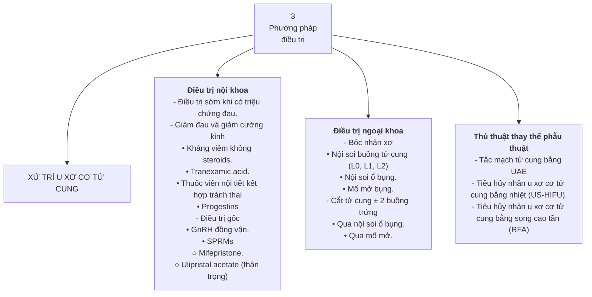

# HƯỚNG DẪN CHẨN ĐOÁN VÀ XỬ TRÍ U XƠ CƠ TỬ CUNG

**BỘ Y TẾ**

**CỘNG HOÀ XÃ HỘI CHỦ NGHĨA VIỆT NAM**
**Độc lập - Tự do - Hạnh phúc**

Số: 456 /QĐ-BYT

*Hà Nội, ngày 12 tháng 02 năm 2026*

**QUYẾT ĐỊNH**
**Về việc ban hành tài liệu chuyên môn**
**“Hướng dẫn chẩn đoán và xử trí u xơ cơ tử cung”**

**BỘ TRƯỞNG BỘ Y TẾ**

*Căn cứ Luật Khám bệnh, chữa bệnh số 15/2023/QH15;*

*Căn cứ Nghị định số 42/2025/NĐ-CP ngày 27 tháng 02 năm 2025 của Chính phủ quy định chức năng, nhiệm vụ, quyền hạn và cơ cấu tổ chức của Bộ Y tế;*

*Theo đề nghị của Cục trưởng Cục Bà mẹ và Trẻ em, Bộ Y tế.*

**QUYẾT ĐỊNH:**

**Điều 1.** Ban hành kèm theo Quyết định này tài liệu chuyên môn “Hướng dẫn chẩn đoán và xử trí u xơ cơ tử cung”.

**Điều 2**. Tài liệu chuyên môn “Hướng dẫn chẩn đoán và xử trí u xơ cơ tử cung” được áp dụng tại các cơ sở khám bệnh, chữa bệnh trong phạm vi toàn quốc.

**Điều 3.** Quyết định này có hiệu lực thi hành kể từ ngày ký, ban hành và thay thế Quyết định số 3780/QĐ-BYT ngày 26 tháng 8 năm 2019 của Bộ trưởng Bộ Y tế về việc phê duyệt tài liệu chuyên môn “Hướng dẫn lâm sàng xử trí u xơ cơ tử cung”.

**Điều 4.** Các ông, bà: Chánh Văn phòng Bộ, Cục trưởng và Vụ trưởng các Cục/Vụ thuộc Bộ Y tế; Thủ trưởng các đơn vị thuộc và trực thuộc Bộ Y tế; Giám đốc Sở Y tế các tỉnh, thành phố; Giám đốc các Bệnh viện Phụ Sản; Giám đốc các bệnh viện Sản Nhi; Giám đốc các bệnh viện đa khoa tỉnh, thành phố trực thuộc Trung ương; Giám đốc các bệnh viện, viện có giường bệnh trực thuộc Bộ Y tế; Thủ trưởng Y tế các ngành và các cơ quan, đơn vị có liên quan chịu trách nhiệm thi hành Quyết định này./.

***Nơi nhận***:
- Như Điều 4;
- Bộ trưởng (để b/c);
- Các Thứ trưởng;
- Cổng Thông tin điện tử Bộ Y tế;
- Website Cục Bà mẹ và Trẻ em;
- Hội Phụ Sản Việt Nam;
- Lưu: VT, BMTE.

**KT. BỘ TRƯỞNG**
**THỨ TRƯỞNG**

*(Đã ký)*

**Nguyễn Tri Thức**

---

**HƯỚNG DẪN CHẨN ĐOÁN VÀ XỬ TRÍ U XƠ CƠ TỬ CUNG**

*(Ban hành kèm theo quyết định số /QĐ-BYT ngày tháng năm 2026)*

*(Ghi chú biên tập: trang bìa bản gốc để trống số quyết định, ngày và tháng; giữ nguyên như bản gốc. Văn bản Quyết định ở trang 1 ghi số 456/QĐ-BYT ngày 12 tháng 02 năm 2026.)*

**Hà Nội, năm 2026**

---

**THAM GIA BIÊN SOẠN LẦN I**

**Chỉ đạo biên soạn**

- GS. TS. BS. Nguyễn Viết Tiến
- GS. BS. Nguyễn Thị Ngọc Phượng
- GS. TS. BS. Cao Ngọc Thành
- GS. TS. BS. Trần Thị Phương Mai
- THS.BS. Nguyễn Đức Vinh

**Tham gia biên soạn**

- GS. TS. BS. Trần Thị Lợi
- PGS. TS. BS. Lê Hồng Cẩm
- PGS. TS. BS. Lưu Thị Hồng
- THS. BS. Tống Trần Hà
- THS. BS. Nghiêm Thị Xuân Hạnh
- PGS. TS. BS. Nguyễn Vũ Quốc Huy
- TS. BS. Vương Thị Ngọc Lan
- THS. BS. Hồ Mạnh Tường
- PGS. TS. BS. Huỳnh Nguyễn Khánh Trang
- BS. CKII. Nguyễn Hữu Dự
- PGS. TS. BS. Trần Danh Cường
- PGS. TS. BS. Lê Hoàng
- PGS. TS. BS. Hồ Sỹ Hùng
- ThS. BS. Lê Quang Thanh
- TS. BS. Hoàng Thị Diễm Tuyết
- TS. BS. Trần Đình Vinh
- TS. BS. Huỳnh Thị Thu Thủy
- BS. CKII. Hoàng Thị Mỹ Ý
- THS. BS. Nguyễn Thị Quý Khoa
- PGS. TS. BS. Nguyễn Duy Ánh
- TS. BS. Vũ Văn Tâm
- BS. CKII. Nguyễn Bá Mỹ Nhi
- BS. CKI. Âu Nhựt Luân
- THS. BS. Đặng Quang Vinh
- TS. BS. Tạ Thị Thanh Thủy
- TS. BS. Bùi Chí Thương
- TS. BS. Trần Nhật Thăng

**THAM GIA BIÊN SOẠN LẦN II**

**Chỉ đạo biên soạn**

- PGS.TS. Nguyễn Tri Thức — Thứ trưởng Bộ Y tế
- THS.BS. Đinh Anh Tuấn — Cục trưởng Cục Bà mẹ và Trẻ em, Bộ Y tế

**Tham gia cập nhật**

- GS.TS. Nguyễn Viết Tiến — Chủ tịch Hội Phụ Sản Việt Nam, Phó Chủ tịch Hội đồng Y khoa Quốc gia
- GS.TS. Cao Ngọc Thành — Phó Chủ tịch Hội Phụ Sản Việt Nam
- GS.TS. Trần Thị Lợi — Phó Chủ tịch thường trực Hội Nội tiết sinh sản và Vô sinh Tp. Hồ Chí Minh
- GS.TS. Nguyễn Duy Ánh — Giám đốc Bệnh viện Phụ Sản Trung ương
- PGS.TS. Lưu Thị Hồng — Nguyên Vụ trưởng Vụ Sức khỏe Bà mẹ-Trẻ em, Bộ Y tế. Tổng Thư ký Hội Phụ Sản Việt Nam
- PGS.TS. Huỳnh Nguyễn Khánh Trang — Trưởng khối sản, Bệnh viện Hùng Vương
- BS.CKII. Nguyễn Bá Mỹ Nhi — Bệnh viện đa khoa Tâm Anh, Tp. HCM
- TS.BS. Trần Thị Thu Hạnh — Phó Trưởng khoa Phụ Nội tiết, Bệnh viện Phụ Sản Trung ương

**Tổ thư ký**

- THS.BS. Dương Thị Hải Ngọc — Chuyên viên chính, Cục Bà mẹ và Trẻ em
- THS.BS. Nghiêm Thị Xuân Hạnh — Chuyên viên chính, Cục Bà mẹ và Trẻ em
- CN. Trần Minh Nghĩa — Cán bộ Cục Bà mẹ và Trẻ em

---

**MỤC LỤC**

- I. ĐẠI CƯƠNG — 1
- II. DỊCH TỄ HỌC VÀ CÁC YẾU TỐ NGUY CƠ — 2
- III. PHÂN LOẠI — 3
- IV. TRIỆU CHỨNG LÂM SÀNG CỦA U XƠ CƠ TỬ CUNG — 4
  - 1\. Triệu chứng cơ năng — 5
  - 2\. Triệu chứng thực thể — 6
  - 3\. Triệu chứng của các biến chứng — 6
- V. CHẨN ĐOÁN U XƠ CƠ TỬ CUNG — 7
  - 1\. Chẩn đoán xác định — 7
  - 2\. Chẩn đoán phân biệt — 8
- VI. BIẾN CHỨNG CỦA U XƠ CƠ TỬ CUNG — 10
  - 1\. Xuất huyết tử cung bất thường — 10
  - 2\. Chèn ép — 10
  - 3\. Đau — 10
  - 4\. Thoái hóa — 11
  - 5\. Vô sinh — 11
  - 6\. Các biến chứng liên quan đến thai kỳ — 11
- VII. THEO DÕI, XỬ TRÍ CÁC TRƯỜNG HỢP U XƠ CƠ TỬ CUNG CHƯA CÓ CHỈ ĐỊNH CAN THIỆP NỘI - NGOẠI KHOA — 11
- VIII. ĐIỀU TRỊ NỘI KHOA U XƠ CƠ TỬ CUNG — 12
- IX. ĐIỀU TRỊ NGOẠI KHOA U XƠ CƠ TỬ CUNG — 15
  - 1\. Chỉ định: — 15
  - 2\. Chuẩn bị trước mổ — 15
  - 3\. Các phương pháp điều trị ngoại khoa — 16
    - *3.1\. Bóc u xơ cơ tử cung* — 16
    - *3.2\. Cắt tử cung* — 18
    - *3.3\. Một số phương pháp dùng để giảm mất máu trong phẫu thuật bóc UXCTC* — 20
- X. CÁC PHƯƠNG PHÁP ĐIỀU TRỊ ÍT VÀ KHÔNG XÂM LẤN — 21
  - 1\. Điều trị UXCTC bằng sóng siêu âm hội tụ cường độ cao (US – HIFU) — 21
  - 2\. Thuyên tắc động mạch tử cung — 23
  - 3\. MRI-HIFU — 24
  - 4\. Tiêu hủy UXCTC bằng sóng cao tần (Radiofrequency Ablation - RFA) — 24
- XI. U XƠ CƠ TỬ CUNG VÀ VÔ SINH — 25
- XII. U XƠ CƠ TỬ CUNG TRONG THAI KỲ — 26
  - 1\. Đại cương — 26
  - 2\. Ảnh hưởng của thai kỳ lên UXCTC — 26
  - 3\. Ảnh hưởng của UXCTC lên thai kỳ — 27
  - 4\. Triệu chứng của UXCTC trong thai kỳ — 27
  - 5\. Theo dõi và điều trị — 28
- PHỤ LỤC — 29

**DANH MỤC BẢNG VÀ HÌNH**

- Bảng 1. Phân loại UXCTC theo FIGO, 2011. — 4
- Hình 1. UXCTC qua siêu âm đường âm đạo. — 7
- Hình 2. Chẩn đoán phân biệt UXCTC và bệnh tuyến cơ tử cung (adenomyosis) trên siêu âm. — 8
- Bảng 2. Đặc điểm phân biệt UXCTC và bệnh tuyến cơ tử cung trên siêu âm — 9

**CÁC TỪ VIẾT TẮT VÀ THUẬT NGỮ**

|  |  |
|---|---|
| FIGO | Féderation Internationale de Gynécologie et d'Obstétrique -Liên đoàn sản phụ khoa thế giới |
| LNG-IUS | Dụng cụ tử cung có nội tiết levonorgestrel |
| MLT | Mổ lấy thai |
| MRI | Cộng hưởng từ |
| MRgFUS | Phương pháp tập trung các chùm siêu âm năng lượng cao (MRI Guided Focused Ultrasound) |
| NAIDS | Thuốc kháng viêm không Steroid |
| NĐMTC | Nút động mạch tử cung |
| NPV | Tỷ lệ thể tích không tưới máu |
| RFA | Radiofrequency Ablation (điều trị khối u bằng sóng cao tần) |
| TVTTKH | Thuốc viên tránh thai kết hợp |
| UIV | Urographie Intra Veineuse (Chụp hệ niệu cản quang) |
| UXCTC | U xơ cơ tử cung (leiomyoma) |
| US-HIFU | Sóng siêu âm hội tụ cường độ cao |

*(Ghi chú biên tập: bản gốc trình bày danh mục từ viết tắt dạng hai cột không kẻ khung, không có tiêu đề cột; hàng tiêu đề để trống. “NAIDS” giữ nguyên như bản gốc — thân văn bản dùng cả “NSAIDS” (tr.14) lẫn “NAIDS” (tr.36).)*

---

**LỜI NÓI ĐẦU**

U xơ cơ tử cung (UXCTC) là một bệnh lý phổ biến ở phụ nữ. Tuy là một loại khối u lành tính nhưng UXCTC có thể gây những biến chứng nguy hiểm như chèn ép gây đau, băng kinh, rong huyết, hoặc hoại tử, nhiễm trùng… làm ảnh hưởng đến sức khỏe, chất lượng cuộc sống của người phụ nữ. Nghiêm trọng hơn, UXCTC còn có thể là nguyên nhân dẫn đến tình trạng vô sinh, hiếm muộn hoặc gây ra những biến chứng nặng nề trong thai kỳ như sảy thai, đẻ non.

Để giúp cho các bác sỹ lâm sàng có được một tài liệu chuyên môn về chẩn đoán và xử trí UXCTC, ngày 26 tháng 8 năm 2019, Bộ trưởng Bộ Y tế đã có Quyết định số 3780/QĐ-BYT ban hành Hướng dẫn lâm sàng xử trí u xơ cơ tử cung. Tuy nhiên, trong thời gian qua trên thế giới và trong nước đã có nhiều tiến bộ khoa học, kỹ thuật được ứng dụng trong theo dõi, chẩn đoán cũng như điều trị UXCTC. Trước tình hình đó, Cục Bà mẹ và trẻ em đã chủ trì, phối hợp với Hội Phụ Sản Việt Nam và các bệnh viện chuyên ngành sản phụ khoa tiến hành nghiên cứu các tiến bộ trong nước và quốc tế, cập nhật tài liệu Hướng dẫn chẩn đoán và điều trị u xơ cơ tử cung.

Được biên soạn bởi các chuyên gia, các nhà khoa học hàng đầu trong lĩnh vực sản phụ khoa dựa trên những bằng chứng khoa học trong nước và trên thế giới, tài liệu được ban hành lần này sẽ cung cấp cho các thầy thuốc, nhân viên y tế chuyên ngành phụ sản những kiến thức khoa học, phương pháp, kỹ thuật mới, tiên tiến trong chẩn đoán và điều trị UXCTC.

Nhân dịp tài liệu được cập nhật và ban hành lần thứ hai, Cục Bà mẹ và Trẻ em, Bộ Y tế xin trân trọng gửi lời cảm ơn tới Ban Chấp hành Hội sản phụ khoa Việt Nam, các Bệnh viện được Bộ Y tế giao chỉ đạo tuyến chuyên ngành sản phụ khoa, các chuyên gia trong Ban biên soạn đã nỗ lực phối hợp trong việc biên soạn và hoàn thiện tài liệu. Dù đã cố gắng đưa vào tài liệu những tiến bộ khoa học, kỹ thuật cập nhật nhất về UXCTC, tuy nhiên cũng không thể tránh được hết những thiếu sót trong quá trình soạn thảo và biên tập, chúng tôi mong tiếp tục nhận được những ý kiến đóng góp quý báu của các đồng nghiệp xa gần để tài liệu được hoàn thiện hơn trong những lần cập nhật sau. Mọi ý kiến đóng góp xin gửi về địa chỉ: *Cục Bà mẹ và Trẻ em, Bộ Y tế, số 35 Trần Phú, Ba Đình, Hà Nội.*

Xin trân trọng cảm ơn!

**ThS.BS. Đinh Anh Tuấn**
**Cục trưởng Cục Bà mẹ và Trẻ em**

---

**HƯỚNG DẪN CHẨN ĐOÁN VÀ XỬ TRÍ U XƠ CƠ TỬ CUNG**

## I. ĐẠI CƯƠNG

U xơ cơ tử cung (leiomyoma − UXCTC), trước đây thường được gọi theo u xơ tử cung, là khối u lành tính không rõ nguyên nhân do sự phát triển quá mức của sợi cơ trơn và mô liên kết ở tử cung. Bệnh có khuynh hướng di truyền.

UXCTC thường không có triệu chứng, được phát hiện tình cờ qua khám hay siêu âm. Trong một số trường hợp u xơ gây biến chứng như cường kinh gây thiếu máu, đau vùng chậu, triệu chứng chèn ép… UXCTC có biến chứng gây ảnh hưởng đến chất lượng cuộc sống và ảnh hưởng đến khả năng sinh sản của người phụ nữ. Do thường không có triệu chứng nên không xác định được chính xác tần suất UXCTC trong dân số chung. Tỷ lệ mới mắc của UXCTC tăng theo tuổi, khoảng **20 - 50%** nếu phụ nữ trên 30 tuổi ước tính tỷ lệ mới mắc ở phụ nữ 50 tuổi là **70 %**.

Chẩn đoán UXCTC dựa vào hỏi tiền sử, khám lâm sàng và chẩn đoán hình ảnh. Cần chẩn đoán phân biệt với **sarcoma tử cung**. Trong tổng số các trường hợp được cắt tử cung vì nhiều lý do, tỷ lệ sarcoma cơ trơn thân tử cung khoảng **0,26%** bằng với tần suất **0,27%** khi dân số được khảo sát là phụ nữ có khối u vùng chậu phát triển nhanh. Như vậy, một UXCTC đã được phát hiện từ lâu đột ngột lớn nhanh ở người phụ nữ tuổi mãn kinh hay mới xuất hiện khi đã mãn kinh là một dấu hiệu nghi ngờ ác tính cao.

UXCTC không có triệu chứng, không cần can thiệp. Không nên điều trị dự phòng để tránh biến chứng trong tương lai, vì không có yếu tố tiên lượng đáng tin cậy về sự tiến triển của UXCTC. Trong một số trường hợp có thể điều trị dự phòng, ngăn sẩy thai ở UXCTC dưới niêm mạc (nếu người này dự định mang thai) và u xơ nằm trong dây chằng rộng gây tắc nghẽn đường tiết niệu đưa đến thận ứ nước.

UXCTC có triệu chứng (ra huyết âm đạo bất thường, đau, chèn ép) cần được điều trị. Phương thức và thời gian điều trị dựa trên một số yếu tố ảnh hưởng như: phân loại UXCTC, mức độ triệu chứng, kích thước, vị trí, số lượng khối u xơ, tuổi người bệnh, kế hoạch sinh sản và tiền sử sản khoa, tình trạng bệnh nội khoa kèm theo, nguy cơ thoái hóa ác tính, tình trạng sắp mãn kinh và mong muốn bảo tồn tử cung của người phụ nữ. Trong những năm qua UXCTC là một trong các chỉ định thường gặp nhất cho cắt tử cung trên toàn cầu. Tuy nhiên, cắt tử cung gây nhiều biến chứng cũng như tăng gánh nặng kinh tế cho người bệnh.

Các thụ thể của estrogen (ER) và của progesterone (PR) thường được tìm thấy trên các sợi cơ của UXCTC nhiều hơn là trên các sợi cơ bình thường của tử cung. Như vậy cả hai hormones steroids, estrogen và progesterone đều có ảnh hưởng lên sự phát triển của UXCTC. Nếu bị cắt nguồn steroids, hầu hết các u xơ sẽ có chiều hướng thoái triển. Progesterone đóng vai trò quan trọng trong sự phát triển của UXCTC. Dựa trên đặc tính đó, điều trị nội khoa bằng cách điều hòa các thụ thể của hormones steroids đóng vai trò quan trọng trong điều trị UXCTC. Xuất phát từ những phương pháp điều trị mới ra đời đã được nghiên cứu và có những chứng cứ y học mức độ cao, hướng dẫn lâm sàng dành riêng cho xử trí u xơ cơ tử cung được ra đời.

Nội dung của hướng dẫn sẽ bao gồm: theo dõi không điều trị, điều trị nội khoa, điều trị ngoại khoa, đặc biệt với u xơ dưới niêm mạc, u xơ ảnh hưởng đến khả năng sinh sản và thai kỳ.

Mục tiêu của hướng dẫn thực hành lâm sàng xử trí UXCTC là đưa ra các khuyến nghị trong chẩn đoán và điều trị cho bệnh nhân UXCTC tại Việt Nam, dựa trên các bằng chứng y khoa và kinh nghiệm lâm sàng hiện có, nhằm đưa đến cách xử trí thống nhất trong ngành sản phụ khoa Việt Nam.

## II. DỊCH TỄ HỌC VÀ CÁC YẾU TỐ NGUY CƠ

UXCTC là khối u lành tính của tử cung phổ biến nhất ở phụ nữ. Đa số các trường hợp UXCTC không có biểu hiện lâm sàng. Uớc tính chỉ có khoảng **25%** UXCTC có biểu hiện lâm sàng ở phụ nữ trong độ tuổi sinh sản và khoảng **25%** trong số đó có triệu chứng nặng cần điều trị.

Tỉ lệ mới mắc UXCTC là **217 – 3.745/100.000** mỗi năm và tỉ lệ hiện mắc **4,5 – 68,6%**. Các tỉ lệ này dao động rất nhiều, phụ thuộc vào phương pháp nghiên cứu và dân số nghiên cứu (đa số các nghiên cứu được tiến hành ở đối tượng phụ nữ có biểu hiện triệu chứng hoặc sau phẫu thuật).

Có nhiều yếu tố nguy cơ làm gia tăng tỉ lệ phát sinh UXCTC bao gồm:

***Tuổi***: Tần suất xuất hiện UXCTC tăng theo tuổi. Phụ nữ trên 40 tuổi có nguy cơ bị UXCTC cao hơn 4 lần phụ nữ dưới 40 tuổi. Phụ nữ ở nhóm tuổi 41 – 50 và nhóm tuổi từ 51 – 60 có nguy cơ phát hiện UXCTC cao hơn 10 lần nhóm tuổi 21-30. Ngoài ra, khi tuổi của người phụ nữ gia tăng thì UXCTC cũng thường có kích thước lớn hơn, số lượng u xơ cũng nhiều hơn và tỉ lệ phải nhập viện vì UXCTC cũng cao hơn. Điều này phản ánh diễn tiến tự nhiên theo thời gian của UXCTC. Tuy nhiên, tỉ lệ mắc bệnh sẽ giảm ở nhóm phụ nữ tuổi mãn kinh.

***Chủng tộc***: Tỉ lệ mới mắc UXCTC không khác biệt giữa người da trắng, châu Á và Mỹ Latin. Tuy nhiên, người da đen có nguy cơ phát triển UXCTC cao hơn 2 đến 3 lần. Ngoài ra, nguy cơ suốt đời đối với UXCTC là gần 70% ở người da trắng, và trên 80% ở người da đen. Phụ nữ da đen thường được chẩn đoán UXCTC ở độ tuổi trẻ hơn, u xơ thường nhiều và lớn hơn, đồng thời cũng gây ra các triệu chứng nghiêm trọng hơn ở các nhóm chủng tộc khác. Những khác biệt này phần nào gợi ý sự khác nhau về sinh tổng hợp estrogen, chuyển hóa và di truyền.

***Tiền sử gia đình***: Tiền sử gia đình bị UXCTC làm tăng nguy cơ cho người phụ nữ hơn 3 lần.

***Các yếu tố di truyền***: Một số gene (như MED12, HMGA2, CYP1A1, và CYP1B1) và các bất thường nhiễm sắc thể (trisomy 12; đảo đoạn 12q, 6p, 10q, 13q; và mất đoạn 7q, 3q, 1p) được tìm thấy có liên quan đến sự hình thành và phát triển của UXCTC.

***Khoảng cách sinh con***: Một số nghiên cứu cho thấy khoảng cách sinh từ 5 năm trở lên làm tăng nguy cơ phát triển UXCTC lên 2-3 lần.

***Giai đoạn tiền mãn kinh***: có nguy cơ bị UXCTC cao hơn đến 10 lần giai đoạn mãn kinh. Đồng thời, tỉ lệ UXCTC có triệu chứng cũng cao hơn 3 lần.

***Rối loạn chuyển hóa***: Béo phì, kháng insulin, hội chứng buồng trứng đa nang, tăng lipid máu, tăng huyết áp… là những yếu tố gây ra hội chứng chuyển hóa và đều góp phần làm gia tăng nguy cơ phát triển UXCTC. Riêng phụ nữ có bệnh lý tăng huyết áp có thể làm gia tăng gần 5 lần nguy cơ phát triển UXCTC so với phụ nữ không tăng huyết áp.

***Lối sống và chế độ ăn uống***: cũng có thể liên quan đến nguy cơ gia tăng UXCTC, tuy nhiên rất khó nghiên cứu và đánh giá vì có nhiều yếu tố nhiễu. Ít hoạt động thể chất và nhiều stress làm gia tăng nguy cơ bị UXCTC. Các loại thực phẩm chứa nhiều acid béo nguồn gốc động vật, sử dụng nhiều thịt bò, thịt đỏ, thiếu vitamin D, tiêu thụ nhiều thức uống có cồn, caffeine có nguy cơ làm gia tăng tỉ lệ UXCTC.

***Các chất phụ gia***: sử dụng trong chế biến và bảo quản thực phẩm làm tăng nguy cơ phát triển UXCTC đến 3 lần.

Bên cạnh đó, cũng có rất nhiều yếu tố được coi là yếu tố bảo vệ như mang thai và sinh con nhiều lần, hoạt động thể chất thường xuyên, ăn nhiều cá và rau xanh, trái cây, vitamin A có nguồn gốc động vật.

## III. PHÂN LOẠI

UXCTC được phân loại theo hai cách, theo tính chất và theo vị trí khối u.

***Theo tính chất***, u xơ có 2 dạng: không triệu chứng và có triệu chứng. Hầu hết UXCTC thuộc dạng không triệu chứng, thường không cần điều trị. UXCTC có triệu chứng cần được điều trị và theo dõi.

***Theo vị trí***, hiện nay, hệ thống phân loại UXCTC của Hiệp hội Sản Phụ khoa Quốc tế FIGO năm 2011 được sử dụng phổ biến nhất. Phân loại được mô tả chi tiết tại Bảng 1.

Các UXCTC **L0, L1, L2** thường gây triệu chứng xuất huyết tử cung bất thường, có thể là nguyên nhân của vô sinh và sẩy thai. Nhóm này cần được điều trị bằng phương pháp nội soi buồng tử cung.

UXCTC **L3** cũng có thể gây triệu chứng xuất huyết tử cung bất thường hoặc không. Điều trị nhóm này thường ưu tiên dùng thuốc để làm giảm kích thước khối u trước khi mang thai.

Các UXCTC **L4-8** thường không gây xuất huyết tử cung bất thường. U xơ nhóm này cần điều trị khi kích thước to hoặc u chèn ép gây thận ứ nước hoặc bí tiểu hoặc táo bón. Có thể cân nhắc điều trị nội khoa hoặc phẫu thuật bóc u đối với phụ nữ còn nguyện vọng mang thai.

**Bảng 1. Phân loại UXCTC theo FIGO, 2011.**

|  |  |  |
|---|---|---|
| **UXCTC Dưới niêm mạc** | 0 | Có cuống, trong buồng tử cung |
| **UXCTC Dưới niêm mạc** | 1 | > 50% trong buồng tử cung |
| **UXCTC Dưới niêm mạc** | 2 | ≤ 50% trong buồng tử cung |
| **O – Khác** | 3 | Dưới niêm mạc nhưng 100% trong cơ tử cung |
| **O – Khác** | 4 | Hoàn toàn nằm trong cơ tử cung |
| **O – Khác** | 5 | Dưới thanh mạc, ≥ 50% trong cơ tử cung |
| **O – Khác** | 6 | Dưới thanh mạc, < 50% trong cơ tử cung |
| **O – Khác** | 7 | Dưới thanh mạc, có cuống |
| **O – Khác** | 8 | Vị trí khác (cổ tử cung, các cơ quan quanh tử cung) |
| | | Nếu u xơ nằm trọn trong cơ và lồi ra dưới niêm và dưới thanh mạc, có thể có 2 số chỉ vị trí khối u, 2–5, cách nhau bằng 1 gạch nối. Theo quy ước, số đầu chỉ khối u gần niêm mạc, số sau chỉ khối u gần thanh mạc. |
| | UXCTC (L2-5) | Dưới niêm mạc và dưới thanh mạc (< 50% nằm trong lòng tử cung và < 50% lồi ra dưới thanh mạc, hướng vào ổ bụng). |

*(Ghi chú biên tập: bản gốc không có hàng tiêu đề cột; hàng tiêu đề để trống. Cột đầu là ô gộp theo nhóm (“UXCTC Dưới niêm mạc” cho ba hàng đầu; “O – Khác” cho sáu hàng tiếp theo), lặp lại ở mỗi hàng. Đoạn “Nếu u xơ nằm trọn trong cơ…” là ô gộp trải hai cột “Loại” và “Mô tả”, ghi ở cột “Mô tả”. Ở hai hàng cuối, cột đầu để trống như bản gốc. Trong ô nhóm “O – Khác” có hình minh họa.)*

*(Hình: sơ đồ tử cung minh họa vị trí các loại u xơ theo FIGO, trong ô “O – Khác” của Bảng 1 — các vòng tròn đánh số “0”, “1”, “2”, “3”, “4”, “5”, “6”, “7” và “2-5” đặt ở các vị trí tương ứng quanh buồng tử cung và thành tử cung.)*

## IV. TRIỆU CHỨNG LÂM SÀNG CỦA U XƠ CƠ TỬ CUNG

UXCTC thường nhỏ và không có triệu chứng nên thường được phát hiện tình cờ thông qua thăm khám, siêu âm phụ khoa. Tuy nhiên, nhiều phụ nữ có UXCTC cũng gặp nhiều vấn đề làm ảnh hưởng cuộc sống như xuất huyết tử cung bất thường, đau bụng hay vô sinh. Những triệu chứng của UXCTC thường liên quan đến số lượng, kích thước và vị trí của khối UXCTC.

### 1. Triệu chứng cơ năng

Những triệu chứng của UXCTC gồm rong kinh, cường kinh, bụng to, cảm giác trằn nặng vùng hạ vị, đau, tiểu khó, táo bón.

Trong số các triệu chứng bất thường do UXCTC gây ra thì xuất huyết tử cung bất thường là triệu chứng phổ biến nhất, chiếm **26 – 29%**, các triệu chứng khác chiếm tỷ lệ ít hơn.

***Ra kinh nhiều hoặc kéo dài*** là triệu chứng xuất huyết tử cung bất thường điển hình nhất trong UXCTC và là triệu chứng thường gặp nhất do UXCTC gây ra. Tình trạng của xuất huyết tử cung bất thường phụ thuộc nhiều nhất vào vị trí khối u, sau đó là đến kích thước khối u:

- UXCTC dưới niêm mạc nhô vào trong lòng tử cung, dù nhỏ (như L0, L1, L2 theo phân loại FIGO 2011), thường liên quan với tình trạng chảy máu kinh nhiều.
- UXCTC trong cơ tử cung cũng có thể gây ra tình trạng chảy máu kinh nhiều hoặc kéo dài nhưng UXCTC dưới thanh mạc thường không được xem là nguyên nhân chính gây ra tình trạng này.
- UXCTC ở cổ tử cung nếu nằm gần kênh cổ tử cung cũng có thể gây ra tình trạng xuất huyết tử cung bất thường. UXCTC ở cổ tử cung thường gây giao hợp đau.

***Triệu chứng do chèn ép*** thay đổi nhiều, phụ thuộc vào kích thước, hình dạng và vị trí các khối UXCTC. Những triệu chứng này bao gồm cảm giác khó chịu hay đau vùng chậu, thận ứ nước nếu chèn ép niệu quản, bí tiểu hoặc đi tiểu khó nếu chèn ép bàng quang hay cổ bàng quang, táo bón nếu chèn ép trực tràng, chèn ép tĩnh mạch.

- *Cảm giác khó chịu, đau vùng chậu*: Cảm giác trằn nặng, đau vùng chậu âm ỉ thường gặp ở phụ nữ bị UXCTC to. Tuy nhiên, triệu chứng này ít xuất hiện hơn xuất huyết tử cung bất thường.
- *Đau bụng kinh*: được ghi nhận ở nhiều phụ nữ có UXCTC. Tình trạng đau bụng kinh này thường xuất hiện kèm hiện tượng chảy máu kinh nhiều, có máu đông.
- *Đau khi giao hợp*: hiện còn là một triệu chứng chưa rõ có mối liên quan với UXCTC hay không. Tuy nhiên, những trường hợp có UXCTC nằm ở thành trước, ở cổ tử cung, hoặc ở vùng đáy có thể có cảm giác đau sâu khi giao hợp.
- *Đau lưng*: triệu chứng đau lưng cũng có thể xuất hiện trong UXCTC, cần loại trừ các nhóm bệnh lý khác có thể gây ra triệu chứng này.

Trong một nghiên cứu đoàn hệ nhỏ cho thấy trong **14%** trường hợp phụ nữ có UXCTC xuất hiện tình trạng thận ứ nước, thường ở bên phải, có thể do UXCTC nằm trong dây chằng rộng, chèn ép phải niệu quản phải. Kích thước UXCTC lớn nhất trung bình khoảng **6 cm** và kích thước cả tử cung khoảng thai **18 tuần** thường có sự liên quan với tình trạng thận ứ nước.

- *Chèn ép tĩnh mạch*: UXCTC rất lớn có thể chèn ép tĩnh mạch chủ và làm tăng nguy cơ tắc mạch do huyết khối. Nghiên cứu đã chứng minh nguy cơ thuyên tắc tĩnh mạch do huyết khối do UXCTC to cao hơn nguy cơ sau phẫu thuật
- *Đau bụng*: UXCTC thoái hóa hoặc xoắn (thường là UXCTC L7) cũng có thể gây ra triệu chứng đau bụng cấp tính. Đau bụng vùng chậu do UXCTC thoái hóa thường có thể xuất hiện kèm triệu chứng sốt nhẹ, tử cung đau khi sờ chạm, tăng bạch cầu, hoặc dấu cảm ứng phúc mạc. Đặc biệt, UXCTC trong thai kỳ thường to nhanh, mạch máu nuôi tăng trưởng theo không kịp đưa đến hoại tử vô trùng, đau rất nhiều và kéo dài. Tình trạng đau bụng do UXCTC thoái hóa thường giới hạn trong vài ngày đến vài tuần và đáp ứng với thuốc giảm đau kháng viêm không Steroid (NSAIDS). Chẩn đoán UXCTC thoái hóa thường dựa theo sự tồn tại của UXCTC cùng các triệu chứng điển hình. Khi siêu âm, triệu chứng đau khi quét đầu dò trực tiếp vùng UXCTC là triệu chứng giúp định hướng chẩn đoán. Trong trường hợp không rõ chẩn đoán, chụp cộng hưởng tử (MRI) vùng chậu có thể được sử dụng với gadolinium giúp việc chẩn đoán có thể rõ hơn thông qua dấu hiệu vùng UXCTC thoái hóa không tăng độ tương phản khi sử dụng gadolinium. Trong trường hợp đau bụng cấp tính nghi ngờ do UXCTC thoái hóa và có chỉ định phẫu thuật, thì cần loại trừ cẩn thận các bệnh lý khác có thể gây tình trạng đau vùng chậu cấp như lạc nội mạc tử cung, cơn đau quặn thận, hay các bệnh lý ít gặp như lao vùng chậu.

### 2. Triệu chứng thực thể

***Sốt***: hiếm gặp, thường chỉ gặp trong trường hợp UXCTC thoái hóa.

***Thiếu máu***: xuất hiện khi tình trạng xuất huyết tử cung nặng và/hoặc kéo dài, có thể gây ảnh hưởng sinh hiệu (mạch nhanh, huyết áp tụt) nhưng hiếm, thường gặp hơn là tình trạng da xanh, niêm nhợt. Có thể sử dụng xét nghiệm tổng phân tích máu toàn bộ để đánh giá chính xác hơn mức độ thiếu máu.

***Khám mỏ vịt***: có thể thấy khối UXCTC tại cổ ngoài cổ tử cung hoặc thấy UXCTC dưới niêm mạc nằm nhô ra ngoài cổ tử cung, thường được chẩn đoán phân biệt với polyp nội mạc tử cung bằng độ chắc của khối u và giải phẫu bệnh lý.

Nên khám kỹ để đánh giá kích thước, vị trí, độ di động của khối UXCTC, khi khám nên kết hợp khám tay trong âm đạo và tay ngoài thành bụng.

- Kích thước của tử cung có UXCTC khi thăm khám thường được ước tính tương đương với kích thước một tử cung khi mang thai sống.
- Một tử cung to, di động với đường viền không đều, cảm giác nhiều khối nhỏ lổn nhổn trên bề mặt là một tử cung đa nhân xơ.
- Tử cung to nhưng ít di động hoặc không di động, chúng ta nên nghĩ tới tình trạng viêm nhiễm hoặc kết hợp với lạc nội mạc tử cung.

### 3. Triệu chứng của các biến chứng

***Vô sinh*** là tình trạng có thể gặp phải thường liên quan với khối UXCTC làm biến dạng lòng tử cung như UXCTC dưới niêm mạc hoặc UXCTC trong cơ tử cung có một phần nhô vào buồng tử cung. Những cấu trúc này dù nhỏ, cũng có thể là nguyên nhân làm cản trở quá trình thụ thai cũng như tăng nguy cơ sẩy thai, sẩy thai liên tiếp. *( xem phần “UXCTC và vô sinh”)*

***Biến chứng sản khoa***: UXCTC cũng đã được chứng minh là làm tăng các biến chứng sản khoa như rau/nhau bong non, thai chậm tăng trưởng trong tử cung, ngôi thai bất thường và sinh non. *(xem phần “UXCTC trong thai kỳ”)*

***Thoái hóa ác tính***: rất hiếm gặp. Nên nghĩ tới tình trạng UXCTC thoái hóa ác tính khi khối u to nhanh, nhất là trên phụ nữ tuổi mãn kinh. Siêu âm có thể thấy tình trạng xuất huyết hoặc hoại tử. *(xem phần “Biến chứng của UXCTC”)*

## V. CHẨN ĐOÁN U XƠ CƠ TỬ CUNG

### 1. Chẩn đoán xác định

***Dựa trên triệu chứng lâm sàng***

Hầu hết trường hợp UXCTC đều không biểu hiện triệu chứng và được chẩn đoán tình cờ khi khám phụ khoa và siêu âm vùng chậu. Tuy nhiên cũng có những trường hợp UXCTC gây triệu chứng rầm rộ trên lâm sàng như xuất huyết tử cung bất thường, đau vùng chậu, thiếu máu.

Chẩn đoán UXCTC trên khám lâm sàng dựa trên các dấu hiệu thường gặp bao gồm: (1) tử cung to, phát triển chậm (2) xuất huyết tử cung bất thường (rối loạn kinh nguyệt, ra kinh nhiều hoặc kéo dài), (3) đau, căng tức vùng chậu do thoái hóa hay do chèn ép các cơ quan xung quanh gây đi tiểu khó, bí tiểu, táo bón, thận ứ nước, (4) sẩy thai liên tiếp.

***Dựa trên chẩn đoán hình ảnh***

*Siêu âm đường âm đạo*: là kỹ thuật hình ảnh đầu tay trong chẩn đoán UXCTC. Đặc điểm của UXCTC điển hình trên siêu âm bao gồm: khối u giới hạn rõ, hình cầu, có thể có dấu calcium hóa, phân bố mạch máu viền quanh tổn thương trên siêu âm doppler.

*(Hình: Hình 1. UXCTC qua siêu âm đường âm đạo.)* — ảnh siêu âm hai khung cạnh nhau: khung trái thang xám, khung phải siêu âm doppler màu với các tín hiệu mạch máu viền quanh tổn thương; dải chữ trên ảnh: “UXTC/PK”, “BENH VIEN MY DUC”, “TIEU MY”, “26.06.2019”.

**Hình 1. UXCTC qua siêu âm đường âm đạo.**

*Siêu âm đường bụng*: giúp đánh giá tổng quát vùng chậu, đếm số lượng khối u, quan sát các khối u lớn. Ngoài ra, siêu âm đường bụng còn có thể giúp đánh giá biến chứng chèn ép niệu quản, bàng quang, trực tràng.

*Siêu âm doppler*: đánh giá phân bố mạch máu trong UXCTC, chẩn đoán phân biệt dạng phân bố xuyên tổn thương trong bệnh tuyến cơ tử cung (adenomyosis). Ngoài ra, siêu âm doppler đánh giá chỉ số đập (PI) và chỉ số kháng trở (RI) động mạch cũng giúp ích trong chẩn đoán phân biệt UXCTC và bệnh tuyến cơ tử cung.

*Siêu âm bơm nước buồng tử cung*: thường chỉ định trong chẩn đoán UXCTC dưới niêm mạc (L 0-2 theo phân loại của FIGO).

Trong trường hợp UXCTC không điển hình, không thể chẩn đoán xác định hoặc cần chẩn đoán phân biệt với bệnh tuyến cơ tử cung có thể sử dụng cộng hưởng từ (MRI). Phần lớn những trường hợp không thể phân biệt UXCTC và bệnh tuyến cơ tử cung trên siêu âm là dạng kết hợp cả hai bệnh lý. MRI còn có ưu điểm là giúp đánh giá tổng quát các cơ quan vùng chậu, phát hiện bệnh lý đi kèm hoặc biến chứng.

### 2. Chẩn đoán phân biệt

Cần chẩn đoán UXCTC và các bệnh lý sau:

- Tử cung to do có thai.
- Polyp nội mạc tử cung (trường hợp UXCTC dưới niêm mạc).
- Khối u buồng trứng (trường hợp UXCTC dưới thanh mạc có cuống).
- Leiomyosarcoma: sarcoma tử cung được chẩn đoán xác định dựa trên kết quả giải phẫu bệnh. Chẩn đoán lâm sàng sarcoma tử cung thật sự là một thách thức, bởi sự biệt hóa đa dạng của sarcoma, dấu hiệu lâm sàng nghèo nàn, không đặc hiệu. Cần đặc biệt lưu ý trường hợp UXCTC đột ngột tăng nhanh kích thước hoặc mới xuất hiện trên phụ nữ tuổi mãn kinh.

Đặc điểm của sarcoma tử cung trên siêu âm thường là khối đặc với phản âm không đồng nhất; kèm tăng sinh mạch máu mức độ trung bình trở lên.

Về chẩn đoán hình ảnh, cần chẩn đoán phân biệt UXCTC và bệnh tuyến cơ tử cung:

*(Hình: Hình 2. Chẩn đoán phân biệt UXCTC và bệnh tuyến cơ tử cung (adenomyosis) trên siêu âm.)* — bốn khung ảnh siêu âm đánh nhãn A, B, C, D (A và B là một ảnh ghép có dải chữ “UXTC/PK”, “BENH VIEN MY DUC”, “TIEU MY”, “26.06.2019”; C và D là một ảnh ghép có dải chữ “Adenomyosis lan toa”, “BENH VIEN MY DUC”, “TIEU MY”, “26.06.2019”).

**Hình 2. Chẩn đoán phân biệt UXCTC và bệnh tuyến cơ tử cung (adenomyosis) trên siêu âm.**

A: phân bố mạch máu quanh UXCTC trên siêu âm doppler

B: UXCTC trên siêu âm thang xám ngả âm đạo

C: bệnh tuyến cơ tử cung (adenomyosis) trên siêu âm thang xám ngả âm đạo

D: phân bố mạch đâm xuyên qua tổn thương (mạch lưới) bệnh tuyến cơ tử cung (adenomyosis) trên siêu âm doppler

**Bảng 2. Đặc điểm phân biệt UXCTC và bệnh tuyến cơ tử cung trên siêu âm**

| Đặc điểm | UXCTC điển hình | Bệnh tuyến cơ tử cung (Adenomyosis) |
|---|---|---|
| Đường bờ thanh mạc tử cung | Phân thùy hoặc bờ đều | Tử cung hình cầu, tăng kích thước. |
| Giới hạn tổn thương | Giới hạn rõ | Giới hạn không rõ. |
| Sự đồng nhất của thành tử cung | Thành tử cung không đồng nhất trong vùng tổn thương giới hạn rõ | Thành trước – sau cơ tử cung không đồng nhất. |
| Đường bờ tổn thương | Giới hạn rõ, trơn láng | Bờ không rõ, không đồng nhất. |
| Hình dạng | Tròn, oval, phân thùy | Không có hình dạng nhất định. |
| Viền tổn thương | Phản âm kém hoặc dày | Không có viền tổn thương. |
| Bóng (lưng) | Bóng lưng ở bờ hoặc bên trong tổn thương (thường có hình rẻ quạt) | Không có bóng lưng ở bờ tổn thương, bóng lưng hình rẻ quạt. |
| Độ hồi âm | Đồng nhất: có thể đồng âm, giảm âm hoặc tăng âm. Không đồng nhất: phản âm hỗn hợp. | Không đồng nhất: phản âm hỗn hợp. Nhiều nang, nhiều vùng tăng âm, nhiều đường phản âm sọc dưới niêm mạc tử cung. |
| Phân bố mạch máu | Quanh tổn thương | Mạch đâm xuyên qua tổn thương (mạch lưới). |
| **Vùng nối** | | |
| Dày vùng nối, tính đồng nhất | Không dày, đều hoặc không quan sát thấy. | Dày vùng nối, không đều hoặc giới hạn không rõ. |
| Vùng nối gián đoạn | Mất liên tục hoặc giãn ở vùng có UXCTC L1-3 theo FIGO. | Vùng nối mất liên tục (ngay cả khi không quan sát thấy tổn thương khu trú). |

## VI. BIẾN CHỨNG CỦA U XƠ CƠ TỬ CUNG

Hầu hết phụ nữ có UXCTC nhỏ không có triệu chứng. UXCTC to, gây chèn ép, gây xuất huyết tử cung bất thường làm cho phụ nữ lo lắng và đến khám phụ khoa.

### 1. Xuất huyết tử cung bất thường

Xuất huyết tử cung bất thường là biến chứng thường gặp nhất, do UXCTC nằm trong buồng tử cung hay nhô ra làm biến dạng buồng tử cung (L0, L1, L2). Các hình thái xuất huyết tử cung bất thường thường gặp là cường kinh (khoảng **30%**), rong kinh và xuất huyết giữa chu kỳ kinh. Cơ chế xuất huyết tử cung bất thường do UXCTC vẫn chưa được hiểu rõ, giải thích được chấp nhận nhiều nhất là tăng diện tích bề mặt niêm mạc, bất thường mạch máu tử cung kết hợp với sự thay đổi hệ thống cầm máu tại nội mạc tử cung.

Mức độ xuất huyết phụ thuộc vào vị trí hơn là kích thước khối u. UXCTC dưới niêm mạc (L0, L1, L2) dù nhỏ nhưng vẫn có thể gây cường kinh.

UXCTC dưới niêm mạc có thể giải quyết bằng phẫu thuật nội soi buồng tử cung (L0, L1, L2) hay điều trị nội khoa (L2, L3) bằng thuốc điều hòa thụ thể progesterone có chọn lọc; thuốc ngừa thai; GnRH đồng vận; LNG-IUS (vòng Mirena) sau khi đã cắt bỏ UXCTC L0 và L1; Tranexamic acid.

### 2. Chèn ép

UXCTC có thể to lên và chèn ép các cơ quan lân cận trong vùng chậu. Chèn ép niệu quản gây thận ứ nước, chèn ép bàng quang gây rối loạn đi tiểu hoặc chèn ép trực tràng gây nên táo bón. Các triệu chứng liên quan đến tiểu tiện nên được thăm khám và loại trừ các nguyên nhân khác trước khi kết luận các triệu chứng này liên quan đến UXCTC. Một số ít trường hợp khối UXCTC to chèn ép tĩnh mạch vùng chậu, dẫn đến sự ứ máu tại vùng chậu và dẫn đến thuyên tắc mạch. UXCTC gặp ở độ tuổi tiền mãn kinh có nguy cơ liên quan đến thuyên tắc huyết khối tĩnh mạch sâu và thuyên tắc phổi.

### 3. Đau

Đau do UXCTC ít gặp và thường liên quan đến thoái hóa. Đau cũng có thể do UXCTC có cuống xoắn và có thể kết hợp với bệnh tuyến cơ tử cung (adenomyosis) và/hoặc lạc nội mạc tử cung. Đau do UXCTC không đáp ứng với điều trị nội khoa cũng là một trong những chỉ định của điều trị ngoại khoa.

### 4. Thoái hóa

Thoái hóa là biến chứng cũng thường gặp của UXCTC. Thoái hóa được phân chia thành nhiều dạng khác nhau như thoái hóa kính, thoái hóa nang, hoại sinh vô khuẩn hoặc hóa vôi.

- Thoái hóa kính là loại thoái hóa thường gặp nhất, chiếm **60%**.
- Thoái hóa nang gặp khoảng **4%** và thường xảy ra sau khi có thoái hóa kính.
- Hoại sinh vô khuẩn thường gặp trong khi mang thai, khoảng **8%** UXCTC trong thai kỳ, khoảng **3%** cho các UXCTC nói chung.

Thoái hóa ác tính (sarcomatous degeneration) hiếm xảy ra, tỷ lệ khoảng **0,2%** cho tất cả các loại UXCTC. Cần đặc biệt chú ý đến các khối UXCTC phát triển nhanh hoặc những khối u mới xuất hiện khi đã mãn kinh. Triệu chứng của thoái hóa ác tính có thể là đau và xuất huyết tử cung bất thường. Khi phẫu thuật bóc nhân xơ hoặc cắt tử cung, nếu khối u to, mặt cắt màu vàng hoặc nâu, mềm, có đốm xuất huyết hay hoại tử thì nghi ngờ thoái hóa ác tính. Chẩn đoán được xác định bằng giải phẫu bệnh lý.

### 5. Vô sinh

Ảnh hưởng của UXCTC lên khả năng sinh sản luôn là vấn đề được quan tâm nhưng chưa được hiểu biết rõ ràng. UXCTC đơn thuần không phải là nguyên nhân tuyệt đối gây hiếm muộn, nhiều bệnh nhân có UXCTC vẫn có thai mà không cần can thiệp. UXCTC dưới niêm mạc làm giảm khả năng có thai, tăng nguy cơ sẩy thai, UXCTC dưới niêm mạc (L0, L1, L2) phải được xử trí bằng phẫu thuật nội soi buồng tử cung. Trong khi đó, UXCTC trong cơ có thể không có ảnh hưởng rõ ràng, tuy nhiên nếu gây biến dạng lòng tử cung thì có thể ảnh hưởng đến khả năng thụ thai cũng như tăng nguy cơ sẩy thai, sẩy thai liên tiếp. *(Xin xem phần UXCTC và vô sinh)*.

### 6. Các biến chứng liên quan đến thai kỳ

Tần suất phát hiện UXCTC trong thai kỳ phụ thuộc vào các nghiên cứu siêu âm, chủng tộc và độ tuổi. Hầu hết các nghiên cứu siêu âm cho thấy UXCTC có thể to lên, nhỏ đi hoặc giữ kích thước như trước khi có thai.

Một vài nghiên cứu hồi cứu cho thấy ảnh hưởng của UXCTC và kết cục thai kỳ. UXCTC làm tăng nguy cơ ngôi bất thường, mổ lấy thai, rau tiền đạo, rau bong non, vỡ ối sớm, sinh non và thai lưu.. Tuy nhiên khác biệt này < 2% và không có ý nghĩa thống kê. Điều này cho thấy UXCTC (đặc biệt các khối UXCTC lớn ) và thai kỳ nên được theo dõi chặt chẽ để có đảm bảo cho tốt nhất cho sản phụ và thai nhi *(Xin xem phần UXCTC và thai kỳ).*

## VII. THEO DÕI, XỬ TRÍ CÁC TRƯỜNG HỢP U XƠ CƠ TỬ CUNG CHƯA CÓ CHỈ ĐỊNH CAN THIỆP NỘI - NGOẠI KHOA

UXCTC là loại khối u vùng chậu thường gặp nhất ở phụ nữ trong độ tuổi sinh sản. Hiện nay, đồng thuận của các Hiệp hội Sản Phụ khoa thế giới cho rằng các trường hợp UXCTC không có triệu chứng và người bệnh không nhu cầu mang thai thì không cần điều trị. Do đó, chỉ định điều trị nội khoa và ngoại khoa chỉ đặt ra khi UXCTC có biến chứng gây nên những triệu chứng làm ảnh hưởng đến chất lượng cuộc sống và khả năng sinh sản của phụ nữ.

Tuy không cần phải điều trị, các trường hợp UXCTC không có chỉ định can thiệp nội khoa hay ngoại khoa vẫn cần được tiếp cận, theo dõi để dự phòng các biến chứng có thể xảy ra.

Để tiếp cận và theo dõi các trường hợp này, có thể phân thành 2 đối tượng:

**UXCTC ở phụ nữ trong độ tuổi sinh sản**

- Theo dõi sự phát triển kích thước của khối u bằng các số đo của siêu âm **mỗi 6 tháng – 1 năm** tuỳ vị trí, kích thước của khối u.
- Theo dõi sự xuất hiện các triệu chứng liên quan đến các biến chứng: khai thác bệnh sử, thăm khám **mỗi 6 tháng – 1 năm**.

**UXCTC ở phụ nữ mãn kinh**

- Vì UXCTC có khuynh hướng giảm kích thước một cách đáng kể, thậm chí biến mất ở phụ nữ mãn kinh, vì vậy ở đối tượng này thì thái độ thận trọng theo dõi là một chọn lựa tối ưu hơn là một biện pháp can thiệp khác. Theo dõi sự phát triển về kích thước, tính chất của khối u qua khảo sát siêu âm **mỗi 3-6 tháng**. Chú ý khả năng hóa ác khi khối u to nhanh, hình ảnh hoại tử trong lòng khối u.
- Đối với những phụ nữ mãn kinh có điều trị nội tiết thay thế, thì cần được cảnh báo rằng UXCTC có thể sẽ không giảm kích thước và có thể xuất hiện một số triệu chứng liên quan của UXCTC. Nếu có xuất huyết âm đạo, cần theo dõi sát để xác định khả năng ác tính. Cần đo bề dày niêm mạc tử cung ở mỗi lần siêu âm và nạo sinh thiết tầng nếu nội mạc tử cung dày.

## VIII. ĐIỀU TRỊ NỘI KHOA U XƠ CƠ TỬ CUNG

Hiện nay, các Hiệp hội Sản Phụ Khoa đều đồng thuận rằng việc điều trị UXCTC chỉ được đặt ra khi UXCTC có biến chứng gây nên những triệu chứng làm ảnh hưởng đến chất lượng cuộc sống và khả năng sinh sản của phụ nữ.

Việc điều trị UXCTC nên được cá thể hóa dựa trên tuổi, triệu chứng, kích thước UXCTC, nhu cầu mang thai và các tác dụng phụ có thể có của của từng phương pháp.

Trước đây, các trường hợp UXCTC có biến chứng thường được chỉ định phẫu thuật. Tuy nhiên, điều trị nội khoa có nhiều tiến bộ và xu hướng điều trị bảo tồn tăng lên do yêu cầu của bản thân người phụ nữ và do có những bằng chứng cho thấy phụ nữ cắt tử cung, bảo tồn 1 hoặc 2 buồng trứng, có nguy cơ mãn kinh sớm hơn 2-3 năm so với nhóm chứng.

Nhiều nhóm thuốc được nghiên cứu và bước đầu mang lại kết quả khả quan tạo thêm nhiều lựa chọn phù hợp cho từng bệnh nhân và giúp bảo tồn khả năng sinh sản.

**Điều trị nội khoa có thể được áp dụng cho các trường hợp**:

- UXCTC gây rong kinh rong huyết nhưng chưa ảnh hưởng nghiêm trọng đến thể trạng của bệnh nhân như gầy sút, thiếu máu nặng, chất lượng cuộc sống suy giảm trầm trọng.
- UXCTC không gây chèn ép lòng tử cung, vô sinh hoặc sẩy thai liên tiếp.
- UXCTC không gây chèn ép nặng niệu quản, thận ứ nước, suy thận mãn sau thận do tắc nghẽn.
- Để giảm kích thước khối u và tử cung, cải thiện tình trạng thiếu máu của bệnh nhân trước khi mổ.

**Các nhóm thuốc sử dụng điều trị nội khoa**:

#### (1) Tranexamic acid

Tranexamic acid là một chất chống ly giải fibrin. Tranexamic acid được chứng minh làm giảm lượng máu kinh kể cả khi có UXCTC.

*Khuyến cáo*:

- Có bằng chứng ủng hộ sử dụng tranexamic acid trên bệnh nhân cường kinh và kiểm soát chảy máu trong phẫu thuật.
- Điều trị kết hợp thuốc ngừa thai và tranexamic không được khuyến cáo.
- Tranexamic acid không được khuyến cáo trên bệnh nhân có bệnh lý đông máu bẩm sinh hoặc có tiền căn huyết khối.

*Cách sử dụng:*

- Đường uống: viên Transamin **250 mg hoặc 500 mg**, **1viên x 3 lần mỗi ngày** đến khi ngưng xuất huyết. Liều tối đa: **750 mg – 2.000 mg/24 giờ**.
- Hoặc đường tiêm (ống thuốc có hàm lượng 250 mg hoặc 500 mg/5mL) : **250 - 500 mg/ngày** tiêm bắp hay tĩnh mạch, dùng **1 - 2 lần/ngày** trước khi mổ hoặc nếu xuất huyết trong hay sau phẫu thuật **500 – 1.000 mg/lần** tiêm tĩnh mạch hoặc **500 – 2.500 mg** pha trong **500 mL** dung dịch glucose 5% hay dung dịch có chất điện giải, truyền nhỏ giọt tĩnh mạch **24 giờ**.
- Cẩn thận trên bệnh nhân đang điều trị huyết khối tĩnh mạch, suy thận hay quá mẫn với các thành phần của thuốc.

*Lưu ý:* tác dụng phụ có thể gặp bao gồm thống kinh, nôn ói, buồn nôn dù không thường xuyên xuất hiện.

#### (2) Thuốc viên tránh thai kết hợp (TVTTKH)

*Khuyến cáo*:

- Có bằng chứng ủng hộ sử dụng TVTTKH để điều trị triệu chứng xuất huyết tử cung nặng liên quan tới UXCTC, sau khi đã điều trị đợt xuất huyết cấp.
- Chống chỉ định trên bệnh nhân có nguy cơ thuyên tắc tĩnh mạch, béo phì, tăng huyết áp và hút thuốc.

Nguy cơ có thể gặp gồm ung thư vú, nhồi máu cơ tim, đột quỵ được xem là thấp dựa trên các chứng cứ hiện có. Ngoài ra, thuốc còn có các tác dụng phụ khác như đau đầu, buồn nôn, căng ngực.

#### (3) Dụng cụ tử cung chứa levonogetrel (LNG-IUS) và que cấy tránh thai chứa progestin

*Khuyến cáo*:

- LNG-IUS được chỉ định điều trị triệu chứng cường kinh và có thể là biện pháp điều trị thay thế để tránh nguy cơ phẫu thuật trong trường hợp cường kinh là triệu chứng chính của bệnh nhân.
- LNG-IUS có thể cải thiện nồng độ haemoglobin.
- LNG-IUS không được khuyến cáo cho những bệnh nhân xuất huyết âm đạo bất thường chưa xác định nguyên nhân.
- Bệnh nhân cần được điều trị ổn định qua đợt xuất huyết cấp, được nội soi buồng tử cung cắt các khối UXCTC L0, L1, L2, và điều trị các bệnh lây truyền qua đường tình dục (nếu có) trước khi đặt vòng LNG-IUS.

LNG-IUS làm giảm đáng kể lượng máu mất bằng cách giảm phân bào nội mạc tử cung, tăng cường chết tế bào theo chương trình.

LNG-IUS làm giảm **80%** lượng máu kinh trong **4 tháng** đầu tiên, lâm sàng có thể ra máu thấm giọt hoặc gây vô kinh trong vòng **2 năm**. Hemoglobin tăng **7,8%** trong 4 tháng đầu điều trị 15). LNG-IUS cải thiện chất lượng sống, tăng mức độ hài lòng của bệnh nhân và tiếp tục duy trì quá trình điều trị, tránh bớt chỉ định phẫu thuật.

*(Ghi chú biên tập: “15)” giữ nguyên như bản gốc — có vẻ là dấu trích dẫn tài liệu tham khảo còn sót; bản gốc không có danh mục tài liệu tham khảo đánh số tương ứng.)*

Tỷ lệ rơi vòng tuy thấp nhưng có thể xảy ra, đặc biệt ở những trường hợp có UXCTC to dưới niêm mạc hoặc trong cơ.

- Các thuốc chứa progestins khác cũng có thể làm giảm chảy máu như que cấy chứa etonogestrel (Implanon).

#### (4) GnRH đồng vận (Gomadotropin releasing hormone agonist)

*Khuyến cáo*:

- GnRH đồng vận được sử dụng điều trị UXCTC có triệu chứng, có thể làm giảm kích thước khối u xơ và tử cung. Có thể sử dụng trước phẫu thuật **1-3 tháng** để giảm lượng máu mất và mổ dễ hơn.
- GnRH đồng vận được khuyến cáo sử dụng trong trường hợp UXCTC có triệu chứng nhằm cải thiện nồng độ huyết sắc tố trước phẫu thuật. Ngưng GnRH đồng vận trong khoảng **2 tuần** trước khi phẫu thuật.
- Không nên sử dụng GnRH đồng vận kéo dài **trên 6 tháng**, trừ khi có kết hợp thêm các điều trị bổ sung, nhằm cân bằng những rối loạn do nội tiết tố sinh dục. Có bằng chứng cho thấy GnRH đồng vận gây giảm mật độ xương không hồi phục dù đã bổ sung estrogen trong quá trình điều trị.
- GnRH đồng vận gây nên những triệu chứng của mãn kinh như bốc hỏa, viêm teo âm đạo và giảm mật độ xương, do đó chỉ nên chỉ định ngắn hạn (**dưới 6 tháng**) trước khi phẫu thuật nhằm làm giảm kích thước u xơ và cải thiện tình trạng thiếu máu cho bệnh nhân.
- Các dạng GnRh đồng vận: Tiêm ( Triptorelin), uống (Elagolix, Relugolix)

*(Ghi chú biên tập: bản gốc xếp Elagolix, Relugolix (thuốc uống) vào mục “GnRH đồng vận”; cần biên tập viên y khoa xác nhận.)*

*Lưu ý*: UXCTC có thể tái phát rất nhanh đồng thời kéo theo các triệu chứng liên quan sau khi ngưng điều trị GnRH đồng vận.

#### (5) Thuốc điều hòa chọn lọc thụ thể progesterone

**Mifepristone**

*Khuyến cáo*:

- Mifepristone được khuyến cáo chỉ định trong trường hợp UXCTC có xuất huyết tử cung bất thường, thiếu máu và thống kinh.
- Mifepristone chống chỉ định sử dụng trong thai kỳ và bệnh nhân đã điều trị steroids trong **3 tháng** trước đó.

*Lưu ý*:

- Khoảng **63%** bệnh nhân được ghi nhận dày niêm mạc tử cung khi điều trị với mifepristone.
- Những thay đổi trên nội mạc tử cung được gọi là “thay đổi nội mạc tử cung liên quan đến điều hòa thụ thể progesterone-PAEC”, có thể thoái triển khi ngưng liệu trình điều trị. Sự thay đổi này không phải tăng sinh nội mạc tử cung hay ung thư nội mạc tử cung.
- Cần lưu ý, mifepristone không được đăng ký chính thức để điều trị UXCTC (off-label).

#### (6) Thuốc điều hòa chọn lọc thụ thể progesterone (SPRMs)

Ulipristal acetate (UPA)

UPA được đánh giá có hiệu quả trong điều trị chảy máu và giảm kích thước khối u. Tuy nhiên, chỉ định có tính chọn lọc khi các phương pháp điều trị khác không phù hợp hoặc không kiểm soát được tình trạng chảy máu. Cần sàng lọc chức năng gan trước khi chỉ định và theo dõi chức năng gan trong suốt quá trình điều trị. Ngừng thuốc nếu có tổn thương gan.

*(Ghi chú biên tập: phần điều trị nội khoa của bản gốc không nêu liều cho GnRH đồng vận, mifepristone, ulipristal acetate, TVTTKH, LNG-IUS; chỉ tranexamic acid có liều cụ thể. Không bổ sung liều từ nguồn ngoài.)*

## IX. ĐIỀU TRỊ NGOẠI KHOA U XƠ CƠ TỬ CUNG

### 1. Chỉ định:

- UXCTC to, gây cảm giác khó chịu nhiều cho bệnh nhân lớn tuổi, không mong có thêm con.
- UXCTC gây biến chứng nặng như xuất huyết tử cung bất thường nặng, sẩy thai liên tiếp.
- Điều trị nội khoa thất bại.

### 2. Chuẩn bị trước mổ

- Loại trừ các tổn thương ung thư nội mạc tử cung hay cổ tử cung:

Tất cả những trường hợp có xuất huyết tử cung bất thường, cần được loại trừ ung thư trước khi tiến hành phẫu thuật bằng cách thực hiện các thủ thuật nạo sinh thiết từng phần, soi cổ tử cung, phết tế bào cổ tử cung, bấm sinh thiết cổ tử cung nếu có chỉ định.

- Giải thích và cung cấp đầy đủ thông tin cho người bệnh về điều trị nội khoa và điều trị ngoại khoa, điều trị ngắn hạn và điều trị dài hạn.
- Đặt sonde JJ có thể được chỉ định đối với các UXCTC to, nhất là UXCTC có gây biến chứng chèn ép niệu quản, thận ứ nước.

Tất cả bệnh nhân có UXCTC to gây biến chứng chèn ép niệu quản, thận ứ nước trên siêu âm nên được chụp hệ niệu cản quang (Urographie intra veineuse-UIV) nhằm xác định mức độ tắc nghẽn. CT scan hoặc MRI cũng có thể là chọn lựa nếu cần khảo sát kỹ hơn về hệ niệu, bể thận và nếu điều kiện cơ sở y tế có sẵn.

Trong một số trường hợp khi UXCTC to, hình ảnh thận ứ nước trên siêu âm và không thực hiện được UIV vì nhiều lý do, có thể cân nhắc đặt sonde JJ thường quy trước phẫu thuật.

### 3. Các phương pháp điều trị ngoại khoa

#### 3.1. Bóc u xơ cơ tử cung

Bóc UXCTC là một lựa chọn với trường hợp UXCTC có biến chứng nhưng mong muốn bảo tồn tử cung để mang thai. Bằng chứng cho thấy bóc UXCTC làm tăng tỷ lệ có thai phụ nữ dưới 35 tuổi có hiếm muộn, giảm tỷ lệ sẩy thai.

**Chỉ định:**

- Có UXCTC nhưng người bệnh muốn giữ tử cung để bảo tồn chức năng mang thai (người bệnh còn mong muốn có thai).
- Bệnh nhân trẻ có xuất huyết tử cung nặng gây thiếu máu, có UXCTC làm biến dạng buồng tử cung (L0, L1, L2).
- Bệnh nhân trẻ có UXCTC gây đau vùng chậu.
  - Đau vùng chậu cấp.
  - Đau mạn tính vùng chậu hoặc thắt lưng hoặc bị đè nặng vùng chậu.
- UXCTC gây hiếm muộn hoặc sẩy thai liên tiếp.
- Bệnh nhân không muốn cắt tử cung.

**Tư vấn nguy cơ:**

- Có thể cắt tử cung trong quá trình phẫu thuật bóc UXCTC, do tổn thương quá nhiều, phức tạp.
- Khoảng **15%** tái phát sau bóc UXCTC, **10%** cắt tử cung sau **5 – 10 năm**.
- Nguy cơ vỡ tử cung trong thai kỳ sau phẫu thuật bóc UXCTC đặc biệt là những trường hợp bóc nhiều nhân xơ.

**Lựa chọn đường thực hiện bóc u xơ:** Tùy thuộc vào số lượng của khối u, kích thước, vị trí, mức độ dính và kinh nghiệm của phẫu thuật viên mà chọn đường thực hiện bóc u xơ. Kiểm soát và xử trí tình trạng chảy máu trong quá trình bóc u xơ là ưu tiên hàng đầu để đạt kết quả tốt nhất sau phẫu thuật. Dưới đây là một số kỹ thuật bóc u xơ cơ tử cung:

##### 3.1.1 Phẫu thuật nội soi buồng tử cung cắt UXCTC

**Chỉ định:**

UXCTC dưới niêm mạc L0, L1, L2 có biến chứng gây xuất huyết nặng, vô sinh, sẩy thai liên tiếp, và kích thước khối u **< 5 cm**.

Phẫu thuật viên có kinh nghiệm sẽ thực hiện được việc cắt UXCTC dưới niêm mạc (L0, L1, L2) có kích thước **4 – 5 cm** qua nội soi buồng tử cung. Cắt UXCTC dưới niêm mạc L2 có nhiều khả năng thực hiện phẫu thuật 2 thì so với L0, L1, vì nguy cơ hấp thụ dịch cao và thủng tử cung trong phẫu thuật. Cần thận trọng khi u xơ dưới niêm mạc cách lớp thanh mạc tử cung **dưới 5 mm**.

**Tai biến:**

- *Chảy máu*: Trong phẫu thuật nội soi cắt đốt u xơ L0, L1, L2, tỷ lệ chảy máu khoảng **0,1 – 6,0%**, sử dụng bóng sonde Foley bơm **30 ml** nước muối sinh lý có hiệu quả cầm máu.
- *Tổn thương tử cung*: Nguy cơ chít hẹp cổ tử cung, thủng tử cung thường xẩy ra trong thì nong cổ tử cung, thủng tử cung trong thì cắt đốt có thể gây tổn thương ruột, bàng quang và các mạch máu lân cận.
- *Dính buồng tử cung*: Là biến chứng thường gặp trong phẫu thuật nội soi buồng tử cung cắt đốt UXCTC L0, L1, L2. Tỷ lệ dính buồng tử cung sau phẫu thuật **35-45%** được báo cáo nếu sử dụng năng lượng đơn cực, nhưng nếu sử dụng năng lượng lưỡng cực thì tỷ lệ này giảm xuống còn **7,5%**.

Nên sử dụng phương pháp chống dính buồng tử cung bằng bóng của ống thông Foley, gel hyaluronic trong khoảng **6-8 tuần** sau phẫu thuật.

Nếu cuộc mổ khó, kéo dài, cần bơm nhiều dịch vào buồng tử cung, có thể gây ra tăng tái hấp thụ dịch dẫn đến quá tải tuần hoàn, phù phổi cấp, phù não cấp. Nếu truyền quá nhiều dung dịch glycine sẽ gây mất cân bằng điện giải (hạ natri máu, hạ protein máu và hematocrit thấp) gây buồn nôn, nôn, nhức đầu và lú lẫn.

##### 3.1.2 Mổ mở bóc UXCTC

**Chỉ định:**

- Nhiều nhân xơ, to, trong cơ tử cung ở vị trí L2 đến L7.
- UXCTC có biến chứng nặng, không điều trị được bằng nội khoa.
- Bệnh nhân muốn bảo tồn tử cung hoặc đang mong con.

**Trong quá trình phẫu thuật:**

- Cần giảm lượng máu mất bằng cách tiêm vasopressin hoặc các chất khác *(xem phần 3.3 một số thuốc làm giảm chảy máu trong phẫu thuật bóc UXCTC)* hoặc buộc thắt tạm thời vòng quanh eo tử cung để ép động mạch tử cung 2 bên *(có thể sử dụng 1 ống thông mềm như ống thông Nelaton để buộc thắt)*.
- Có thể bóc nhân xơ đường bụng bằng đường rạch nhỏ **< 8 cm** nếu các khối u không quá to. Phẫu thuật bóc UXCTC đường bụng bằng đường rạch nhỏ là một lựa chọn nhằm giảm sự xâm lấn trên người bệnh có UXCTC lớn và nhiều khối.

Đường rạch da **< 8 cm**, cho phép phẫu thuật viên có thể sờ nắn các khối u xơ nằm trong cơ tử cung và quá trình khâu phục hồi các lớp cơ của tử cung theo 3 lớp tiêu chuẩn dễ dàng hơn.

**Tai biến trong trong phẫu thuật**

Thường là mất máu nhiều nên cần dự trù máu cùng nhóm.

**Tai biến sau phẫu thuật**

- Chảy máu trong vết khâu sau bóc nhân xơ nếu không khâu phục hồi cơ tử cung kỹ.
- Nhiễm trùng, nhất là khi có tụ máu nơi khâu phục hồi cơ tử cung.
- Vỡ tử cung trong lần mang thai sau, chiếm tỉ lệ **0 – 4%**.
- Dò bàng quang-âm đạo-trực tràng, tổn thương niệu quản.

##### 3.1.3 Phẫu thuật nội soi ổ bụng bóc nhân xơ

**Chỉ định**:

- UXCTC dưới thanh mạc và trong cơ có biến chứng.
- Kích thước **nhỏ hơn 10cm**.

**Tai biến trong phẫu thuật**

- *Chảy máu nhiều*, thời gian phẫu thuật kéo dài.
- Đối với các nhân xơ to sau khi được bóc bằng nội soi, không thể lấy khối u ra khỏi ổ bụng qua đường rạch nội soi rất nhỏ, thì có thể mở thành bụng lấy khối u hoặc sử dụng máy bào lấy mô.
- Tổn thương ruột – bàng quang - các mạch máu lớn do đâm Trocar là biến chứng do lỗi kỹ thuật của phẫu thuật viên và thường ít khi gặp.
- Thuyên tắc khí là một biến chứng hết sức nguy hiểm. Phẫu thuật viên và bác sĩ gây mê phải theo dõi sát và phát hiện sớm thuyên tắc khí nếu có xảy ra để điều trị kịp thời.

**Tai biến sau phẫu thuật**

- Chảy máu sau mổ.
- Nhiễm trùng: viêm nội mạc tử cung trong thời gian hậu phẫu chiếm tỷ lệ **1-5%**, nhiễm trùng cơ tử cung, nhiễm trùng vùng chậu dẫn đến cắt tử cung. Kháng sinh dự phòng có thể có hiệu quả để giảm thiểu tỷ lệ nhiễm trùng sau mổ.
- Vỡ tử cung trong thai kỳ lần sau: dao động từ **0 – 10%**.

**Theo dõi sau bóc nhân xơ**

- Tái khám định kỳ:
  - 1 tháng sau mổ.
  - Mỗi 6 – 12 tháng tái khám 1 lần.
- Theo dõi có thai tự nhiên không. Nếu chưa có thai sau mổ 6–12 tháng, cân nhắc tư vấn cho bệnh nhân phương pháp thụ tinh trong ống nghiệm sau khi khám lâm sàng và kiểm tra buồng tử cung.
- Mổ lấy thai chủ động sau bóc nhân xơ.

##### 3.1.4. Phẫu thuật bóc nhân xơ cơ tử cung đường âm đạo

Phẫu thuật bóc u xơ cơ tử cung đường âm đạo, không rạch da là một phẫu thuật khó, chỉ nên được thực hiện đối với UXCTC nhỏ, nằm ở vị trí thuận lợi (cùng đồ sau). Phẫu thuật này đòi hỏi phẫu thuật viên phải có kỹ năng cao và nhiều kinh nghiệm.

#### 3.2. Cắt tử cung

Phẫu thuật cắt tử cung và hai ống dẫn trứng là phương pháp điều trị tận gốc UXCTC có biến chứng.

**Chỉ định**

- Nghi ngờ UXCTC thoái hóa ác tính.
- Đa nhân xơ cơ tử cung, không còn mô lành, không thể bóc được.
- Trong khi bóc UXCTC mà không kiểm soát được tình trạng chảy máu.
- Phụ nữ lớn tuổi và đủ con.
- Có bệnh lý kèm theo như bệnh tuyến cơ tử cung hoặc bệnh lý cổ tử cung.
- Nếu cuộc mổ khó khăn, có thể cắt tử cung bán phần và hai ống dẫn trứng.
- Nên cắt 2 buồng trứng nếu bệnh nhân **trên 50 tuổi**. Tuy nhiên, cần sự đồng thuận của bệnh nhân bằng văn bản.

**Tư vấn**

- Các nguy cơ và tai biến của phẫu thuật cắt tử cung như tổn thương đường tiết niệu, ruột nếu dính nhiều.
- Phẫu thuật cắt tử cung có thể gây ra mãn kinh sớm khoảng **2-3 năm**.
- Cắt tử cung có thể làm thay đổi cấu trúc sàn chậu (mất nút trung tâm đáy chậu tự nhiên nên có thể gia tăng tỷ lệ sa tạng chậu sau mổ, thường bắt đầu 5 năm sau mổ. Giảm Libido, rối loạn chức năng tâm lý (có thể trầm cảm).
- Các thủ thuật thay thế phẫu thuật: lợi ích và nguy cơ.

Dưới đây là một số kỹ thuật cắt tử cung:

##### 3.2.1 Phẫu thuật cắt tử cung qua mổ mở bụng

***Chỉ định:*** khi UXCTC quá lớn, lan tỏa, nhiều nhân, hoặc các trường hợp chống chỉ định phẫu thuật cắt tử cung ngả âm đạo hoặc nội soi ổ bụng.

##### 3.2.2 Phẫu thuật nội soi ổ bụng cắt tử cung

***Chỉ định***: thực hiện trên tử cung có kích thước **< 14 tuần** và không dính.

Là lựa chọn tốt hơn so với phẫu thuật mở bụng cắt tử cung, do chất lượng sống tốt hơn và giảm biến chứng hậu phẫu.

Tuy nhiên, để thực hiện loại phẫu thuật này, cần phải đánh giá cẩn thận kích thước tử cung, cũng như kinh nghiệm, kỹ năng của phẫu thuật viên và trang thiết bị nội soi của bệnh viện để có chỉ định phù hợp. Có thể thực hiện trên người bệnh chưa từng có thai, chưa đẻ đường âm đạo hoặc đã có phẫu thuật đường bụng trước đó, nếu không dính nhiều vùng chậu. Phục hồi nhu động ruột sớm trong thời gian hậu phẫu.

**Tai biến trong phẫu thuật:**

- Thuyên tắc khí.
- Tổn thương ruột, bàng quang, mạch máu lớn do lỗi đâm trocar.
- Tổn thương niệu quản.

**Tai biến sau phẫu thuật:**

- Nhiễm trùng.
- Dò âm đạo-trực tràng, bàng quang-âm đạo, niệu quản-âm đạo.

##### 3.2.3 Phẫu thuật cắt tử cung đường âm đạo

Đây là phương pháp ít xâm lấn và chi phí rẻ nhất. Tuy nhiên, tương tự như phẫu thuật bóc UXCTC đường âm đạo, đây là một phẫu thuật khó thực hiện, nhiều nguy cơ biến chứng như chảy máu nhiều, sa tạng chậu, tổn thương niệu quản. Phẫu thuật này đòi hỏi phẫu thuật viên phải có kỹ năng và nhiều kinh nghiệm. Cần theo dõi sát tình trạng bệnh nhân sau mổ ở cơ sở y tế có đủ trang thiết bị kỹ thuật theo dõi để phát hiện sớm các biến chứng về niệu khoa (bí tiểu, tổn thương niệu quản), chảy máu sau mổ. Có thể cắt tử cung có UXCTC đường âm đạo với sự trợ giúp của nội soi ổ bụng.

Hiện nay, đã có phẫu thuật nội soi cắt tử cung được áp dụng rộng rãi và hiệu quả, do đó bác sĩ lựa chọn cắt tử cung đường âm đạo cần cân nhắc kỹ nguy cơ và biến chứng có thể xảy ra.

#### 3.3. Một số phương pháp dùng để giảm mất máu trong phẫu thuật bóc UXCTC

##### 3.3.1. Phương pháp dùng thuốc

Có thể sử dụng một số thuốc sau đây:

- ***Vasopressin:*** Là một loại thuốc được ưa chuộng trong phẫu thuật phụ khoa. Sử dụng **30 – 40 ml** dung dịch vasopressin truyền trong mổ được chứng minh là có hiệu quả giảm lượng máu mất và nhu cầu truyền máu trong phẫu thuật bóc UXCTC, mặc dù không có sự khác biệt có ý nghĩa về việc làm giảm thời gian phẫu thuật và biến chứng hậu phẫu.
- ***Misoprostol:*** Đặt trực tràng **400 µg** trước phẫu thuật cắt tử cung đường bụng **1 giờ** làm giảm lượng máu mất và thời gian phẫu thuật, ít bị giảm lượng Hemoglobin trong thời gian hậu phẫu.
- ***Oxytocin:*** tăng sự co hồi cơ tử cung dẫn đến giảm dòng máu tới tử cung làm giảm tình trạng chảy máu trong quá trình phẫu thuật. Sử dụng oxytocin phối hợp với misoprostol trong phẫu thuật cắt tử cung ngả âm đạo, có hỗ trợ của nội soi ổ bụng được cho là có hiệu quả giảm lượng máu mất, thời gian phẫu thuật ngắn hơn và giảm thời gian nằm viện.

  Liều sử dụng **30 đơn vị Oxytocin pha trong 500 ml** dung dịch Natri Chlorua 0,9% truyền tĩnh mạch cho thấy giảm thể tích máu mất.
- ***Antifibrinolytics:*** Tranexamic acid đã cho thấy hiệu quả trong việc cầm máu và giảm tỷ lệ truyền máu trong phẫu thuật. Với liều **1g** tiêm/truyền tĩnh mạch làm giảm lượng máu mất trong phẫu thuật cắt tử cung, giảm lượng máu mất **> 500 ml** và giảm tỷ lệ phải phẫu thuật lại do biến chứng xuất huyết nội.

*(Ghi chú biên tập: bản gốc không ghi nồng độ dung dịch vasopressin; giữ nguyên.)*

##### 3.3.2. Phương pháp không dùng thuốc

Buộc thắt tạm thời quanh eo tử cung để ép động mạch tử cung 2 bên (có thể sử dụng 1 ống thông mềm như ống thông Nelaton để buộc thắt).

## X. CÁC PHƯƠNG PHÁP ĐIỀU TRỊ ÍT VÀ KHÔNG XÂM LẤN

### 1. Điều trị UXCTC bằng sóng siêu âm hội tụ cường độ cao (US – HIFU)

#### 1.1. Đại cương:

**Siêu âm hội tụ:** Là một phương pháp điều trị không xâm lấn, sử dụng siêu âm làm nguồn năng lượng. Sóng siêu âm được phát từ bên ngoài vào trong cơ thể, nhờ đặc tính xuyên thấu và khả năng hội tụ của siêu âm để tạo ra một điểm hội tụ năng lượng cao bên trong cơ thể. Tại tiêu điểm sẽ sinh nhiệt độ cực cao trong thời gian ngắn, làm mô tại chỗ bị hoại tử đông đặc và mất hoạt tính của khối u, từ đó đạt mục đích điều trị. Công nghệ này gọi là “Đốt siêu âm hội tụ cường độ cao” (High Intensity Focused Ultrasound ablation – **US-HIFU**)

**Nguyên lý điều trị:** Công nghệ US-HIFU tập trung năng lượng siêu âm từ bên ngoài cơ thể hội tụ chính xác vào vị trí khối u bên trong, làm vùng mô đích đạt **trên 60°C** trong khoảnh khắc, gây hoại tử đông đặc mà hầu như không làm tổn thương các mô dọc đường đi hoặc xung quanh. Cơ chế chính bao gồm hiệu ứng nhiệt, hiệu ứng tạo bọt (cavitation), phá hủy mô bệnh và sau đó mô hoại tử sẽ dần bị cơ thể hấp thụ hoặc xơ hóa (thành sẹo).

#### 1.2. Chỉ định điều trị:

**Chỉ định về kỹ thuật**: u xơ tử cung có đường kính từ **1-20cm** và có kênh điều trị an toàn.

**Chỉ định về lâm sàng**:

- U xơ tử cung có triệu chứng.
- U xơ tử cung ở người bệnh muốn bảo tồn tử cung.
- U xơ tử cung ở bệnh nhân vô sinh.
- Bệnh nhân không muốn phẫu thuật bóc u xơ.

#### 1.3. Chống chỉ định:

**Chống chỉ định tương đối**:

- Vị trí khối u không thể đặt điểm hội tụ vào tổn thương; kênh điều trị không an toàn.
- Viêm vùng chậu cấp tính hoặc đợt cấp/ bán cấp của viêm vùng chậu mạn tính.
- U xơ tử cung có hình ảnh tăng tín hiệu trên T2, ngấm thuốc mạnh sau tiêm thuốc đối quang từ.
- U xơ tử cung ở phụ nữ đã mãn kinh.
- U xơ tử cung dưới thanh mạc có cuống.
- U mạch cơ trơn tử cung.
- Bụng có vết sẹo đường dọc và rộng hơn **15mm**, dày hơn so với da bình thường.
- Bệnh nhân có tiền sử hút mỡ bụng.
- Bệnh nhân không đáp ứng với thuốc an thần và giảm đau.
- Bệnh nhân không thể nằm sấp trong **1 giờ**.

**Chống chỉ định tuyệt đối**:

- U xơ tử cung kèm bệnh lý toàn thân như: rối loạn nhịp tim nặng, suy tim, suy thận, suy gan, nhồi máu cơ tim, tiền sử đột quỵ.
- Bệnh nhân có tiền sử xạ trị vùng tiểu khung.
- U xơ tử cung kèm bệnh lý ác tính của cơ quan sinh dục như: ung thư cổ tử cung, ung thư buồng trứng, ung thư niêm mạc tử cung.
- Nghi ngờ ung thư tử cung.
- Có dị vật trong kênh điều trị.
- Bệnh nhân có thai.

#### 1.4. Quy trình thực hiện kỹ thuật:

Phẫu thuật US-HIFU thường được thực hiện dưới sự hướng dẫn và theo dõi siêu âm thời gian thực.

***Chuẩn bị Bệnh nhân***

- Chuẩn bị ruột : Bệnh nhân được yêu cầu nhịn ăn/ăn lỏng và thụt tháo ruột kỹ càng **1-3 ngày** trước thủ thuật để loại bỏ khí ruột (chất cản trở sóng siêu âm).
- Kiểm soát đau và an thần: Sử dụng thuốc giảm đau và an thần tĩnh mạch (ví dụ: Fentanyl, Midazolam) để giảm đau và lo lắng, nhưng bệnh nhân vẫn phải tỉnh táo để báo cáo cảm giác đau/nóng.
- Tư thế: Nằm sấp, vùng bụng dưới tiếp xúc với bể nước khử khí trên bàn điều trị US-HIFU.

***Các bước thực hiện***

**Bước 1:** Lập bản đồ Mục tiêu: Dùng siêu âm để định vị khối adenomyosis, đánh dấu các điểm cần tiêu hủy, và xác định "đường đi an toàn" tránh bàng quang, ruột và các cơ quan lân cận.

*(Ghi chú biên tập: bản gốc ghi “định vị khối adenomyosis” trong quy trình US-HIFU điều trị UXCTC; giữ nguyên như bản gốc.)*

**Bước 2:** Đánh giá Đường truyền sóng: Xác định cửa sổ âm thanh tối ưu. Bàng quang cần được làm đầy vừa phải để đẩy ruột ra xa.

**Bước 3:** Tiêu hủy khối u:

- Bắt đầu từ vùng sâu nhất/xa nhất khỏi thanh mạc và nội mạc, tiến dần ra ngoài.
- Sử dụng các điểm tập trung theo mô hình điểm-đường-mặt phẳng để tạo ra vùng hoại tử đông đặc.
- Cường độ năng lượng : Điều chỉnh linh hoạt dựa trên vị trí, độ sâu, và khả năng chịu đau của bệnh nhân (thường trong khoảng **200-400 W**).
- Giám sát thời gian thực: Quan sát các dấu hiệu hình ảnh của hoại tử đông trên siêu âm, đồng thời liên tục hỏi cảm giác đau của bệnh nhân.

***Theo dõi sau điều trị:***

*- Theo dõi ngay sau điều trị*

- Đau: sử dụng giảm đau toàn thân.
- Bỏng da: chườm lạnh, kem bôi corticoid, chăm sóc vết thương.
- Phù nề mô dưới da: có thể theo dõi hoặc sử dụng các thuốc chống viêm.
- Nôn và buồn nôn: sử dụng các thuốc chống nôn như ondasetron.
- Sốt: sử dụng thuốc hạ sốt như acetaminophen.
- Một số các biến chứng hiếm gặp như: nhiễm trùng, tổn thương thần kinh, ruột, bàng quang: xử trí tùy từng trường hợp cụ thể.
- Siêu âm tương phản cải tiến: Tiêm chất cản quang ngay sau US-HIFU để đánh giá tỷ lệ thể tích không tưới máu (NPV – Non Perfused Volume).
- Mục tiêu NPV: Cố gắng đạt **NPV 70%** thể tích ban đầu của tổn thương để đảm bảo hiệu quả lâm sàng lâu dài.

*- Biến chứng*

- Rất thấp:
  - Đau thần kinh đùi ngoài (thoáng qua)
  - Bỏng da độ I–II
  - Hội chứng hoại tử u (đau, sốt nhẹ)
- Rất hiếm: tổn thương ruột/bàng quang

*- Theo dõi trong vòng 3 tháng, 6 tháng, 12 tháng:*

- Đánh giá mức độ giảm kích thước khối u và các triệu chứng của UXCTC.
- Tình trạng kinh nguyệt, mang thai (nếu có)
- Biến chứng nếu có (như bỏng da độ 1-2).

### 2. Thuyên tắc động mạch tử cung

Thuyên tắc động mạch tử cung/nút động mạch tử cung (NĐMTC) là thủ thuật ít xâm lấn trong điều trị UXCTC, giúp bảo tồn tử cung và bệnh nhân nhanh chóng hồi phục.

Phương pháp điều trị thực hiện bằng cách tiêm các hạt nhỏ vào mạch máu đến tử cung, mục đích chặn việc cung cấp máu cho u xơ để giảm triệu chứng và giảm kích thước của UXCTC. Có bằng chứng cho thấy thuyên tắc động mạch tử cung có hiệu quả giảm triệu chứng ngắn và trung hạn một cách đáng kể:

- Giảm **43%** khối lượng u xơ sau **2 tháng** và **59%** sau **6 tháng**..
- Giảm triệu chứng **80%** trong số **1387** bệnh nhân trong khoảng thời gian **24 tháng**.
- Cải thiện đáng kể cuộc sống trong vòng 3 năm theo dõi.

NĐMTC có hiệu quả trong điều trị hội chứng chèn ép và cường kinh tuy nhiên thiếu hiệu quả trong điều trị UXCTC dưới niêm mạc và xuất huyết tử cung bất thường.

*(Ghi chú biên tập: câu trên trong bản gốc vừa nêu NĐMTC có hiệu quả với cường kinh vừa nêu thiếu hiệu quả với xuất huyết tử cung bất thường; giữ nguyên như bản gốc.)*

**Chống chỉ định:**

Người phụ nữ vẫn có nhu cầu sinh con, khối u nghi ngờ ác tính, mãn kinh, nhân xơ cơ tử cung có cuống, nhân xơ cơ tử cung dưới niêm mạc.

**Các biến chứng:**

- Nhồi máu tử cung, tổn thương bàng quang và âm hộ, tổn thương buồng trứng, hội chứng sau tắc mạch (Post-embolization syndrome), đau, tăng tiết dịch âm đạo, mãn kinh sớm.
- Sau 5 năm điều trị tỉ lệ tái phát là **10 − 20%** (cao hơn đối với UXCTC dưới niêm mạc) và cần được điều trị lại hoặc phẫu thuật. Tuy NĐMTC tốn ít chi phí thực hiện hơn so với phẫu thuật, nhưng sau đó cần theo dõi sát hơn, cần nhiều khảo sát hình ảnh, và thời gian theo dõi sau thủ thuật dài hơn.
- Bệnh nhân cần được tư vấn về nguy cơ thất bại điều trị, nguy cơ tái phát và cần can thiệp bổ sung.

Phương pháp NĐMTC không phải là lựa chọn đầu tay cho các phụ nữ đang mong con.

### 3. MRI-HIFU

MRI − Guided Focused Ultrasound (MRgFUS) hay High-Intensity Focused Ultrasound (HIFU) là phương pháp tập trung các chùm siêu âm năng lượng cao vào một mô đích, biến thành nhiệt năng để làm hoại tử khối u dưới hướng dẫn của cộng hưởng từ.

Nếu nhiệt độ tại mô mục tiêu lớn hơn **55°C** thì sẽ làm biến đổi protein mô đích khiến chết tế bào và hoại tử. Các mô xung quanh có thể bị ảnh hưởng ấm lên nhưng không bị hoại tử do nhiệt.

**Chỉ định**:

- Bệnh nhân có UXCTC mong muốn bảo tồn tử cung.
- Bệnh nhân không muốn phẫu thuật bóc nhân xơ cổ điển.

**Chống chỉ định**: Mang thai, đường kính u xơ lớn hơn **10cm**, **Hct < 25%**, cân nặng trên **113 kg**, bệnh lý tim mạch, sẹo mổ cũ trên đường đi của tia siêu âm, UXCTC vị trí khó tiếp cận, bệnh nhân có chống chỉ định với MRI có cản quang hay siêu âm có cản quang.

**Nhược điểm**: Khó xác định chính xác được mục tiêu đích, khó đánh giá hiệu quả nhiệt lên cơ quan đích do hạn chế của siêu âm trong đánh giá hiệu quả nhiệt.

**Ưu điểm**: Bệnh nhân nhanh chóng hồi phục sau **24 đến 48 giờ**. Hiệu quả giảm kích thước khối u xơ cơ tử cung phụ thuộc vào thể tích tưới máu sau khi điều trị bằng tiêu hủy UXCTC bằng nhiệt, có thể giảm kích thước khối u hơn **90,1%**, giảm rõ rệt triệu chứng kinh nguyệt.

**Yêu cầu**: Hướng của siêu âm từ thành bụng trước đến u xơ cơ tử cung không đi qua bàng quang và ruột, khoảng cách từ thanh mạc đến u xơ đích lớn hơn **15 mm**. Các bệnh nhân có dụng cụ tử cung phải được lấy ra trước thủ thuật.

**Tác dụng phụ:** Vết bỏng da nhỏ, rát da, mụn nước thành bụng trước. Bệnh nhân cần được tư vấn trước về thiếu dữ liệu an toàn về khả năng có thai và mang thai sau điều trị MRgFUS, nguy cơ vỡ tử cung khi mang thai, nguy cơ tái phát.

### 4. Tiêu hủy UXCTC bằng sóng cao tần (Radiofrequency Ablation - RFA)

Điều trị bằng sóng cao tần ( Radiofrequency Ablation - RFA): là phương pháp can thiệp ít xâm lấn, sử dụng năng lượng dưới dạng dòng điện xoay chiều có tần số cao (từ **3 kHz đến 300 GHz**). Các mô trong cơ thể do chứa dung dịch giàu ion nên cũng là môi trường dẫn điện. Người ta sử dụng dòng điện xoay chiều để tạo nhiệt phá hủy khối u. Phương pháp này chỉ áp dụng cho các khối u có kích thước **< 5 cm**.

## XI. U XƠ CƠ TỬ CUNG VÀ VÔ SINH

UXCTC là loại khối u thường gặp nhất, xuất hiện ở **20 - 40%** phụ nữ trong độ tuổi sinh sản và ở **5 − 10%** phụ nữ vô sinh. Ảnh hưởng của UXCTC lên khả năng sinh sản luôn là vấn đề được quan tâm nhưng chưa được hiểu biết rõ ràng. UXCTC đơn thuần không phải là nguyên nhân tuyệt đối gây hiếm muộn, nhiều bệnh nhân có UXCTC vẫn có thai mà không cần can thiệp. Tuy nhiên, một số dạng UXCTC có liên quan đến tình trạng hiếm muộn như UXCTC dưới niêm mạc hay trong cơ tử cung mà có gây biến dạng lòng tử cung làm giảm tỷ lệ thai, tỷ lệ trẻ sinh sống, tăng nguy cơ sẩy thai diễn tiến và sinh non. UXCTC dưới thanh mạc không làm ảnh hưởng tới khả năng sinh sản.

Xử trí UXCTC ở bệnh nhân vô sinh cần xem xét toàn diện các nguyên nhân gây vô sinh và quyết định can thiệp UXCTC dựa vào tuổi bệnh nhân, vị trí, kích thước, số lượng nhân xơ và quá trình điều trị vô sinh của bệnh nhân. Cụ thể:

- Khảo sát toàn diện các yếu tố liên quan đến vô sinh trước khi quyết định can thiệp UXCTC.
- Bệnh nhân có UXCTC có triệu chứng lâm sàng: can thiệp UXCTC nên gần với thời điểm mong muốn có thai (**> 6 − 12 tháng**) để giảm khả năng tái phát của UXCTC.
- Siêu âm đánh giá kỹ UXCTC về vị trí, kích thước và số lượng.
- Quyết định can thiệp tùy theo vị trí, kích thước của UXCTC và xem xét quá trình điều trị hiếm muộn của bệnh nhân:
  - UXCTC dưới niêm mạc (FIGO L0, L1, L2) gây biến dạng lòng tử cung làm giảm khả năng có thai: điều trị bằng sóng siêu âm hội tụ cường độ cao (US – HIFU) hoặc phẫu thuật nội soi buồng tử cung cắt UXCTC trước khi điều trị hỗ trợ sinh sản.
  - UXCTC (FIGO L2), nếu kích thước UXCTC **> 3 cm**: Điều trị bằng sóng siêu âm hội tụ cường độ cao (US – HIFU) hoặc phẫu thuật mở bụng bóc u. Cần tư vấn cho bệnh nhân các nguy cơ liên quan đến tổn thương lòng tử cung, dính lòng tử cung trước tiến hành phẫu thuật. Nguy cơ dính lòng tử cung sau nội soi buồng tử cung khoảng **7,5%**.
  - UXCTC trong cơ tử cung (FIGO L3-5), kích thước UXCTC **> 4 cm** hay UXCTC **< 4 cm** nhưng thất bại chuyển phôi nhiều chu kỳ thụ tinh ống nghiệm mặc dù phôi tốt hay kết cục thai kỳ xấu (sẩy thai, sinh non): Điều trị bằng sóng siêu âm hội tụ cường độ cao (US – HIFU) hoặc phẫu thuật bóc u (mổ mở hoặc nội soi).
  - UXCTC FIGO L 6 -8: phẫu thuật bóc u.
- Điều trị bằng sóng cao tần ( Radiofrequency Ablation): là phương pháp can thiệp ít xâm lấn, sử dụng năng lượng dưới dạng dòng điện xoay chiều có tần số cao (từ 3 kHz đến 300 GHz). Các mô trong cơ thể do chứa dung dịch giàu ion nên cũng là môi trường dẫn điện. Người ta sử dụng dòng điện xoay chiều để tạo nhiệt phá hủy khối u. Phương pháp này chỉ áp dụng cho các khối u có kích thước **< 5 cm**.
- Điều trị bằng sóng siêu âm hội tụ cường độ cao (US – HIFU : High Intensity Focused Ultrasound Ablation) là phương pháp can thiệp không xâm lấn, khối u bị tiêu hủy bằng sóng siêu âm hội tụ và được cơ thể hấp thu dần theo thời gian. Ưu điểm của điều trị UXCTC bằng US – HIFU là không làm ảnh hưởng đến cấu trúc giải phẫu tử cung, không làm tổn thương cơ tử cung và niêm mạc tử cung, không ảnh hưởng chức năng buồng trứng. Do vậy, chức năng sinh sản sẽ hồi phục một cách tự nhiên. Bệnh nhân có thể mang thai sớm sau điều trị. Nguy cơ vỡ tử cung trong lần mang thai tiếp theo cũng thấp hơn rất nhiều so với các phương pháp phẫu thuật bóc UXCTC. Ngoài ra, khi điều trị US – HIFU không cần gây mê sâu, không có nguy cơ chảy máu và nhiễm trùng.

Trên thế giới và tại Việt Nam đã có nhiều em bé ra đời sau khi mẹ được điều trị nguyên nhân vô sinh do UXCTC bằng US-HIFU (em bé HIFU).

***Điều trị bằng sóng cao tần (Radiofrequency Ablation - RFA):***

Như đã nêu ở phần trên, RFA là phương pháp can thiệp ít xâm lấn, phù hợp với những trường hợp phụ nữ vô sinh, hiếm muộn cần một phương pháp điều trị UXCTC bảo tồn được tử cung và phục hồi chức năng sinh sản.

## XII. U XƠ CƠ TỬ CUNG TRONG THAI KỲ

### 1. Đại cương

Tỉ lệ mới mắc UXCTC trong thai kỳ ước tính dao động từ **2,7%** ở những thai phụ phát hiện trên siêu âm 3 tháng giữa, **12,5%** trên những thai phụ điều trị thụ tinh trong ống nghiệm và có thể lên đến **25%** ở những thai phụ xin trứng.

Tỉ lệ mới mắc của UXCTC tăng theo tuổi, nên tỉ lệ thai phụ có UXCTC cũng tăng theo tuổi và tiền sử thai sản. Hiện tại chưa có dữ liệu về tỉ lệ hiện mắc UXCTC trong thai kỳ ở các vùng trên thế giới, nhưng số liệu thống kê cho thấy tỉ lệ mắc UXCTC tùy thuộc vào độ tuổi, thời điểm siêu âm và chủng tộc.

### 2. Ảnh hưởng của thai kỳ lên UXCTC

UXCTC thường tăng kích thước từ 3 tháng đầu đến ba tháng giữa của thai kỳ, nhưng có xu hướng nhỏ đi đáng kể từ ba tháng cuối đến lúc sinh.

Sự tăng trưởng của UXCTC phụ thuộc vào các hormones steroids. Estrogen là hormone chính trong thai kỳ làm tăng kích thước của UXCTC do u xơ có nhiều thụ thể nội tiết hơn với estrogen. Tuy nhiên gần đây, có bằng chứng cho thấy sự phát triển của UXCTC cũng có lệ thuộc vào progesterone, trong đó thụ thể PR-B có tác dụng làm tăng kích thước UXCTC, thụ thể PR-A không làm thay đổi kích thước UXCTC. Đa số các nghiên cứu cho thấy UXCTC vẫn không thay đổi kích thước khi có thai. Thậm chí, UXCTC có hiện tượng nhỏ đi tự nhiên trên **80%** phụ nữ trong **6 tháng** đầu hậu sản. Những nghiên cứu gần đây cũng cho thấy kích thước UXCTC ổn định trong thai kỳ (tăng giảm **< 10%** thể tích) trong **50 - 60%** trường hợp, tăng lên trong **22 − 32%** và giảm đi ở **8 − 27%** thai phụ.

Sự giảm kích thước UXCTC trong thai kỳ có liên quan đến sự thiếu máu nuôi ở lớp nội mạc và cơ tử cung khi gần sinh. Sự thiếu máu nuôi này vẫn tiếp tục hiện diện trong giai đoạn hậu sản, bao gồm cả sự tái cấu trúc của hệ thống mạch máu tử cung.

### 3. Ảnh hưởng của UXCTC lên thai kỳ

***Sẩy thai***

Trong tam cá nguyệt một, biến chứng thường gặp nhất là sẩy thai. Số lượng cũng như vị trí UXCTC là yếu tố tiên lượng trong sẩy thai. Các UXCTC ở vị trí L0, L1, L2 theo phân loại FIGO thì có nguy cơ gây sẩy thai cao hơn so với các vị trí khác. Sự hiện diện nhiều UXCTC trong cơ (L4-5) có thể không gây sẩy thai. Trong tam cá nguyệt hai, hầu hết các nghiên cứu không cho thấy biến cố bất lợi sản khoa nào đáng chú ý.

***Sinh non***

Một trong những nguyên nhân gây ra các kết cục bất lợi cho sơ sinh trên thai phụ có UXCTC chính là sinh non. Một nghiên cứu đoàn hệ hồi cứu cho thấy tỉ lệ sinh non cao hơn ở những thai phụ có UXCTC, đặc biệt là nhóm có UXCTC **> 3 cm**. Thời điểm sinh trung bình ở các sản phụ không có UXCTC, có UXCTC **≤ 5 cm** và có UXCTC **> 5 cm** lần lượt là **38,6, 38,4 và 36,5 tuần**. Bên cạnh đó, sản phụ có UXCTC dưới niêm mạc **< 3 cm** có nguy cơ sinh non tăng thêm **7%**. Ngoài ra, phụ nữ có nhiều UXCTC khi mang thai cũng có nguy cơ sinh non cao hơn.

***Ngôi bất thường***

Ngôi thai bất thường cũng khá thường gặp trong UXCTC. Những UXCTC to dưới niêm mạc làm biến dạng lòng tử cung hoặc u xơ nằm ở đoạn dưới tử cung có mối liên hệ đến tình trạng ngôi bất thường. Một nghiên cứu trên **72.000** thai kỳ đơn thai từ năm 1990 đến 2007 cho thấy tỉ lệ thai ngôi mông tăng lên đáng kể ở nhóm thai kỳ có UXCTC. Một số yếu tố như đa UXCTC, UXCTC nằm sau bánh rau/nhau hoặc đoạn dưới tử cung, UXCTC to **> 10 cm** làm tăng tỉ lệ ngôi thai bất thường.

***Thai giới hạn tăng trưởng***

UXCTC ảnh hưởng rất ít và gần như không ảnh hưởng đến sự tăng trưởng của thai. Tuy nhiên những UXCTC to với thể tích **> 200 ml** có thể liên quan đến cân nặng trẻ sơ sinh nhỏ so với tuổi thai (< bách phân vị 10 của tuổi thai lúc sinh). UXCTC nằm tại vị trí bánh rau/nhau cũng có liên quan đến thai chậm tăng trưởng do làm giảm tuần hoàn tử cung rau/nhau thai.

***Ối vỡ non***

Đa số nghiên cứu không ghi nhận sự liên quan giữa UXCTC và ối vỡ non.

Nhiều nghiên cứu cho thấy UXCTC làm tăng nguy cơ rau/nhau bong non, đặc biệt là những UXCTC nằm tại ví trí sau bánh rau/nhau.

### 4. Triệu chứng của UXCTC trong thai kỳ

Đa số các UXCTC không có triệu chứng trong thai kỳ. Một số trường hợp có thể gặp triệu chứng đau do UXCTC thoái hóa, đi kèm sốt, buồn nôn, nôn, bạch cầu tăng. Tần suất đau có mối liên hệ với kích thước và thường gặp ở những thai phụ có UXCTC **> 5 cm**. Đau thường xuất hiện ở cuối tam cá nguyệt một và đầu tam cá nguyệt hai, lúc UXCTC ở kích thước lớn nhất và có nguy cơ hoại tử nhất. Hoại tử vô trùng UXCTC không do thoái hóa trong thai kỳ thường rất đau, điều trị để giữ thai đến đủ tháng rất khó. Đau trên thai phụ có UXCTC còn được lý giải là do sự thuyên tắc một phần các mạch máu nuôi u xơ khi tử cung phát triển to dần trong thai kỳ.

### 5. Theo dõi và điều trị

Phụ nữ mang thai có UXCTC gây ra triệu chứng đau có thể cần phải nhập viện để được điều trị phù hợp.

Điều trị hỗ trợ và giảm đau acetaminophen là can thiệp ban đầu. Những thuốc giảm đau opioid với liều chuẩn hoặc giảm đau NAIDS kéo dài trong **48 giờ** có thể được dùng, nếu như các biện pháp giảm đau khác không hiệu quả. Giảm đau với ibuprofen (indomethacin) chỉ nên được sử dụng đối với những thai **nhỏ hơn 32 tuần**, do nguy cơ có thể làm đóng ống động mạch sớm, làm tăng áp phổi sơ sinh, đa ối, và thậm chí là rối loạn chức năng tiểu cầu cho thai.

*(Ghi chú biên tập: bản gốc ghi “ibuprofen (indomethacin)” — hai hoạt chất khác nhau được đặt cùng nhau; “đa ối” được nêu như một nguy cơ. Giữ nguyên như bản gốc; bản gốc không nêu liều.)*

Mổ lấy thai trên thai phụ có UXCTC chỉ nên thực hiện khi có chỉ định sản khoa (UXCTC tiền đạo) hoặc chỉ định liên quan đến thai (ngôi bất thường, CD ngưng tiến triển, thai suy cấp).

Không nên phẫu thuật bóc UXCTC trong mổ lấy thai một cách thường quy. Cần đánh giá kỹ giữa nguy cơ – lợi ích cũng như cân nhắc kỹ năng và kinh nghiệm của phẫu thuật viên, lượng máu dự trù, số lượng, vị trí và kích thước của UXCTC.

Không có sự liên quan giữa phẫu thuật bóc UXCTC trong mổ lấy thai với những kết cục bất lợi lâu dài.

Những UXCTC nằm ở thành trước đoạn dưới tử cung có tiên lượng mổ lấy thai khó hơn u xơ nằm ở các vị trí khác. UXCTC nằm thấp đoạn dưới có khả năng gây bế sản dịch sau mổ dẫn đến biến chứng viêm nội mạc tử cung, nếu không được xử trí kịp thời. Do đó có thể cân nhắc bóc nhân xơ khi mổ lấy thai. Hậu sản hay hậu phẫu mổ lấy thai ở những bệnh nhân có UXCTC đoạn dưới, cần đánh giá sản dịch mỗi ngày về lượng, tính chất (màu, mùi) và khám âm đạo, cổ tử cung, đánh giá sinh hiệu để phát hiện kịp thời dấu hiệu bế sản dịch. Nếu có hiện tượng bế sản dịch, cần nong cổ tử cung để xử trí.

Bóc UXCTC ở vị trí thành trước đoạn dưới tử cung, UXCTC có cuống, dưới thanh mạc (L5-6-7) trong cuộc mổ lấy thai không liên quan đến các yếu tố bất lợi quanh phẫu thuật và được xem là an toàn.

Ở những bệnh nhân đã từng bóc UXCTC đoạn dưới tử cung trong lúc mổ lấy thai, có thể cho thử sinh đường âm đạo ở những lần mang thai sau đó, nhưng phải theo dõi rất sát.

## PHỤ LỤC

### PHÁC ĐỒ XỬ TRÍ U XƠ CƠ TỬ CUNG

*(Ghi chú biên tập: trong sơ đồ bản gốc, ô trung tâm “3 Phương pháp điều trị” có bốn mũi tên chỉ ra: lên ô “XỬ TRÍ U XƠ CƠ TỬ CUNG”, sang trái ô “Điều trị nội khoa”, sang phải ô “Điều trị ngoại khoa” và xuống ô “Thủ thuật thay thế phẫu thuật”; hướng mũi tên được giữ như bản gốc. “song cao tần” giữ nguyên như bản gốc.)*

*(Ghi chú biên tập: bản gốc không có mục tài liệu tham khảo.)*
